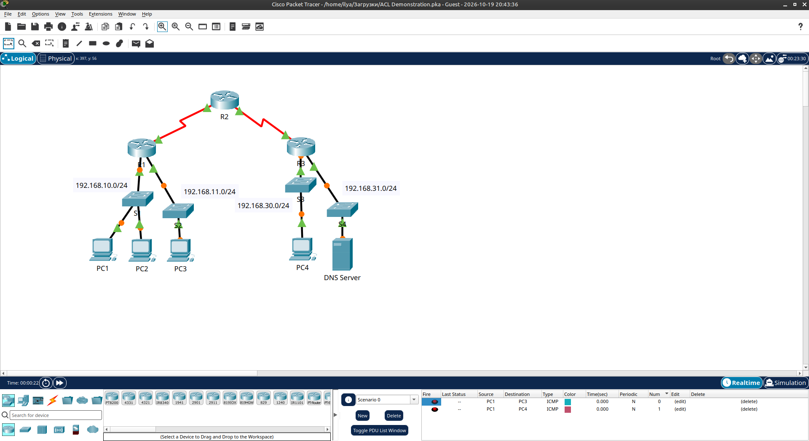
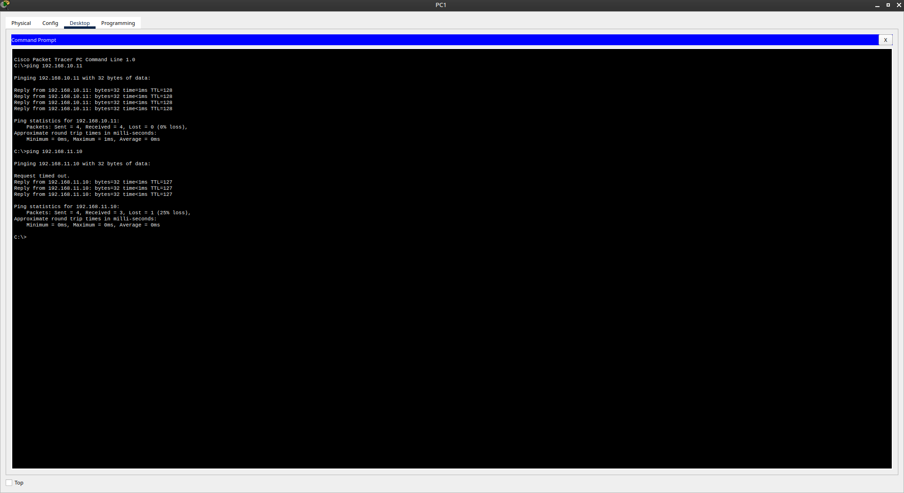
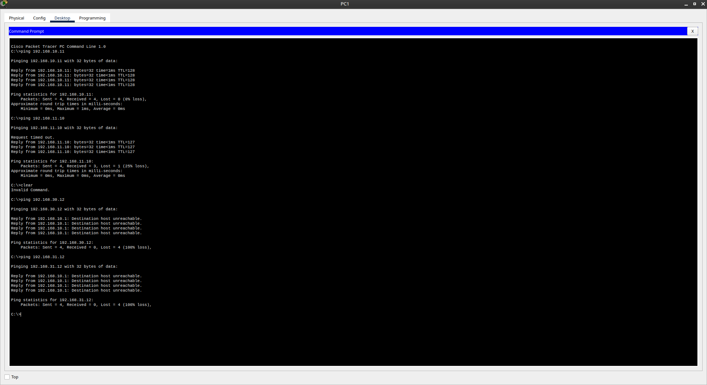
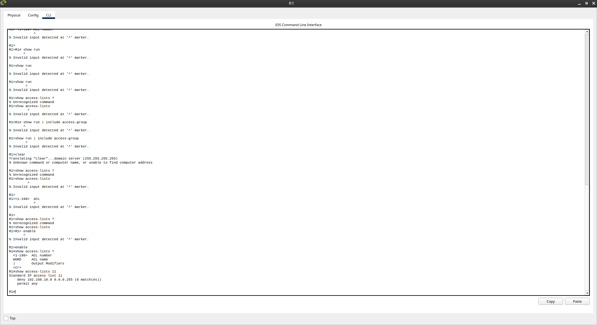
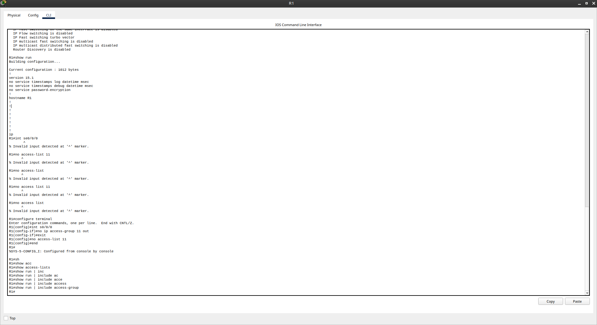
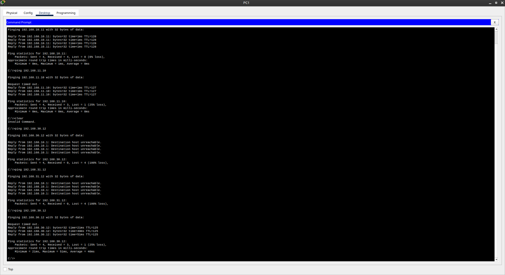

# Packet Tracer - Access Control List Demonstration

Лабораторная работа выполнена в **Cisco Packet Tracer**.

Цель работы — продемонстрировать, как Access Control List (ACL) блокирует трафик, и как после удаления ACL связность восстанавливается.

## Objectives

- Part 1: Verify Local Connectivity and Test Access Control List  
- Part 2: Remove Access Control List and Repeat Test  

## Топология



| Сеть            | Устройства          |
|-----------------|---------------------|
| 192.168.10.0/24 | PC1, PC2            |
| 192.168.11.0/24 | PC3                 |
| 192.168.30.0/24 | PC4                 |
| 192.168.31.0/24 | DNS Server          |

## Part 1: Проверка локальной связности и действие ACL

### Локальные ping (успешны)

С PC1:

```text
ping 192.168.10.11   → success (PC2)
ping 192.168.11.10   → success (PC3)
```



### Удалённые ping (заблокированы ACL)

```text
ping 192.168.30.12   → Destination host unreachable
ping 192.168.31.12   → Destination host unreachable
```



### ACL на R1

```text
Standard IP access list 11
    deny   192.168.10.0 0.0.0.255
    permit any
```

ACL применена **outbound** на интерфейсе Serial 0/0/0.



## Part 2: Удаление ACL

```bash
R1(config)# int se0/0/0
R1(config-if)# no ip access-group 11 out
R1(config)# no access-list 11
```



### Повторный ping на удалённые хосты

После удаления ACL ping до PC4 и DNS Server начинает проходить.



## Результат

- ✅ Локальная связность (PC1 → PC2/PC3) работает всегда
- ✅ ACL блокирует исходящий трафик сети 192.168.10.0/24
- ✅ После удаления ACL удалённая связность восстанавливается

## Полученные навыки

В ходе лабораторной работы были отработаны:

- проверка связности с помощью ping
- просмотр и анализ ACL (`show access-lists`)
- применение ACL на интерфейс (`ip access-group`)
- удаление ACL и снятие с интерфейса
- понимание влияния outbound ACL на трафик

## Используемые технологии

```text
Cisco Packet Tracer
Access Control Lists (ACL)
Standard ACL
ip access-group
ping
```

## Итог

Лабораторная работа наглядно показывает, как стандартный ACL может ограничивать доступ к удалённым сетям и как его удаление возвращает полную связность.
