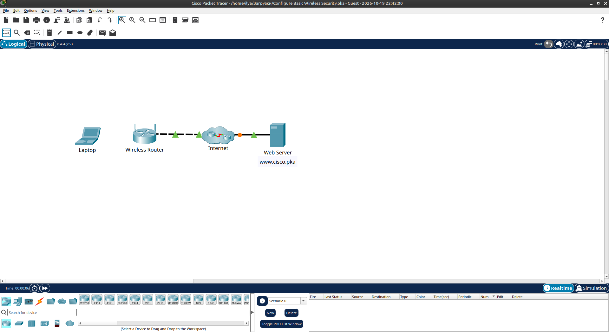
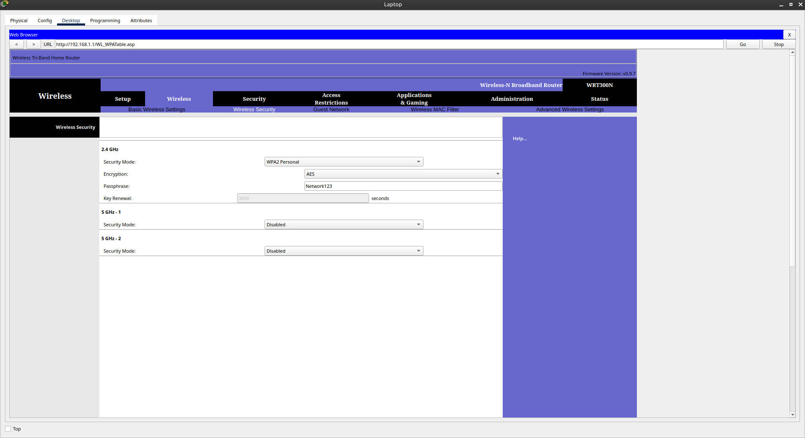
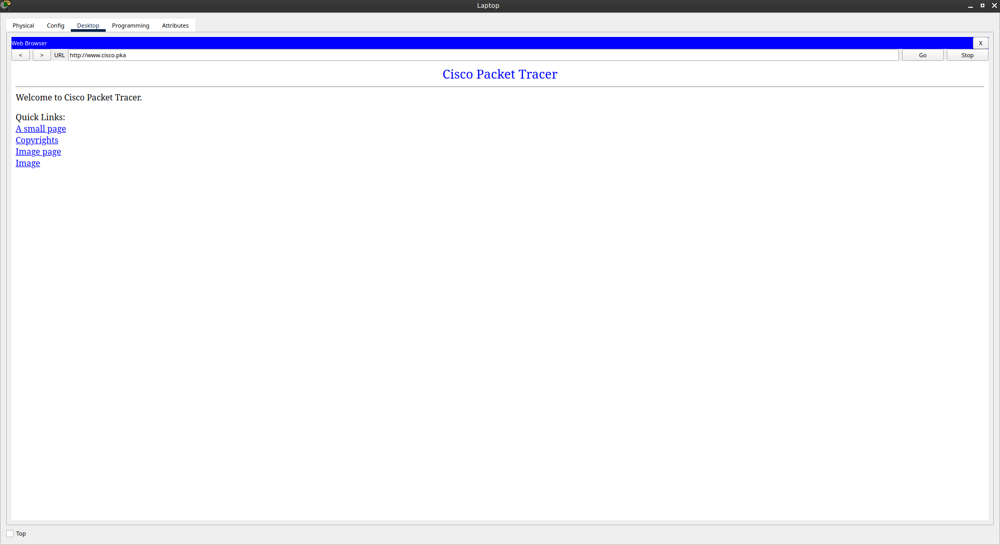

# Packet Tracer - Configure Basic Wireless Security

Лабораторная работа выполнена в **Cisco Packet Tracer**.

Цель работы — настроить базовую защиту беспроводной сети с использованием **WPA2 Personal**.

## Objectives

Configure basic wireless security using WPA2 Personal.

## Топология



| Устройство       | Описание                  |
|------------------|---------------------------|
| Laptop           | Клиент                    |
| Wireless Router  | WRT300N (192.168.1.1)     |
| Internet         | Cloud                     |
| Web Server       | www.cisco.pka             |

## Part 1: Проверка связности

С ноутбука открыт браузер и выполнен переход на `www.cisco.pka` — страница успешно загружается.

## Part 2: Настройка Wireless Security

Доступ к роутеру: `http://192.168.1.1`  
Логин / пароль: `admin` / `admin`

В разделе **Wireless → Wireless Security**:

| Параметр       | Значение          |
|----------------|-------------------|
| Security Mode  | WPA2 Personal     |
| Encryption     | AES               |
| Passphrase     | Network123        |

5 GHz сети оставлены **Disabled**.



## Part 3: Подключение ноутбука

На ноутбуке:

1. Desktop → PC Wireless → Connect
2. Выбрана сеть **Academy**
3. Введён pre-shared key: **Network123**
4. Выполнено подключение

## Part 4: Проверка связности после настройки

После применения WPA2 Personal снова открыт `www.cisco.pka` — страница успешно загружается.



## Результат

- ✅ Настроена защита WPA2 Personal на 2.4 GHz
- ✅ Клиент успешно подключён с passphrase Network123
- ✅ Доступ к веб-серверу сохранён

## Полученные навыки

В ходе лабораторной работы были отработаны:

- вход в веб-интерфейс беспроводного роутера
- настройка WPA2 Personal
- подключение клиента к защищённой Wi-Fi сети
- проверка работоспособности после изменения настроек безопасности

## Используемые технологии

```text
Cisco Packet Tracer
WPA2 Personal
AES
Wireless Security
WRT300N
```

## Итог

Лабораторная работа показывает, как быстро и просто защитить домашнюю/офисную беспроводную сеть с помощью WPA2 Personal.
