# Lab - Configure Security Features in Windows and Linux

Лабораторная работа по настройке базовых функций безопасности в Windows и Linux: обновление систем, Local Security Policy, правила файрвола, установка chkrootkit и Lynis.

## Objectives

- Обновить Windows и Linux
- Настроить Windows Local Security Policy (пароли, lockout, audit)
- Настроить правила Windows Firewall (разрешить ICMP echo request)
- Установить и запустить chkrootkit и Lynis

## Part 1: Update Windows and Linux

### Проверка сетевой связности

**Windows IP:**

```
IPv4 Address: 192.168.1.50
Subnet Mask:  255.255.255.0
Default Gateway: 192.168.1.1
```

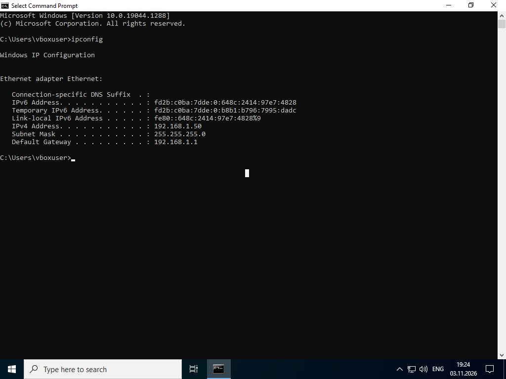

**Linux IP:**

```
enp4s0: 192.168.1.45/24
```

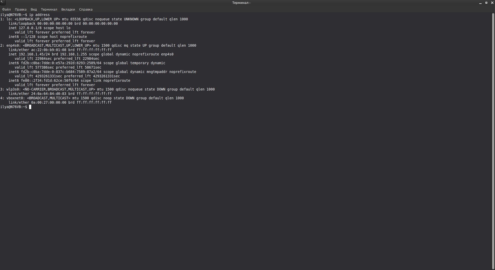

**Ping из Windows:**

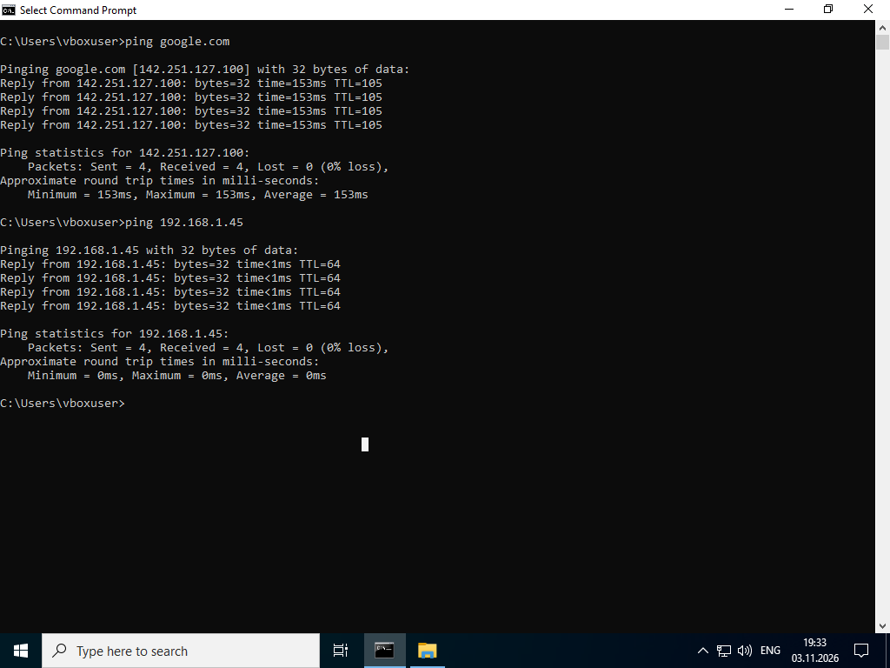

- `ping google.com` — успешно
- `ping 192.168.1.45` (Linux) — успешно

**Ping из Linux (до настройки firewall):**

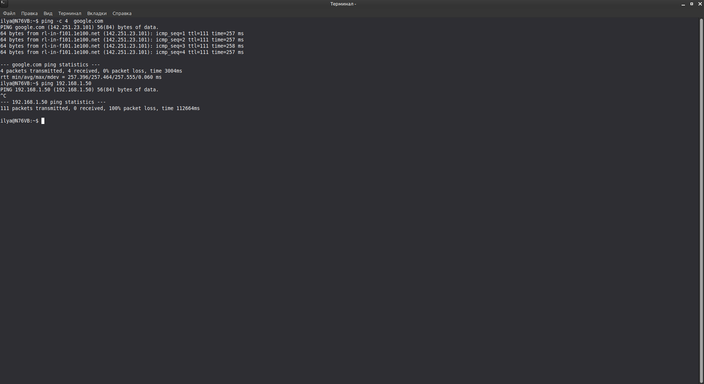

- `ping google.com` — успешно
- `ping 192.168.1.50` (Windows) — **100% packet loss** (firewall блокирует ICMP)

### Windows Update

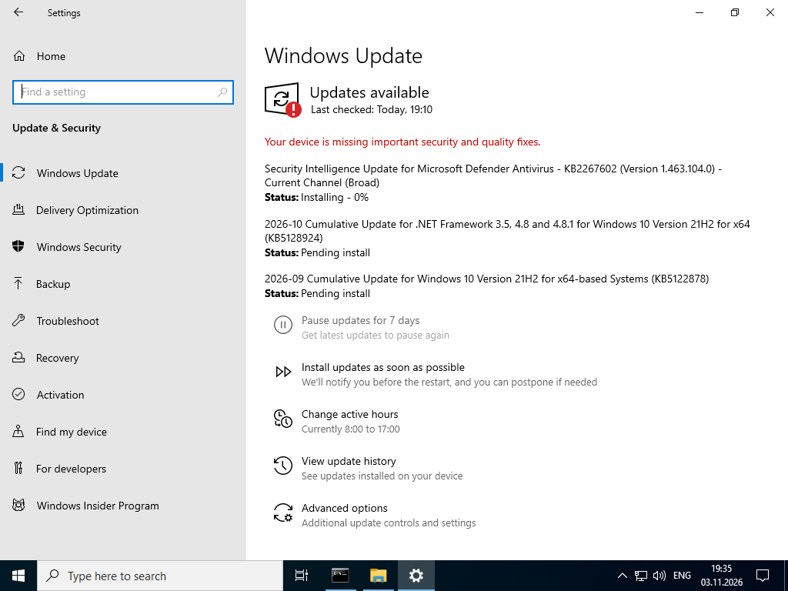

- Last checked: Today
- Есть доступные обновления (Security Intelligence Update, Cumulative Update)

### Linux update / upgrade

```bash
sudo apt-get update
sudo apt-get upgrade
```

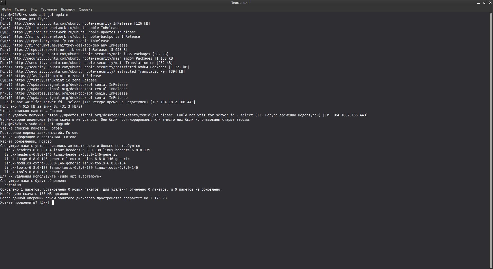

## Part 2: Windows Local Security Policy

### Password Policy

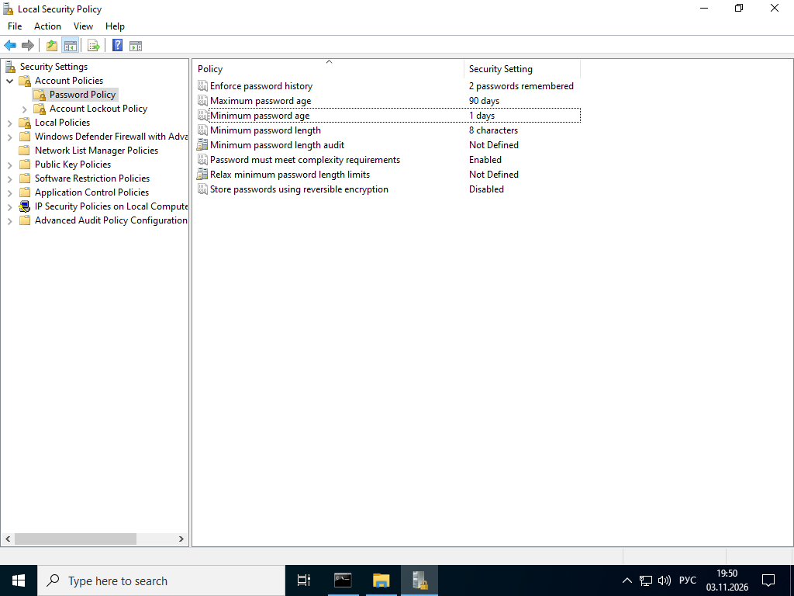

| Policy | Security Setting |
|--------|------------------|
| Enforce password history | 2 passwords remembered |
| Maximum password age | 90 days |
| Minimum password age | 1 days |
| Minimum password length | 8 characters |
| Password must meet complexity requirements | Enabled |
| Store passwords using reversible encryption | Disabled |

### Тест политики паролей

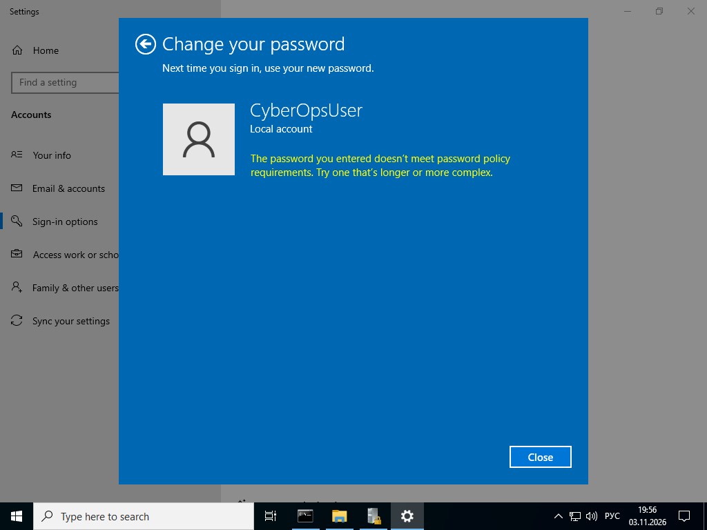

Пароль, не соответствующий требованиям, отклонён:
> The password you entered doesn't meet password policy requirements. Try one that's longer or more complex.

### Account Lockout Policy

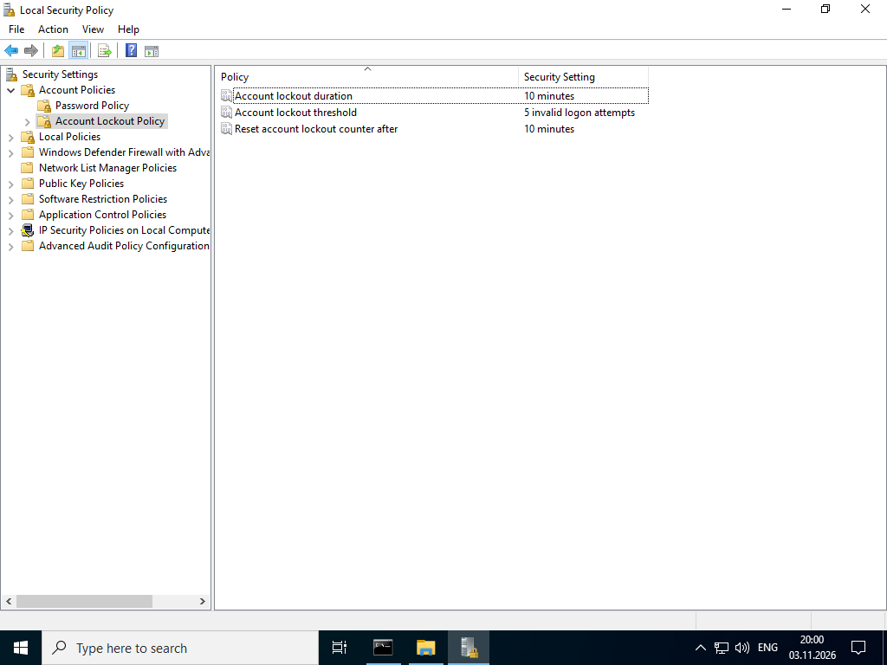

| Policy | Security Setting |
|--------|------------------|
| Account lockout duration | 10 minutes |
| Account lockout threshold | 5 invalid logon attempts |
| Reset account lockout counter after | 10 minutes |

### Audit Policy

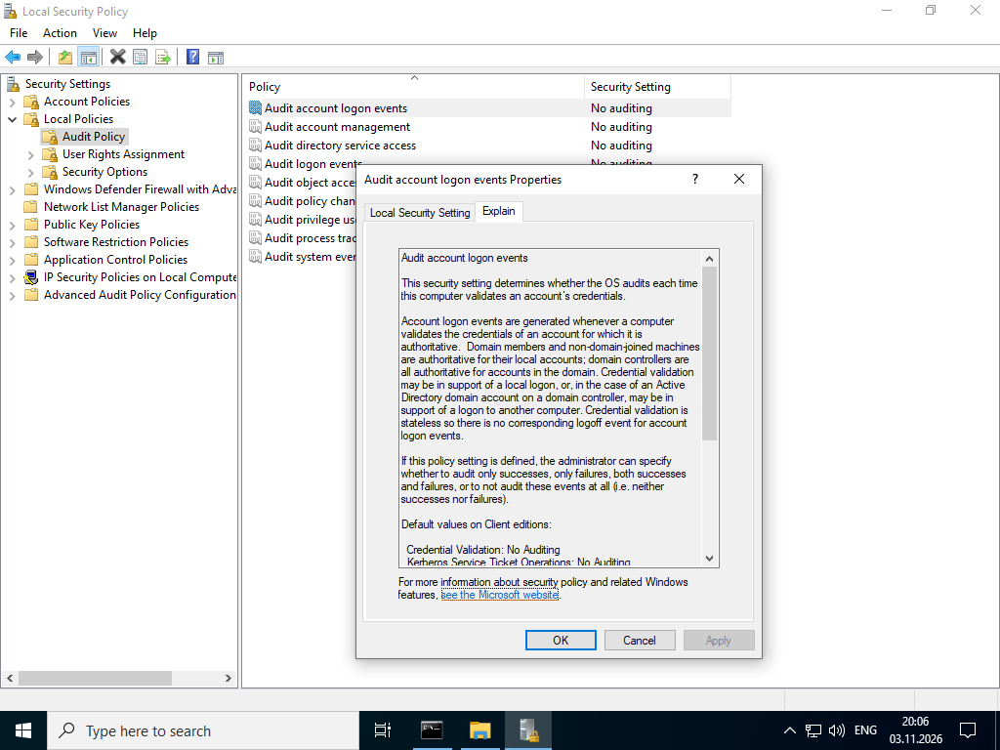

Просмотр настроек **Audit account logon events** (Success / Failure).

## Part 3: Configure Firewall Rules

### Создание inbound rule для ICMPv4 Echo Request

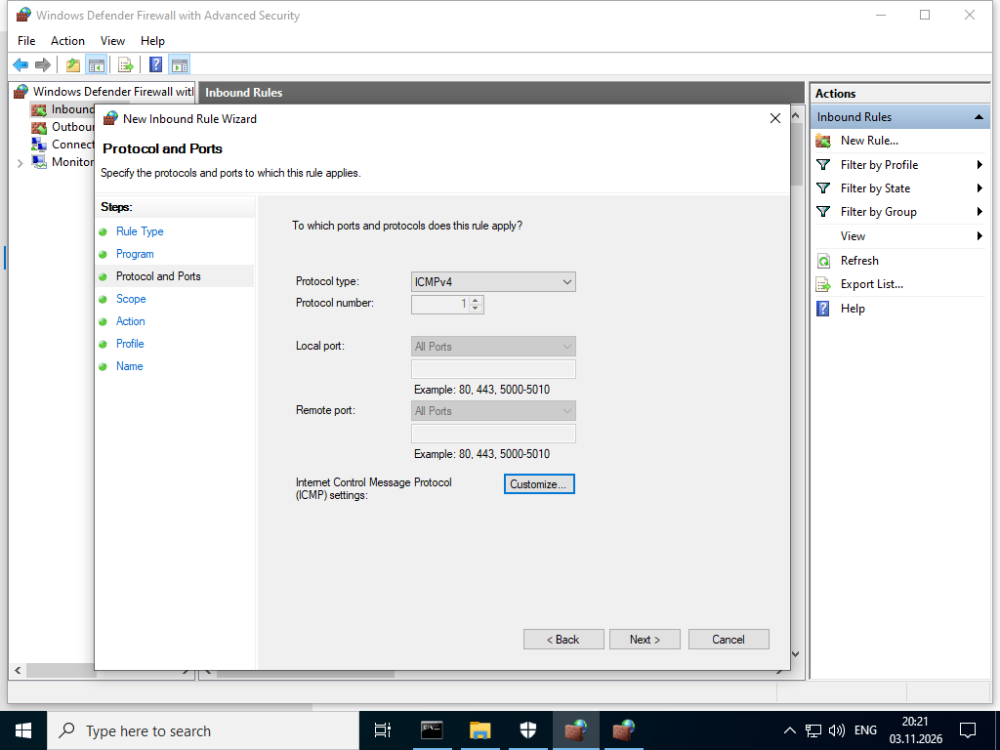

- Protocol type: **ICMPv4**
- Правило: **LabCisco** (Allow)

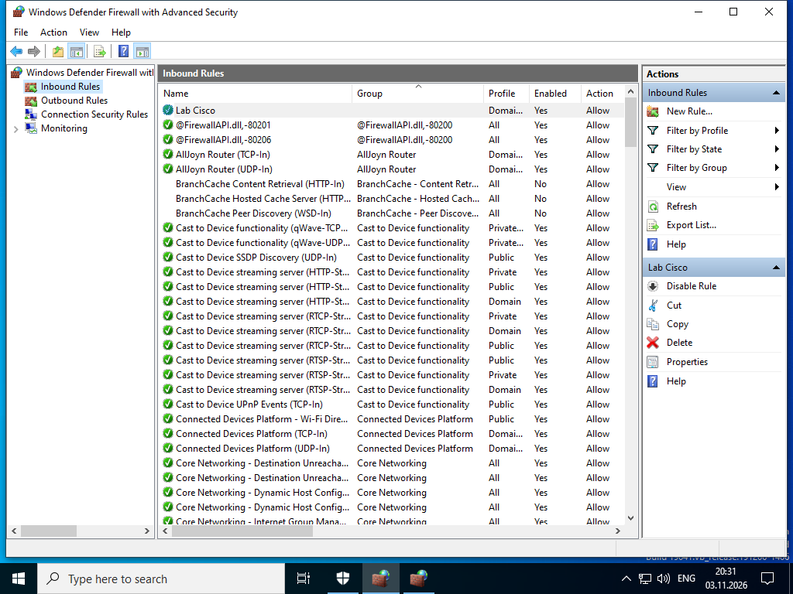

### Проверка после настройки firewall

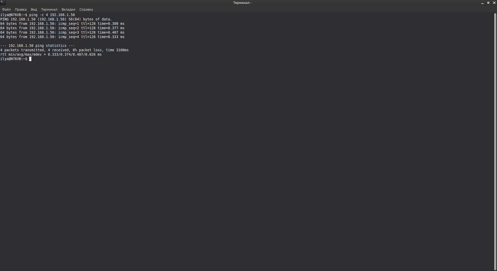

```bash
ping -c 4 192.168.1.50
```

**Результат:** 4 packets transmitted, 4 received, 0% packet loss.

## Part 4: Install and Run Applications

### chkrootkit

```bash
sudo apt install chkrootkit
sudo chkrootkit | grep -i worm
```

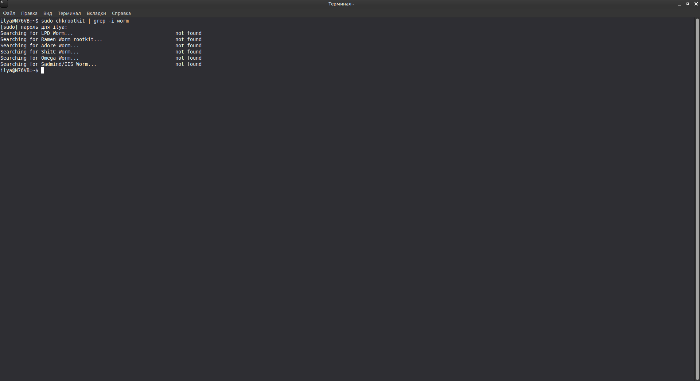

Все проверки на worm: **not found**.

### Lynis

```bash
lynis
# или
lynis show version
```

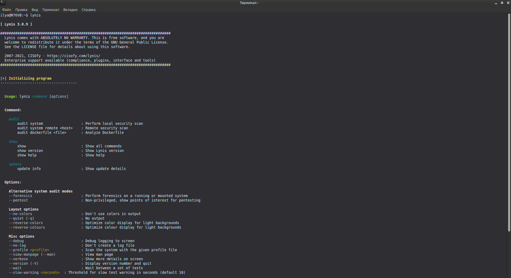

Версия: **Lynis 3.0.9**

## Результат

- ✅ Windows и Linux обновлены
- ✅ Настроена Password Policy, Account Lockout Policy, Audit Policy
- ✅ Создано правило firewall **LabCisco** (ICMP Echo Request)
- ✅ Linux может пинговать Windows после изменения firewall
- ✅ Установлены и запущены **chkrootkit** и **Lynis**

## Полученные навыки

- Обновление Windows и Linux
- Настройка Local Security Policy
- Создание правил Windows Defender Firewall
- Проверка связности (ping)
- Установка и использование chkrootkit / Lynis

## Используемые технологии

```text
Windows Update
Local Security Policy (secpol.msc)
Windows Defender Firewall with Advanced Security
chkrootkit
Lynis
apt / apt-get
```

## Итог

Лабораторная работа демонстрирует базовые практики hardening: регулярные обновления, политики паролей и блокировки учётных записей, контроль сетевого трафика через firewall, а также использование инструментов аудита безопасности (chkrootkit, Lynis).
