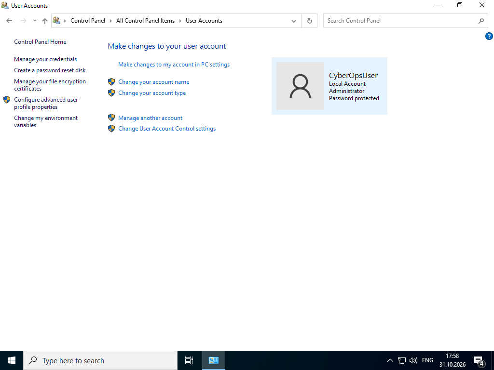
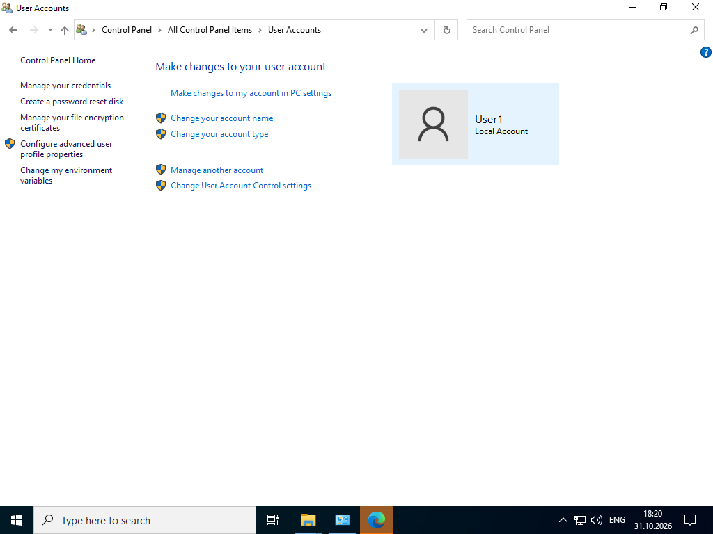
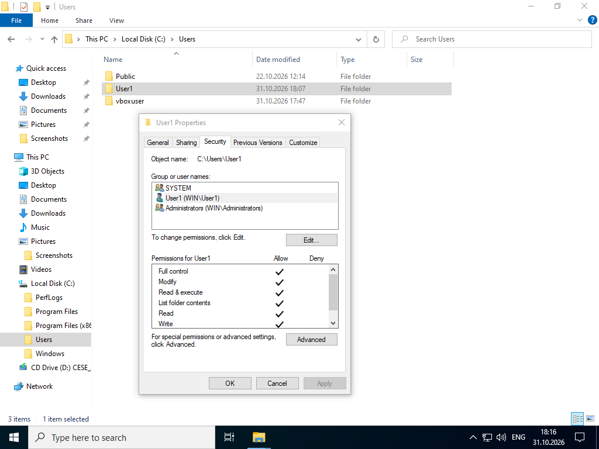
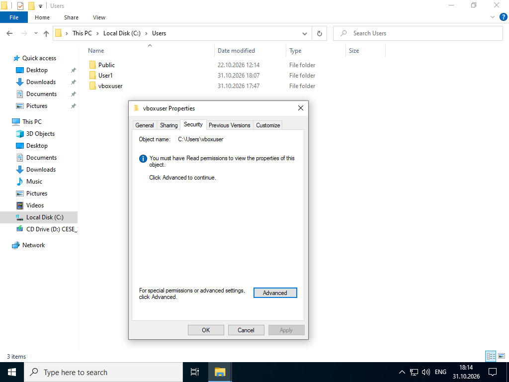
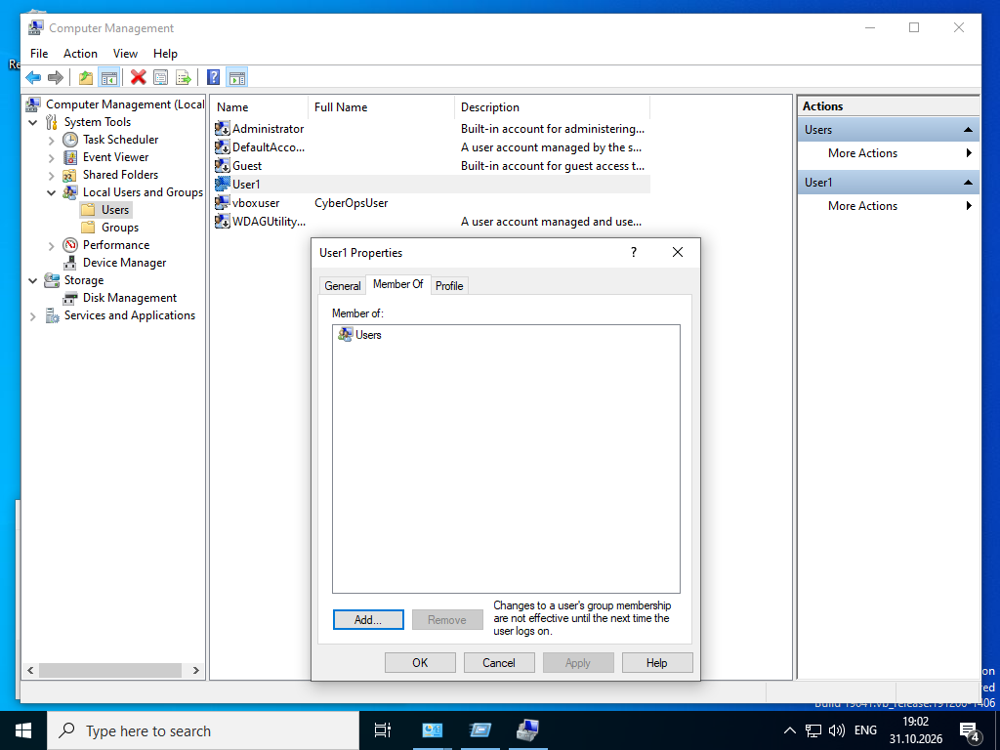
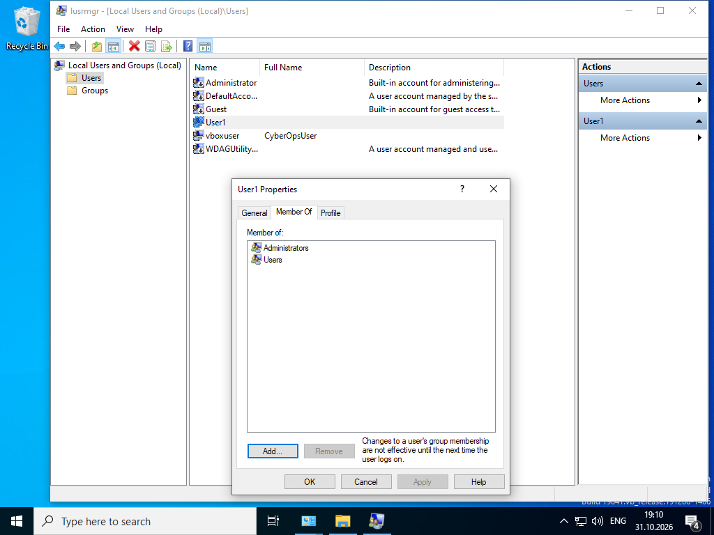
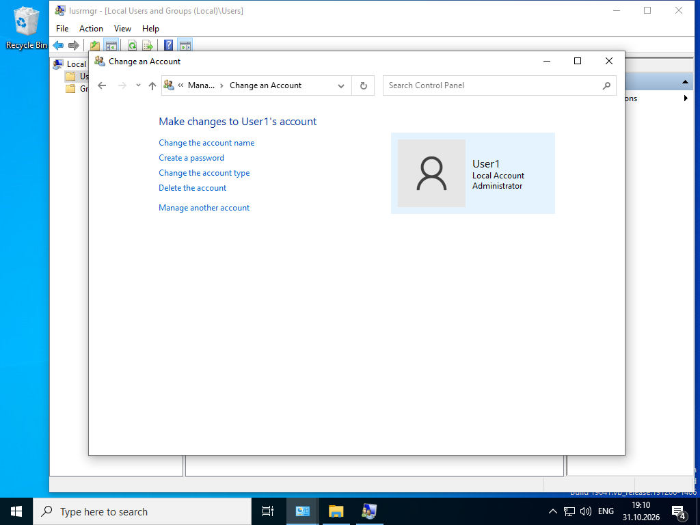
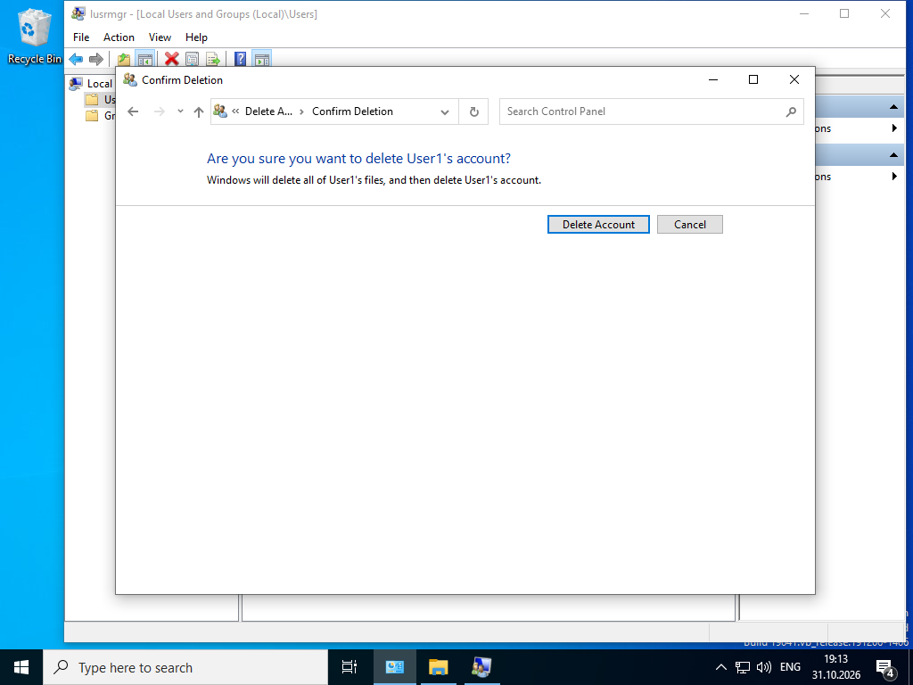

# Lab - Create User Accounts

Лабораторная работа выполнена на **Windows VM**.

Цель работы — создать, изменить и удалить локальные учётные записи пользователей в Windows.

## Objectives

- Создать новую локальную учётную запись
- Просмотреть свойства и права доступа
- Изменить тип учётной записи
- Удалить учётную запись

## Part 1: Creating a New Local User Account

### User Accounts

Через **Control Panel → User Accounts** создана учётная запись **User1**.





Тип созданной учётной записи: **Local Account** (Standard User).

### Права на папки

**C:\Users\User1** — полный доступ у:
- SYSTEM
- User1
- Administrators



**C:\Users\vboxuser** (CyberOpsUser) — при попытке просмотра из-под User1:

> You must have Read permissions to view the properties of this object.



Пользователь со Standard-правами не имеет доступа к профилю другого пользователя.

## Part 2: Reviewing User Account Properties

Через **Computer Management → Local Users and Groups → Users**:



| Учётная запись | Группы        |
|----------------|---------------|
| User1          | Users         |
| CyberOpsUser   | Administrators, Users |

## Part 3: Modifying Local User Accounts

### Смена типа учётной записи

User1 переведён в группу **Administrators**.





После этого User1 имеет административные права.

### Удаление учётной записи

```
Right-click User1 → Delete → Confirm Deletion
```



Windows удаляет все файлы пользователя вместе с учётной записью.

## Результат

- ✅ Создана локальная учётная запись User1
- ✅ Проверены права доступа к профильным папкам
- ✅ User1 добавлен в группу Administrators
- ✅ Учётная запись User1 удалена

## Полученные навыки

В ходе лабораторной работы были отработаны:

- создание и удаление локальных пользователей
- изменение типа учётной записи (Standard ↔ Administrator)
- анализ прав доступа к папкам профилей
- работа с Computer Management и User Accounts

## Используемые технологии

```text
Windows
Control Panel
Computer Management
Local Users and Groups
NTFS Permissions
Endpoint Security
```

## Итог

Лабораторная работа демонстрирует базовое управление учётными записями Windows — ключевой навык при hardening endpoint-систем и разграничении прав доступа.
