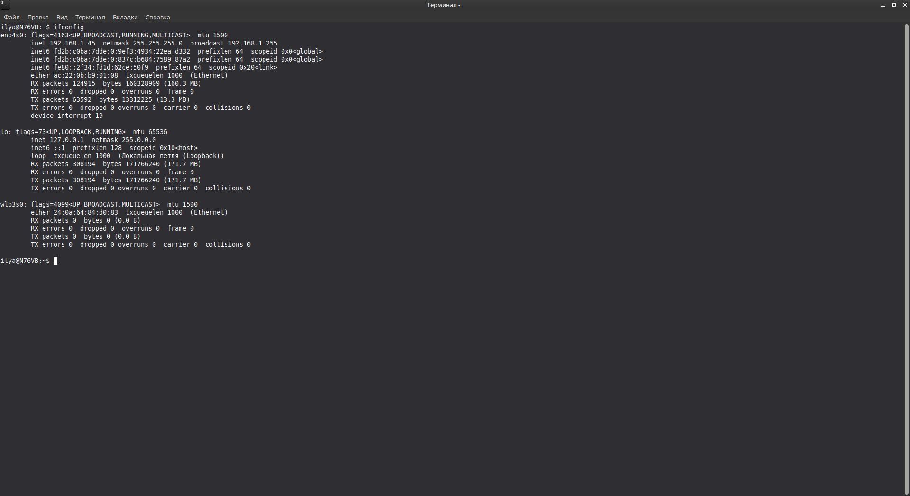
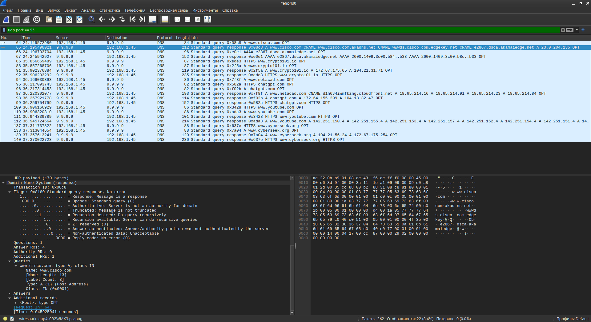
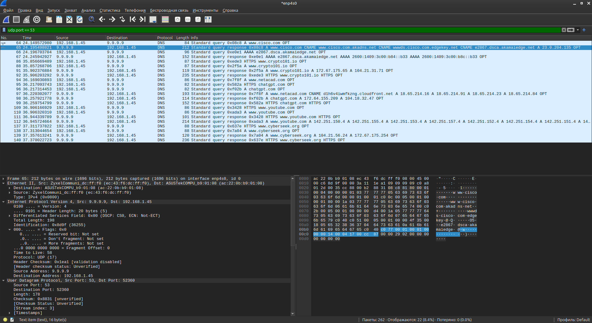

# Lab - Exploring DNS Traffic

Лабораторная работа выполнена с использованием **Wireshark**.

Цель работы — захватить и проанализировать DNS-трафик, изучить структуру DNS-запросов и ответов, а также адресацию на уровнях Ethernet, IP и UDP.

## 1. IP-конфигурация хоста

На ПК выполнен `ifconfig`:

| Интерфейс | IP Address     | Netmask       | Broadcast     |
|-----------|----------------|---------------|---------------|
| enp4s0    | `192.168.1.45` | 255.255.255.0 | 192.168.1.255 |



## 2. Захват DNS-трафика

В Wireshark применён фильтр:

```text
udp.port == 53
```

Видны DNS-запросы и ответы между хостом и DNS-сервером **9.9.9.9**.

Примеры запросов:

| Домен              | Тип запроса |
|--------------------|-------------|
| www.cisco.com      | A           |
| www.crypto101.io   | A / HTTPS   |
| www.netacad.com    | A           |
| chatgpt.com        | A / HTTPS   |
| www.youtube.com    | A / HTTPS   |
| www.cyberseek.org  | A / HTTPS   |



## 3. Анализ пакета DNS Response

Рассмотрен пакет **Frame 65** (DNS response для `www.cisco.com`):

### Ethernet II
| Поле        | Значение                          |
|-------------|-----------------------------------|
| Src MAC     | `ec:43:f6:dc:ff:f0` (ZyXEL)       |
| Dst MAC     | `ac:22:0b:b9:01:08` (ASUSTek)     |

### Internet Protocol (IPv4)
| Поле        | Значение        |
|-------------|-----------------|
| Src IP      | `9.9.9.9`       |
| Dst IP      | `192.168.1.45`  |
| Protocol    | UDP (17)        |

### User Datagram Protocol
| Поле        | Значение   |
|-------------|------------|
| Src Port    | 53 (DNS)   |
| Dst Port    | 52360      |



## 4. Результат

- ✅ Определён IP-адрес хоста (`192.168.1.45`)
- ✅ Захвачен DNS-трафик с фильтром `udp.port == 53`
- ✅ Проанализированы DNS-запросы и ответы
- ✅ Изучены заголовки Ethernet, IP и UDP
- ✅ Подтверждено использование DNS-сервера `9.9.9.9`

## Полученные навыки

В ходе лабораторной работы были отработаны:

- захват сетевого трафика в Wireshark
- фильтрация DNS-пакетов (`udp.port == 53`)
- анализ DNS Query / Response
- разбор заголовков Ethernet, IPv4 и UDP
- понимание роли DNS в разрешении имён

## Используемые технологии

```text
Wireshark
DNS
UDP
IPv4
Ethernet
ifconfig
```

## Итог

Лабораторная работа показывает, как DNS-запросы и ответы передаются по сети: от хоста к DNS-серверу (порт 53) и обратно, с разбором адресов на всех уровнях стека протоколов.
