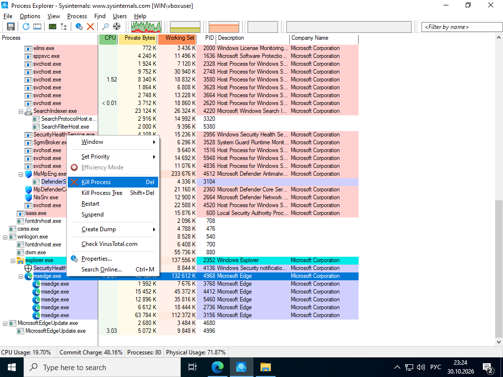
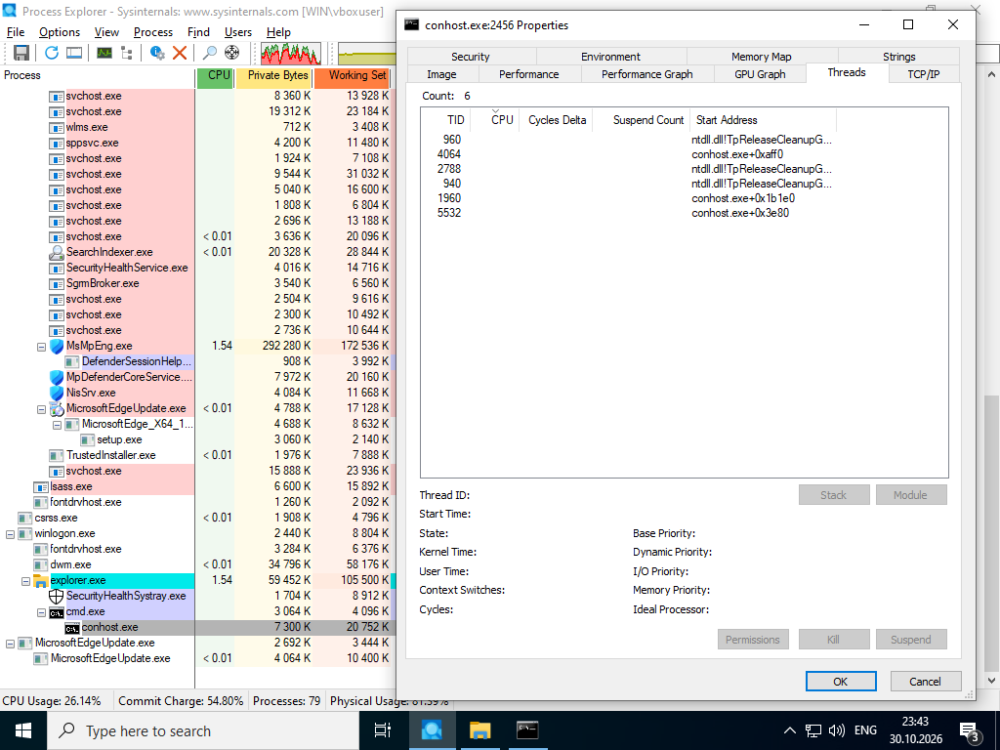
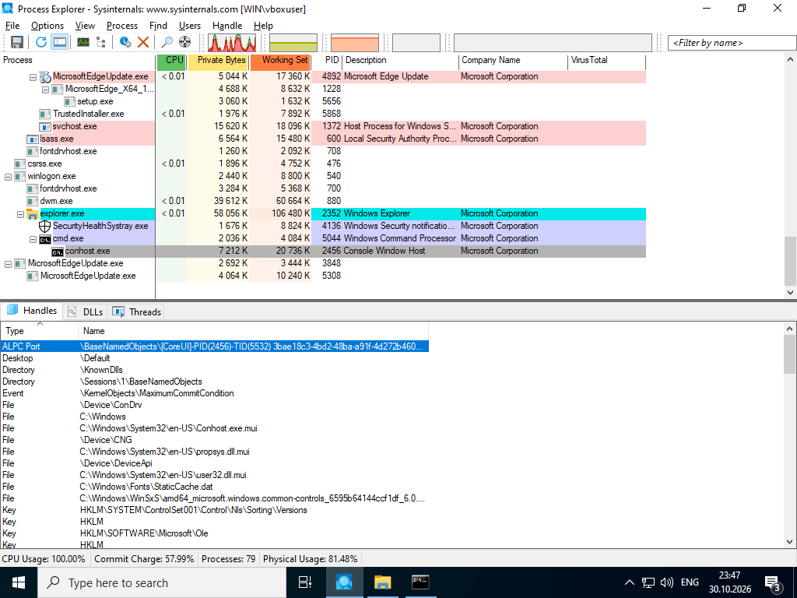
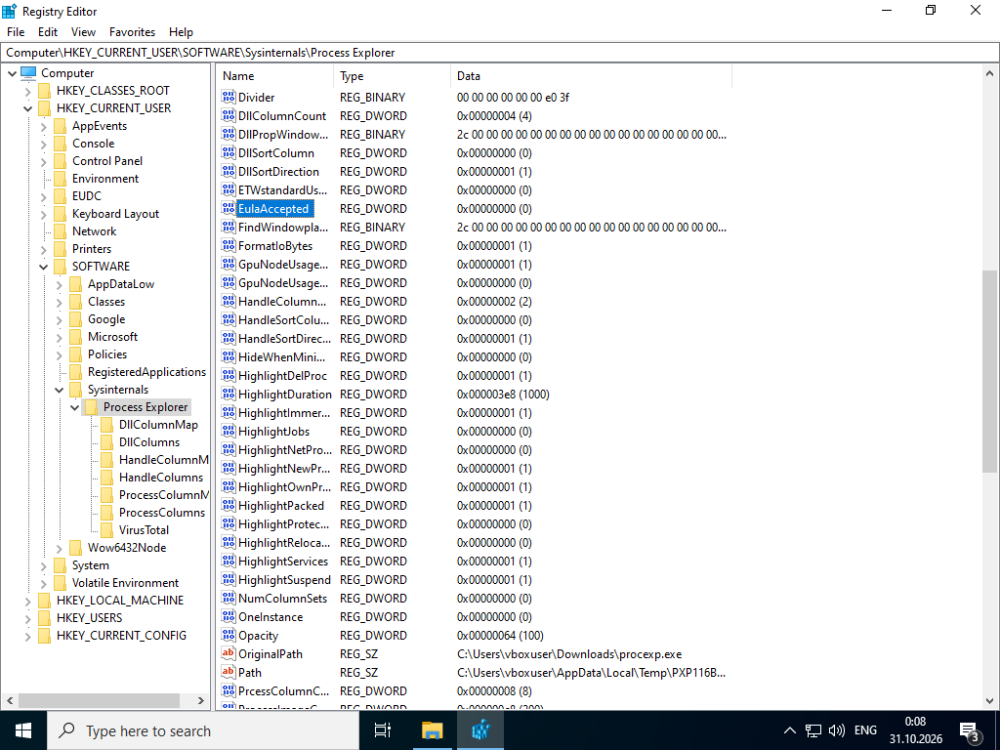

# Lab - Exploring Processes, Threads, Handles, and Windows Registry

Лабораторная работа выполнена на **Windows VM** с использованием **Sysinternals Process Explorer**.

Цель работы — изучить процессы, потоки (threads), handles и реестр Windows с помощью Process Explorer и Registry Editor.

## Objectives

- Исследовать активные процессы с помощью Process Explorer
- Изучить threads и handles процесса
- Изменить параметр в Windows Registry

## Part 1: Exploring Processes

### Process Explorer

Запущен **procexp.exe** из Sysinternals Suite. Отображается дерево процессов.



- Процессы выделены цветом (розовый — службы, голубой — пользовательские)
- Контекстное меню позволяет:
  - **Kill Process**
  - **Kill Process Tree**
  - **Suspend**
  - **Properties...**
  - **Check VirusTotal.com**

### Иерархия процессов

Пример:
- `explorer.exe` (parent)
  - `cmd.exe`
    - `conhost.exe` (child)

При завершении родительского процесса (`cmd.exe`) дочерний (`conhost.exe`) также завершается.

## Part 2: Exploring Threads and Handles

### Threads

Правый клик по `conhost.exe` → **Properties** → вкладка **Threads**.



Доступная информация:
- TID (Thread ID)
- CPU usage
- Cycles Delta
- Suspend Count
- Start Address

### Handles

**View → Lower Pane View → Handles**



Handles указывают на:
- Файлы (`C:\Windows\...`)
- Registry keys (`HKLM\...`)
- Desktop, Directory, Event, ALPC Port
- Device objects

## Part 3: Exploring Windows Registry

### Registry Editor

Путь к ключу Process Explorer:

```
HKEY_CURRENT_USER\SOFTWARE\Sysinternals\Process Explorer
```



Ключ **EulaAccepted**:
- Значение `1` — EULA принята
- Значение `0` — EULA не принята

После изменения значения на `0` при следующем запуске Process Explorer снова запрашивает принятие лицензионного соглашения.

## Результат

- ✅ Исследованы процессы через Process Explorer
- ✅ Просмотрены threads и handles процесса `conhost.exe`
- ✅ Изменён параметр `EulaAccepted` в реестре Windows

## Полученные навыки

В ходе лабораторной работы были отработаны:

- анализ процессов и их иерархии
- работа с threads и handles
- использование Windows Registry
- применение Sysinternals Process Explorer

## Используемые технологии

```text
Windows
Sysinternals Process Explorer
Registry Editor (regedit)
VirusTotal
Endpoint Security
```

## Итог

Лабораторная работа даёт практическое понимание внутренней структуры Windows: процессов, потоков, handles и реестра — ключевых объектов при анализе malware и forensics.
