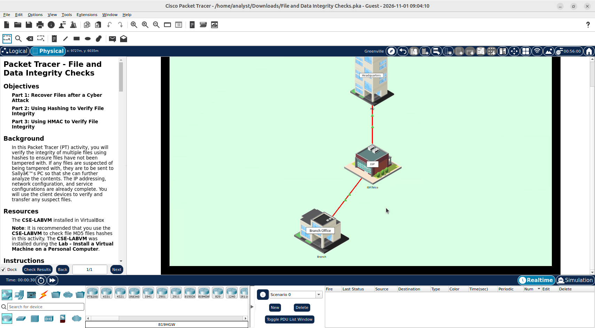
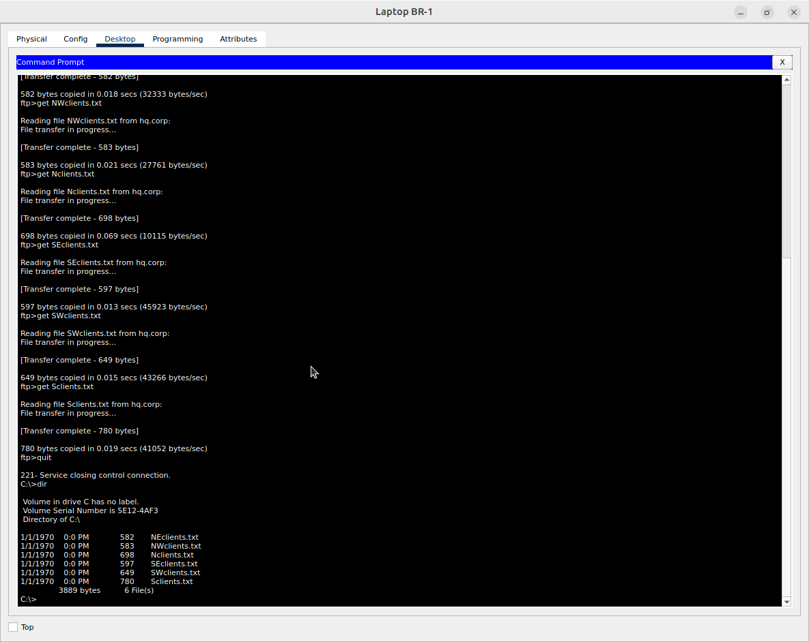
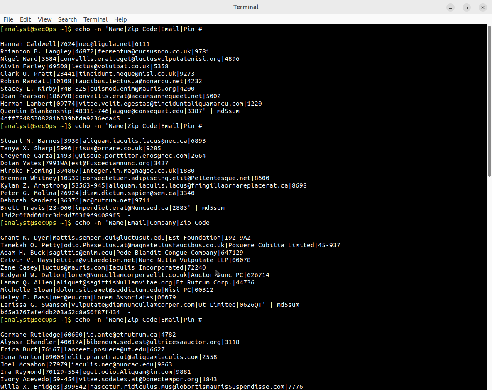
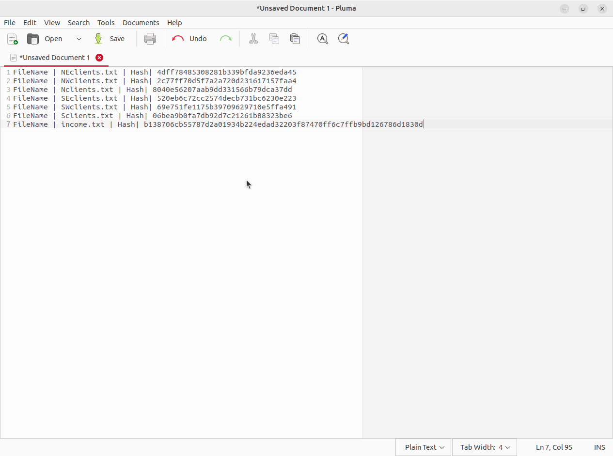
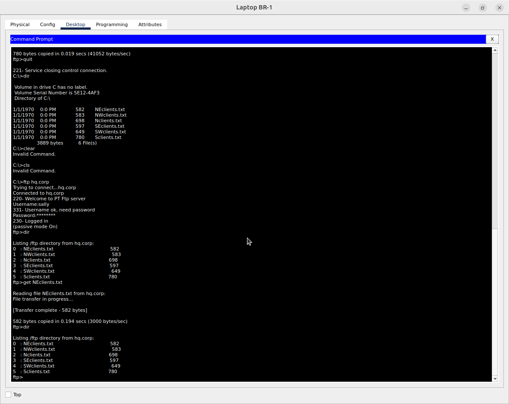
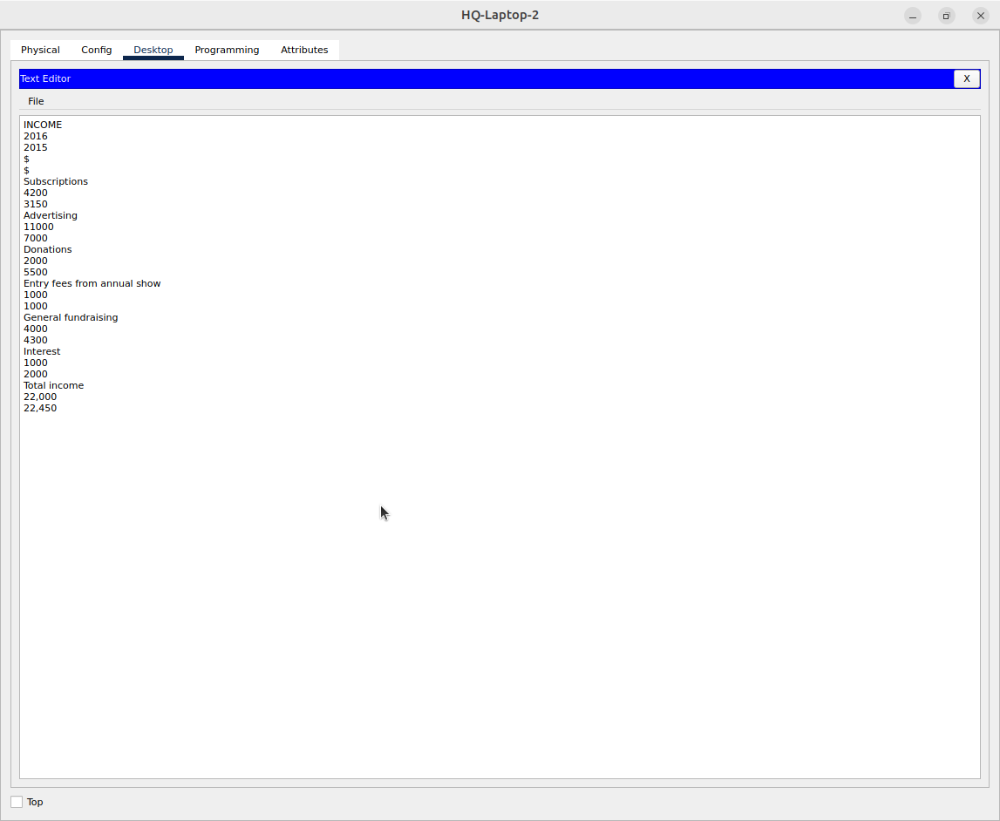
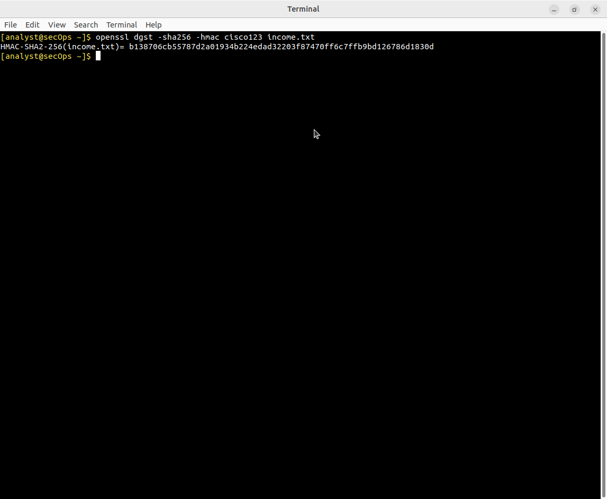

# Packet Tracer - File and Data Integrity Checks

Лабораторная работа выполнена в **Cisco Packet Tracer** + **CSE-LABVM**.

Цель работы — проверить целостность файлов с помощью хеширования и HMAC после кибератаки.

## Objectives

- Восстановить файлы после атаки
- Проверить целостность через MD5-хеши
- Использовать HMAC для проверки критического файла

## Topology



## Part 1: Recover Files after a Cyber Attack

### Обнаружение атаки

На сайте Branch Office отображается сообщение:


> Your files are GONE!  
> The Cyberworld is a Dangerous Place

### Скачивание бэкапов

С Laptop BR-1 через FTP (`hq.corp`, user: **mike** / **cisco123**):

```bash
ftp hq.corp
get NEclients.txt
get NWclients.txt
get Nclients.txt
get SEclients.txt
get SWclients.txt
get Sclients.txt
```



Все 6 клиентских файлов успешно загружены.

## Part 2: Using Hashing to Verify File Integrity

Хеширование содержимого файлов на CSE-LABVM:

```bash
echo -n 'file-contents' | md5sum
```



Сводка хешей:



| File            | Hash (MD5)                         | Status   |
|-----------------|------------------------------------|----------|
| NEclients.txt   | 4dff78485308281b339bfda9236eda45   | OK       |
| NWclients.txt   | 2c77ff70d5f7a2a720d231617157faa4   | OK       |
| Nclients.txt    | 8040e56207aab9dd331566b79dca37dd   | OK       |
| SEclients.txt   | 520eb6c72cc2574decb731bc6230e223   | OK       |
| SWclients.txt   | 69e751fe1175b39709629710e5ffa491   | OK       |
| Sclients.txt    | 06bea9b0fa7db92d7c21261b88323be6   | OK       |

Подозрительный файл отправлен Sally для дальнейшего анализа.

FTP от имени Sally (`sally` / `cisco321`):



## Part 3: Using HMAC to Verify File Integrity

Критический файл `income.txt` на HQ-Laptop-2:



Вычисление HMAC:

```bash
openssl dgst -sha256 -hmac cisco123 income.txt
```



```
HMAC-SHA2-256(income.txt)= b138706cb55787d2a01934b224edad32203f87470ff6c7ffb9bd126786d1830d
```

HMAC использует секретный ключ (`cisco123`), поэтому более защищён, чем обычный хеш.

## Результат

- ✅ Файлы восстановлены с FTP-сервера HQ
- ✅ MD5-хеши файлов проверены
- ✅ Подозрительный файл передан Sally
- ✅ HMAC для income.txt успешно вычислен

## Полученные навыки

В ходе лабораторной работы были отработаны:

- восстановление файлов после атаки
- проверка целостности через MD5
- использование HMAC с секретным ключом
- работа с FTP в Packet Tracer

## Используемые технологии

```text
Cisco Packet Tracer
FTP
MD5 hashing
HMAC-SHA256 (OpenSSL)
CSE-LABVM
Endpoint Security
```

## Итог

Лабораторная работа показывает, как с помощью хеширования и HMAC можно обнаружить изменение файлов и подтвердить их целостность — важный навык в цифровой криминалистике и защите данных.
