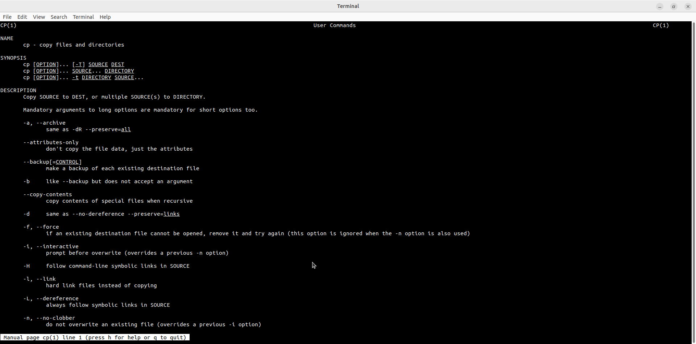
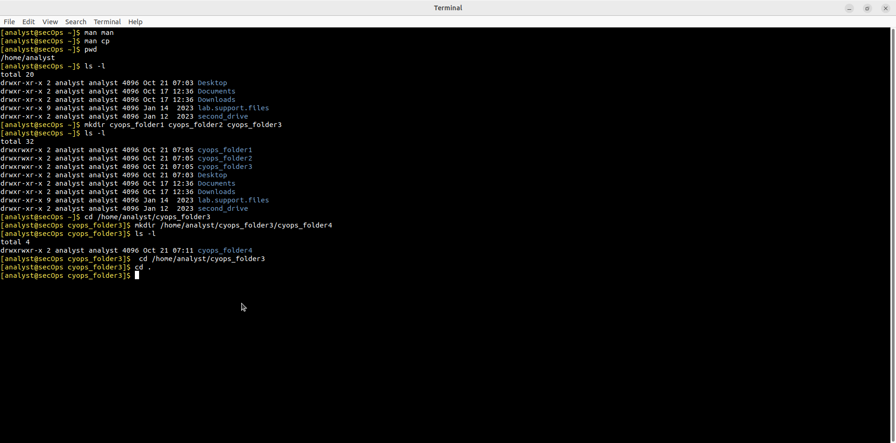
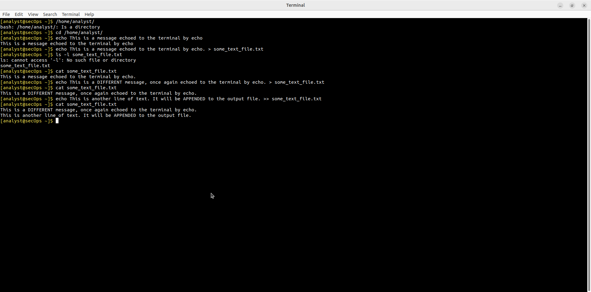
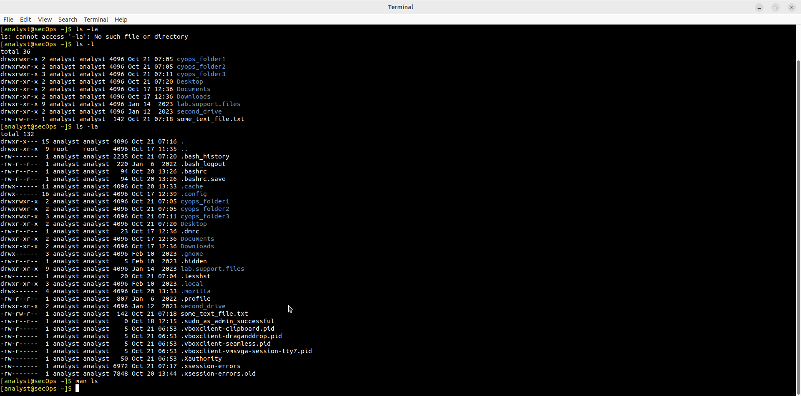
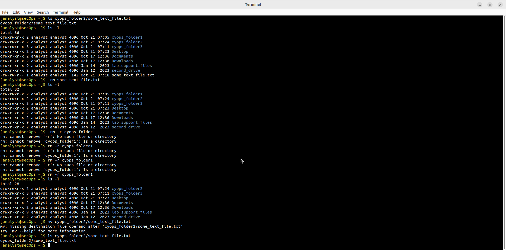

# Lab - Getting Familiar with the Linux Shell

Лабораторная работа выполнена на **CyberOps Workstation** (Security Workstation VM).

Цель работы — освоить базовые команды Linux shell для управления файлами и каталогами.

## Objectives

- Part 1: Shell Basics  
- Part 2: Copying, Deleting, and Moving Files  

## Part 1: Shell Basics

### Справка (man)

```bash
man man
man cp
```



### Навигация и просмотр

```bash
pwd
# /home/analyst

ls -l
```

Создание каталогов:

```bash
mkdir cyops_folder1 cyops_folder2 cyops_folder3
mkdir /home/analyst/cyops_folder3/cyops_folder4
```



### Создание и просмотр текстовых файлов

```bash
echo "This is a message echoed to the terminal by echo." > some_text_file.txt
cat some_text_file.txt

echo "This is a DIFFERENT message..." > some_text_file.txt   # перезапись
echo "This is another line..." >> some_text_file.txt        # добавление
cat some_text_file.txt
```



### Скрытые файлы

```bash
ls -la
```

Показывает файлы, начинающиеся с точки (`.bashrc`, `.bash_history` и др.).



## Part 2: Копирование, удаление и перемещение

### Удаление

```bash
rm some_text_file.txt          # удаление файла
rm -r cyops_folder1            # рекурсивное удаление каталога
```

### Перемещение / переименование

```bash
mv cyops_folder2/some_text_file.txt .
```



## Основные команды

| Команда     | Назначение                          |
|-------------|-------------------------------------|
| `pwd`       | Показать текущий каталог            |
| `ls -l`     | Подробный список файлов             |
| `ls -la`    | Включая скрытые файлы               |
| `mkdir`     | Создать каталог                     |
| `cd`        | Сменить каталог                     |
| `echo`      | Вывести текст / записать в файл     |
| `cat`       | Показать содержимое файла           |
| `rm`        | Удалить файл                        |
| `rm -r`     | Удалить каталог рекурсивно          |
| `mv`        | Переместить / переименовать         |
| `man`       | Справка по команде                  |

## Результат

- ✅ Освоены базовые команды shell
- ✅ Созданы и удалены каталоги и файлы
- ✅ Использованы перенаправление (`>` и `>>`)
- ✅ Просмотрены скрытые файлы

## Полученные навыки

В ходе лабораторной работы были отработаны:

- работа в терминале Linux
- навигация по файловой системе
- создание, просмотр, удаление и перемещение файлов/каталогов
- использование `man` для получения справки
- перенаправление вывода

## Используемые технологии

```text
Linux
Bash
CyberOps Workstation
man
```

## Итог

Лабораторная работа даёт фундамент для дальнейшей работы в Linux — обязательный навык для специалистов по кибербезопасности.
