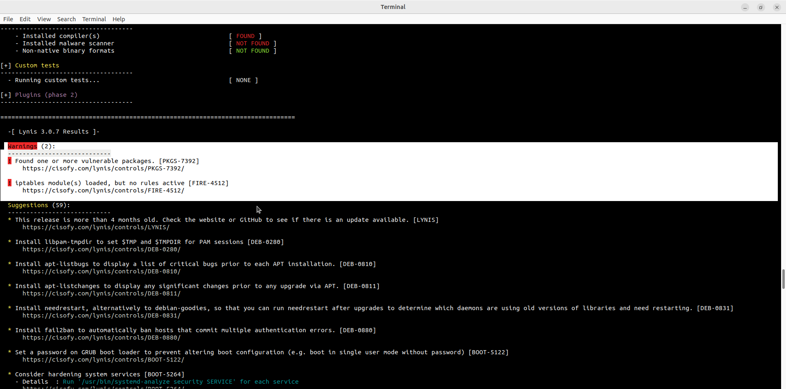

# Lab - Harden a Linux System

Лабораторная работа выполнена на **CyberOps Workstation**.

Цель работы — провести аудит безопасности Linux-системы с помощью **Lynis** и проанализировать рекомендации по hardening.

## Objectives

- Установить и запустить Lynis  
- Проанализировать результаты аудита безопасности  
- Определить предупреждения и рекомендации по hardening  

## Lynis Audit Results

```bash
sudo lynis audit system
```



### Warnings (2)

| ID         | Описание                                      |
|------------|-----------------------------------------------|
| PKGS-7392  | Found one or more vulnerable packages         |
| FIRE-4512  | iptables module(s) loaded, but no rules active|

### Key Suggestions

| ID         | Рекомендация                                              |
|------------|-----------------------------------------------------------|
| LYNIS      | This release is more than 4 months old — check for updates|
| DEB-0280   | Install `libpam-tmpdir` to set `$TMP` and `$TMPDIR`       |
| DEB-0810   | Install `apt-listbugs`                                    |
| DEB-0811   | Install `apt-listchanges`                                 |
| DEB-0831   | Install `needrestart`                                     |
| DEB-0880   | Install `fail2ban`                                        |
| BOOT-5122  | Set a password on GRUB boot loader                        |
| BOOT-5264  | Consider hardening system services                        |

## Основные шаги hardening

1. **Обновление системы**
   ```bash
   sudo apt update && sudo apt upgrade
   ```

2. **Установка рекомендованных пакетов**
   ```bash
   sudo apt install fail2ban libpam-tmpdir apt-listbugs apt-listchanges needrestart
   ```

3. **Настройка firewall**
   ```bash
   sudo ufw enable
   sudo ufw default deny incoming
   sudo ufw default allow outgoing
   ```

4. **Защита GRUB**
   - Установить пароль на bootloader

5. **Повторный аудит**
   ```bash
   sudo lynis audit system
   ```

## Результат

- ✅ Выполнен полный аудит системы с помощью Lynis 3.0.7
- ✅ Выявлены 2 предупреждения и 59 рекомендаций
- ✅ Определены ключевые направления hardening (firewall, fail2ban, GRUB, пакеты)

## Полученные навыки

В ходе лабораторной работы были отработаны:

- использование Lynis для аудита безопасности Linux
- анализ Warnings и Suggestions
- понимание базовых мер hardening endpoint-систем

## Используемые технологии

```text
Lynis
Linux
fail2ban
ufw / iptables
CyberOps Workstation
Endpoint Security
```

## Итог

Лабораторная работа демонстрирует практический подход к hardening Linux-системы с помощью автоматизированного аудита Lynis — важный навык специалиста по endpoint security.
