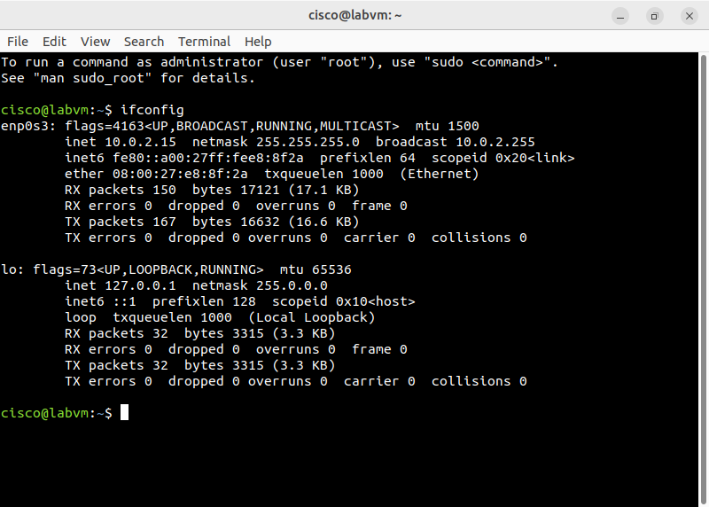
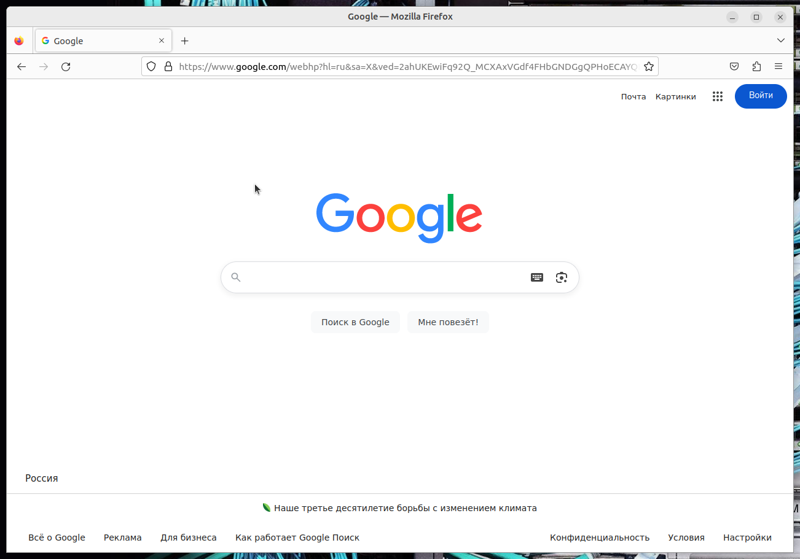

# Lab - Install a Virtual Machine on a Personal Computer

Лабораторная работа выполнена с использованием **Oracle VirtualBox**.

Цель работы — подготовить компьютер к виртуализации, установить VirtualBox, импортировать виртуальную машину и проверить её работоспособность.

## Objectives

- Part 1: Prepare a Computer for Virtualization  
- Part 2: Import a Virtual Machine into VirtualBox Inventory  

## Background

Виртуализация позволяет запускать одну или несколько виртуальных машин внутри физического компьютера. Виртуальные машины (guest) работают на хосте (host) и используют его ресурсы (CPU, RAM, диск).

В данной лабораторной работе используется готовый образ виртуальной машины с Linux.

## 1. Подготовка хоста

Требования к компьютеру:

| Ресурс              | Минимум          |
|---------------------|------------------|
| RAM                 | +4 GB            |
| Свободное место     | 50 GB            |
| Интернет            | Высокоскоростной |
| Виртуализация в BIOS| Включена (для 64-bit VM) |

Установлен **Oracle VirtualBox**.

## 2. Импорт виртуальной машины

Виртуальная машина импортирована в VirtualBox и успешно запущена.

Имя ВМ: `cisco@labvm`

## 3. Проверка сетевых настроек ВМ

Внутри виртуальной машины выполнен `ifconfig`:

| Интерфейс | IP Address  | Netmask       | Broadcast   |
|-----------|-------------|---------------|-------------|
| enp0s3    | `10.0.2.15` | 255.255.255.0 | 10.0.2.255  |



## 4. Проверка доступа в интернет

Из виртуальной машины открыт браузер **Firefox** и выполнен переход на `https://www.google.com`.

Страница успешно загрузилась — интернет работает.



## 5. Результат

- ✅ Установлен Oracle VirtualBox
- ✅ Импортирована виртуальная машина
- ✅ ВМ успешно запущена
- ✅ Получен IP-адрес (`10.0.2.15`)
- ✅ Проверен доступ в интернет из ВМ

## Полученные навыки

В ходе лабораторной работы были отработаны:

- установка программного обеспечения виртуализации
- импорт виртуальной машины
- запуск и работа с guest OS
- проверка сетевых настроек внутри ВМ
- понимание преимуществ и ограничений виртуализации

## Используемые технологии

```text
Oracle VirtualBox
Linux (Guest OS)
ifconfig
Firefox
Virtualization
```

## Итог

Лабораторная работа демонстрирует процесс установки и запуска виртуальной машины на персональном компьютере. Виртуальная машина успешно работает в сети и имеет доступ в интернет.
