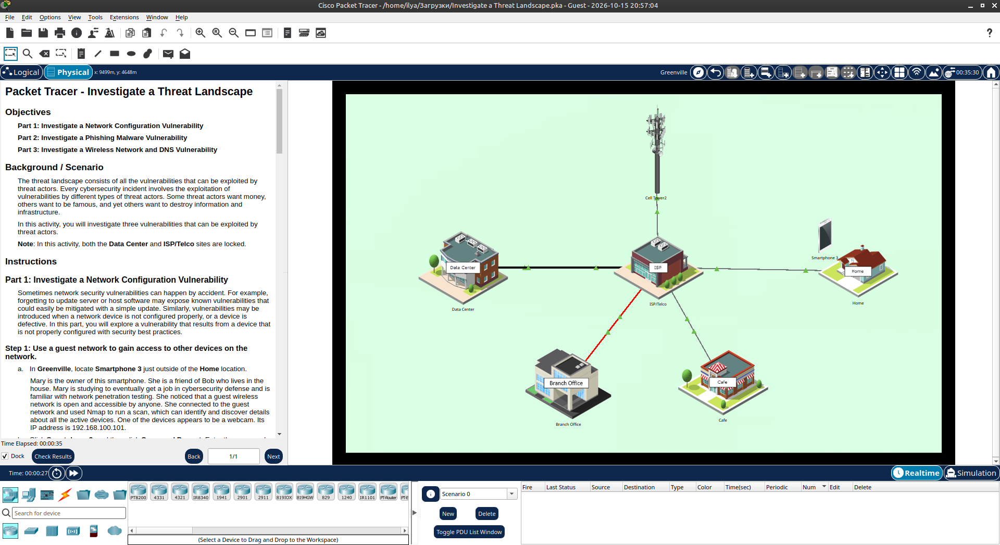
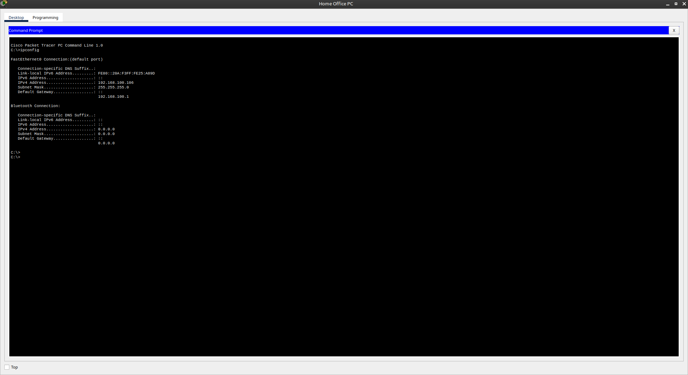
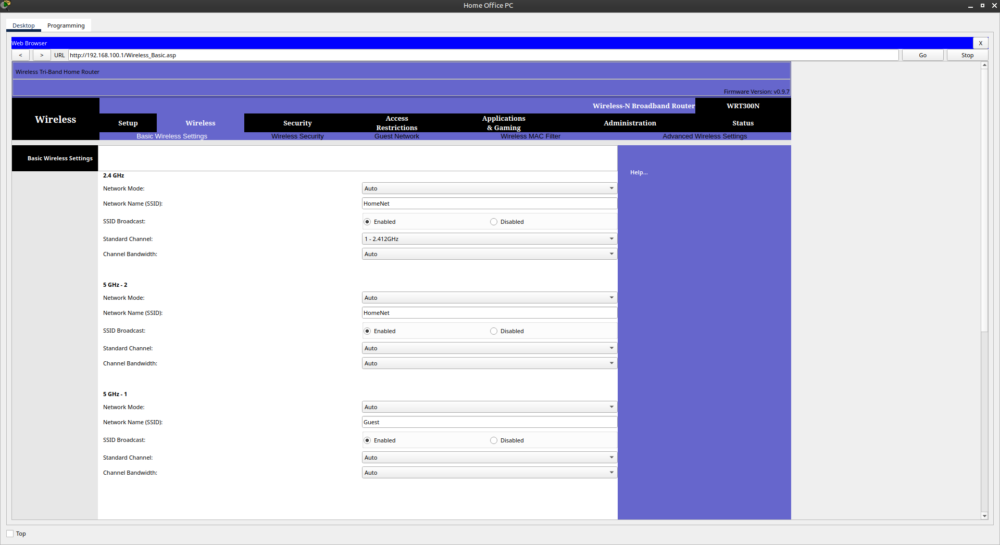
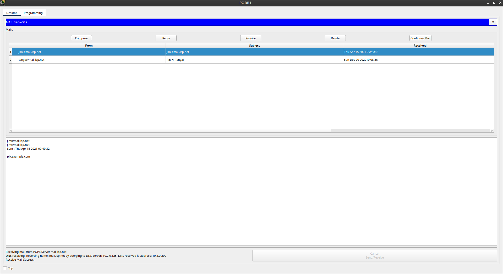
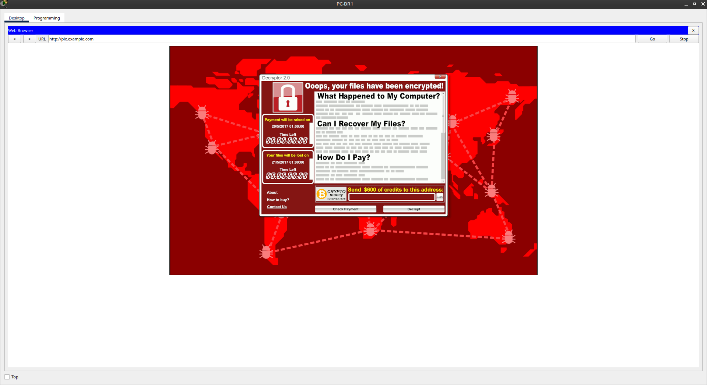
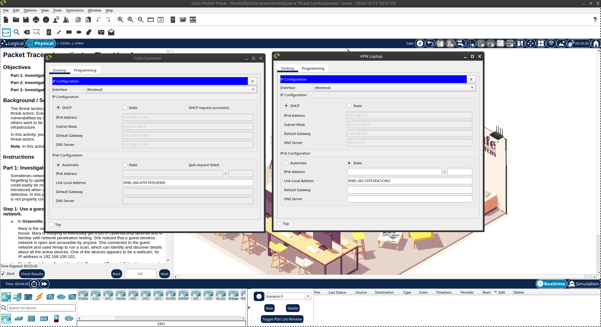

# Packet Tracer - Investigate a Threat Landscape

Лабораторная работа выполнена в **Cisco Packet Tracer**.

Цель работы — исследовать три уязвимости, которые могут быть использованы злоумышленниками:

1. Уязвимость конфигурации сети (открытая гостевая сеть)
2. Фишинговое вредоносное ПО
3. Уязвимость беспроводной сети и DNS (rogue AP)

## Топология сети

В лабораторной работе используется город **Greenville** с локациями:

- Home
- Cafe
- Branch Office
- ISP / Telco
- Data Center
- Smartphone 3



## Part 1: Network Configuration Vulnerability

### IP-адресация Home Office PC

| Параметр        | Значение            |
|-----------------|---------------------|
| IP Address      | `192.168.100.106`   |
| Subnet Mask     | `255.255.255.0`     |
| Default Gateway | `192.168.100.1`     |



### Настройки беспроводной сети

На роутере Home видны две сети:

| Сеть     | SSID     | Назначение          |
|----------|----------|---------------------|
| 2.4 GHz  | HomeNet  | Основная сеть       |
| 5 GHz-2  | HomeNet  | Основная сеть       |
| 5 GHz-1  | Guest    | Гостевая сеть       |

Гостевая сеть **Guest** открыта и доступна любому.



**Вывод Part 1:**  
Открытая гостевая сеть позволяет злоумышленнику (Smartphone 3) подключиться и сканировать устройства в домашней сети (например, веб-камеру 192.168.100.101).

## Part 2: Phishing Malware Vulnerability

На **PC-BR1** в почтовом клиенте получено письмо от `jim@mail.isp.net` со ссылкой на `pix.example.com`.



После перехода по ссылке открывается экран ransomware:

**Decryptor 2.0** — «Ooops, your files have been encrypted!»



**Вывод Part 2:**  
Фишинговое письмо приводит к заражению компьютера ransomware. Пользователь видит требование выкупа.

## Part 3: Wireless Network and DNS Vulnerability

Сравнение двух устройств в кафе:

| Устройство      | IP Address       | Gateway          | DNS Server       |
|-----------------|------------------|------------------|------------------|
| Cafe Customer   | 192.168.10.200   | 192.168.10.198   | 192.168.10.199   |
| VPN Laptop      | 192.168.0.12     | 192.168.0.5      | 10.2.0.125       |



**Вывод Part 3:**  
Cafe Customer подключен к **rogue access point**. DHCP выдаёт поддельный DNS-сервер (192.168.10.199). При обращении к популярному сайту трафик перенаправляется на вредоносный сервер, и устанавливается ransomware.

## Результат

- ✅ Исследована открытая гостевая сеть (Part 1)
- ✅ Продемонстрирован фишинг → ransomware (Part 2)
- ✅ Обнаружен rogue AP и подмена DNS (Part 3)
- ✅ Сравнены легитимное и скомпрометированное подключения

## Полученные навыки

В ходе лабораторной работы были отработаны:

- анализ уязвимостей конфигурации беспроводных сетей
- распознавание фишинговых писем и ransomware
- понимание атаки через rogue access point
- анализ IP/DNS-настроек устройств
- оценка угроз в threat landscape

## Используемые технологии

```text
Cisco Packet Tracer
Wireless Networks
DHCP / DNS
Phishing
Ransomware
Rogue Access Point
```

## Итог

Лабораторная работа показывает три реальных вектора атак:

1. Неправильная конфигурация (открытый Guest)
2. Социальная инженерия (фишинг)
3. Атака на беспроводную сеть + подмена DNS

Понимание этих уязвимостей помогает предотвращать инциденты до того, как они произойдут.
