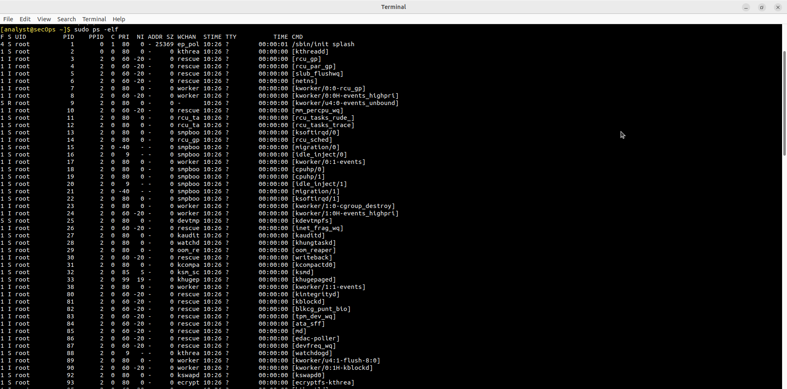
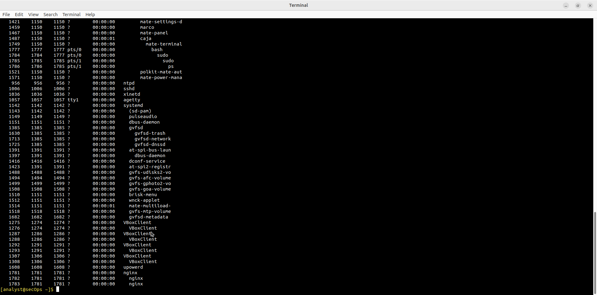
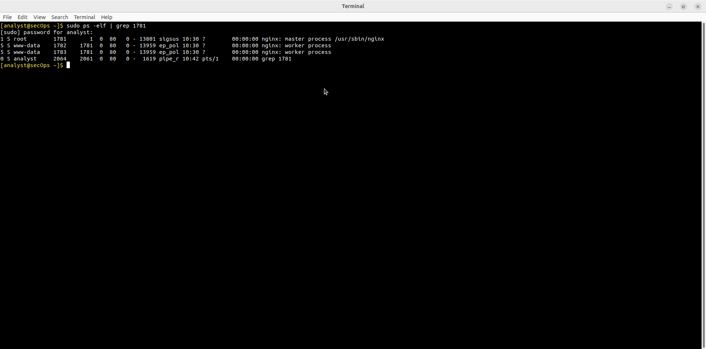
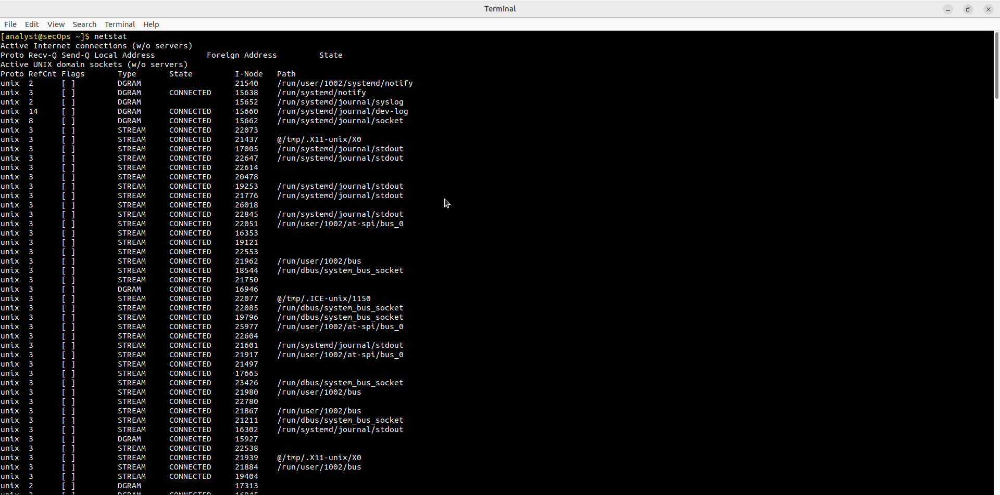
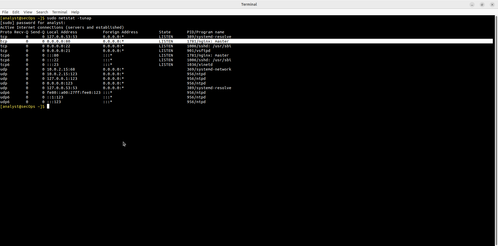
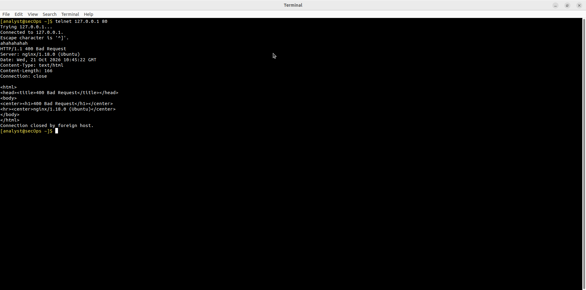
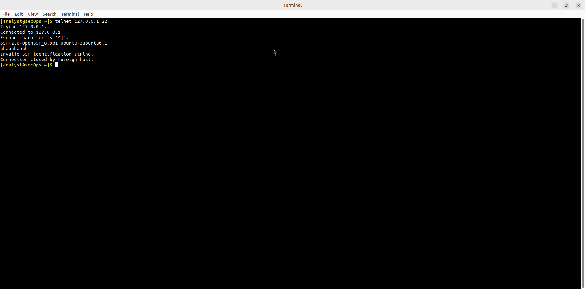

# Lab - Linux Servers

Лабораторная работа выполнена на **CyberOps Workstation**.

Цель работы — идентифицировать серверы, работающие на Linux-системе, и протестировать TCP-сервисы с помощью Telnet.

## Objectives

- Part 1: Servers  
- Part 2: Using Telnet to Test TCP Services  

## Part 1: Идентификация серверов

### Просмотр процессов

```bash
sudo ps -elf
```



Список процессов с nginx, sshd и другими службами:



Поиск конкретного процесса по PID:

```bash
sudo ps -elf | grep 1781
```



### Просмотр сетевых соединений

```bash
netstat
sudo netstat -tunap
```





Ключевые listening-порты:

| Порт      | Протокол | Процесс        |
|-----------|----------|----------------|
| 80        | TCP      | nginx          |
| 22        | TCP      | sshd           |
| 21        | TCP      | vsftpd         |
| 23        | TCP      | xinetd (telnet)|
| 53        | TCP/UDP  | systemd-resolve|
| 123       | UDP      | ntpd           |

## Part 2: Тестирование TCP-сервисов с Telnet

### Проверка HTTP (порт 80)

```bash
telnet 127.0.0.1 80
```

Сервер nginx отвечает:

```
HTTP/1.1 400 Bad Request
Server: nginx/1.18.0 (Ubuntu)
```



### Проверка SSH (порт 22)

```bash
telnet 127.0.0.1 22
```

Получен баннер SSH:

```
SSH-2.0-OpenSSH_8.9p1 Ubuntu-3ubuntu0.1
```



## Основные команды

| Команда                | Назначение                              |
|------------------------|-----------------------------------------|
| `ps -elf`              | Подробный список процессов              |
| `ps -elf \| grep <PID>`| Поиск процесса по PID                   |
| `netstat`              | Активные соединения                     |
| `netstat -tunap`       | TCP/UDP + PID/имя программы             |
| `telnet <IP> <port>`   | Проверка доступности TCP-сервиса        |

## Результат

- ✅ Идентифицированы работающие серверы (nginx, sshd, vsftpd, ntpd)
- ✅ Сопоставлены порты и процессы через `netstat -tunap`
- ✅ Протестированы TCP-сервисы с помощью Telnet (порты 80 и 22)

## Полученные навыки

В ходе лабораторной работы были отработаны:

- анализ процессов Linux (`ps`)
- просмотр сетевых соединений (`netstat`)
- тестирование TCP-сервисов через Telnet
- понимание связи между процессами и открытыми портами

## Используемые технологии

```text
Linux
ps
netstat
Telnet
nginx
OpenSSH
CyberOps Workstation
```

## Итог

Лабораторная работа показывает, как определить, какие серверы работают на системе, и быстро проверить доступность TCP-сервисов.
