# Lab - Locating Log Files

Лабораторная работа выполнена на **CyberOps Workstation**.

Цель работы — найти и просмотреть системные и сервисные лог-файлы, а также использовать `journalctl` для работы с журналами systemd.

## Objectives

- Найти расположение логов в `/var/log`
- Просмотреть логи nginx
- Использовать `journalctl` для фильтрации системных журналов

## Part 1: Конфигурация и процессы nginx

```bash
ps ax | grep nginx
ls -l /etc/nginx/
cat /etc/nginx/nginx.conf
```

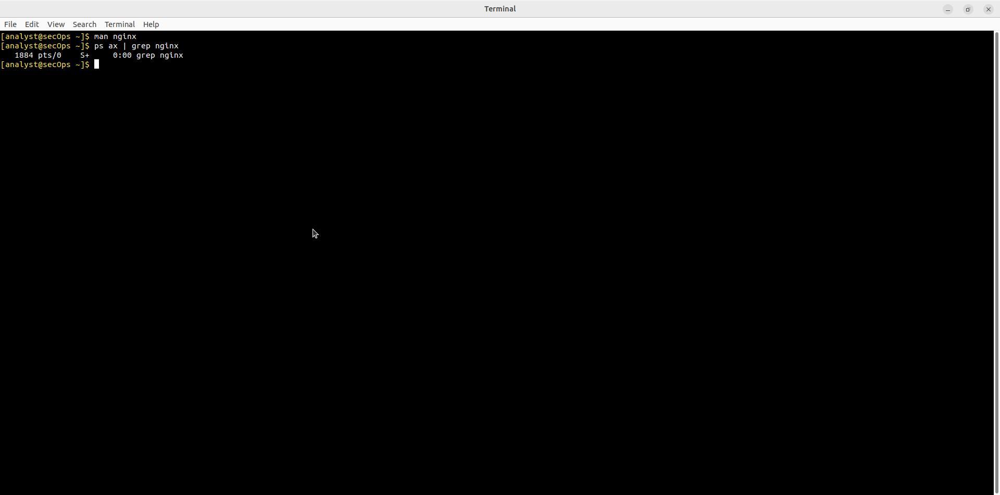

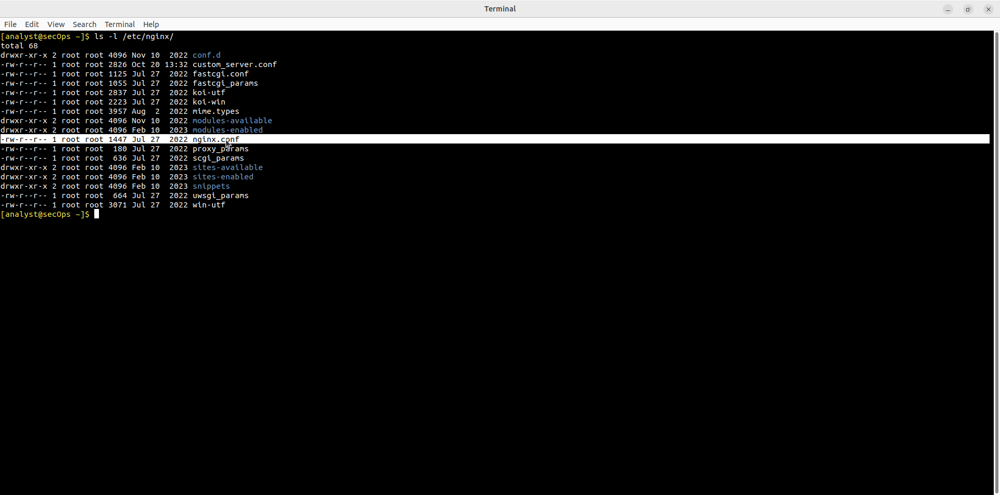

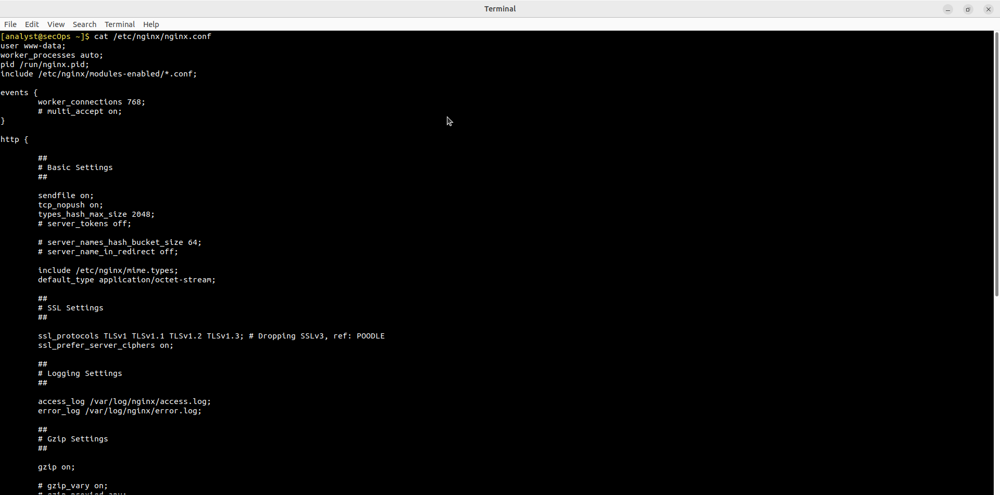

В конфиге указаны пути к логам:

```
access_log /var/log/nginx/access.log;
error_log  /var/log/nginx/error.log;
```

## Part 2: Логи в /var/log

```bash
ls -l /var/log/
ls -l /var/log/nginx
```

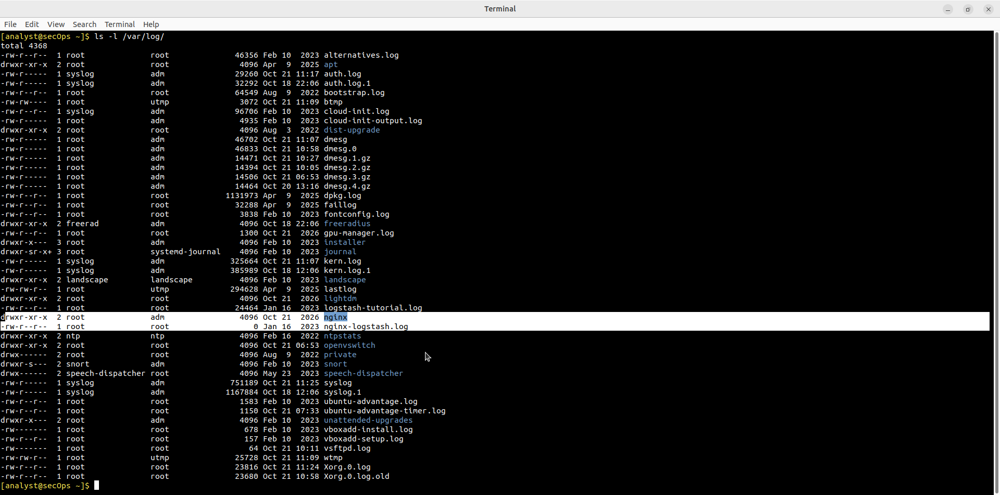

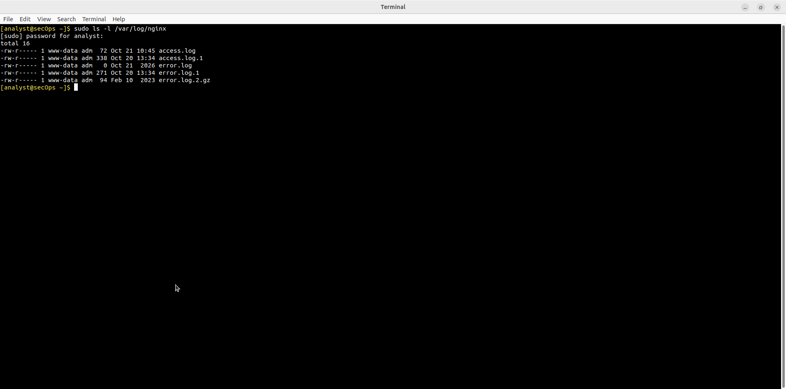

Файлы nginx:

| Файл            | Описание              |
|-----------------|-----------------------|
| access.log      | Текущий access-лог    |
| access.log.1    | Ротированный лог      |
| error.log       | Текущий error-лог     |
| error.log.1     | Ротированный error    |
| error.log.2.gz  | Сжатый архив          |

### Просмотр access-лога

```bash
sudo tail -n 5 /var/log/nginx/access.log
sudo tail -f /var/log/nginx/access.log
```

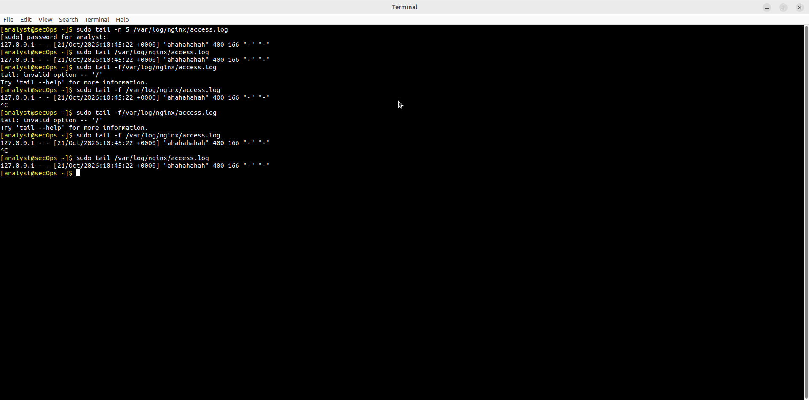

### Пример большого лога

```bash
cat /var/log/logstash-tutorial.log
```

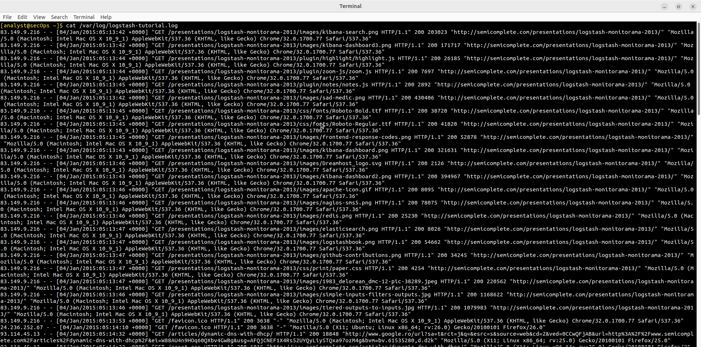

## Part 3: journalctl

### Базовый просмотр

```bash
journalctl
```

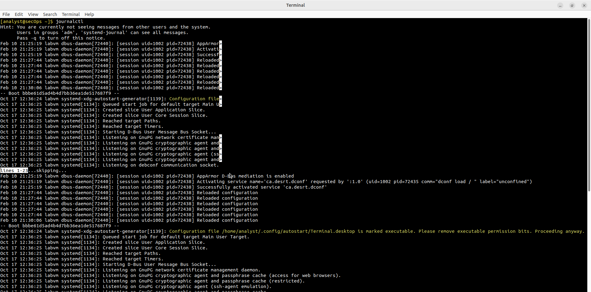

### Журналы текущей и предыдущих загрузок

```bash
sudo journalctl -b
sudo journalctl -b -2
sudo journalctl --list-boots
```

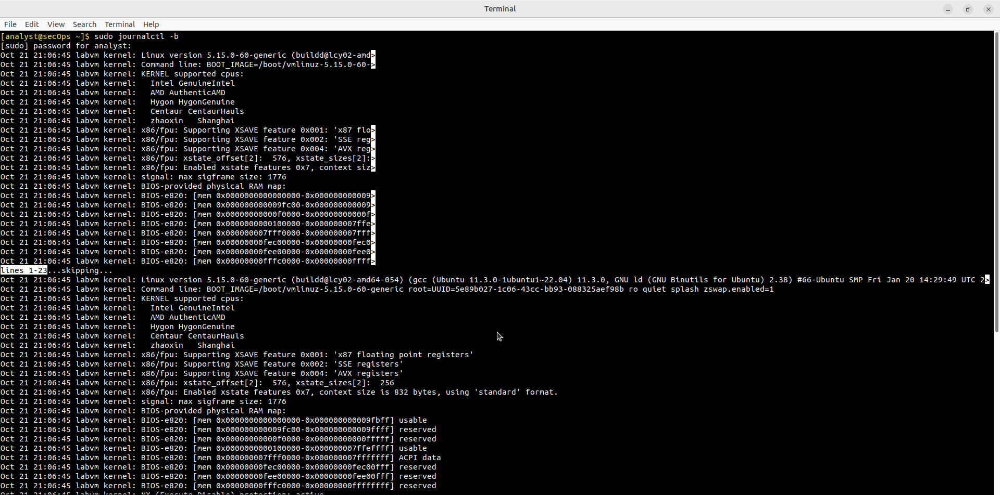

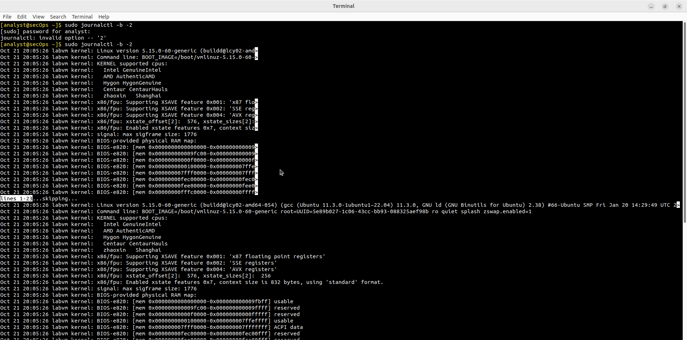

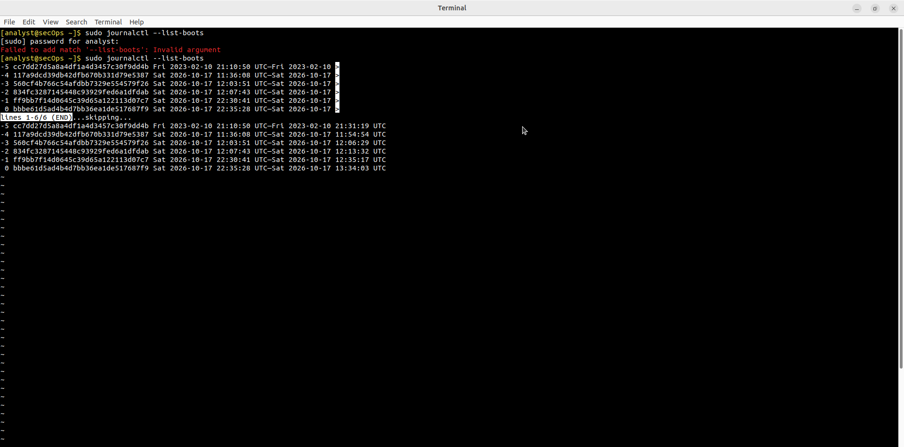

### Фильтр по времени

```bash
sudo journalctl --since "2 hours ago"
```

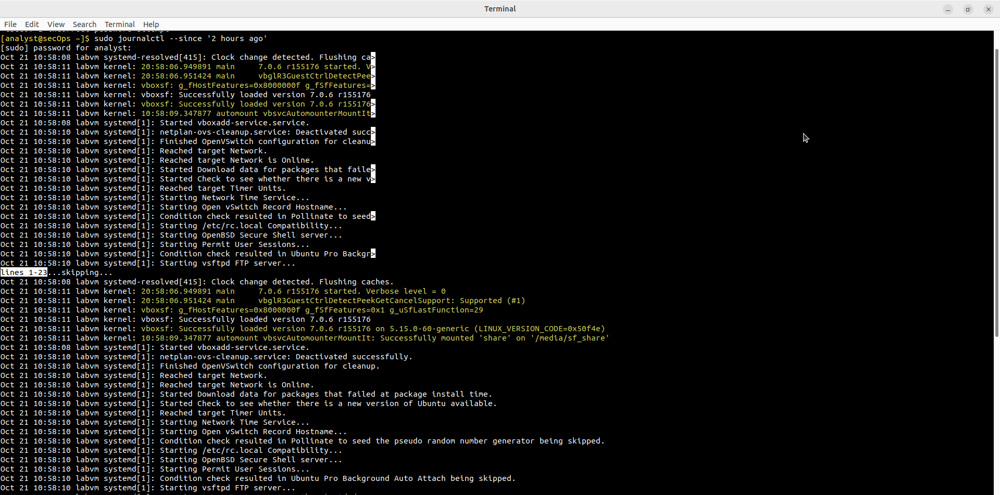

### Фильтр по сервису (nginx)

```bash
sudo journalctl -u nginx.service
sudo journalctl -u nginx.service -f
```

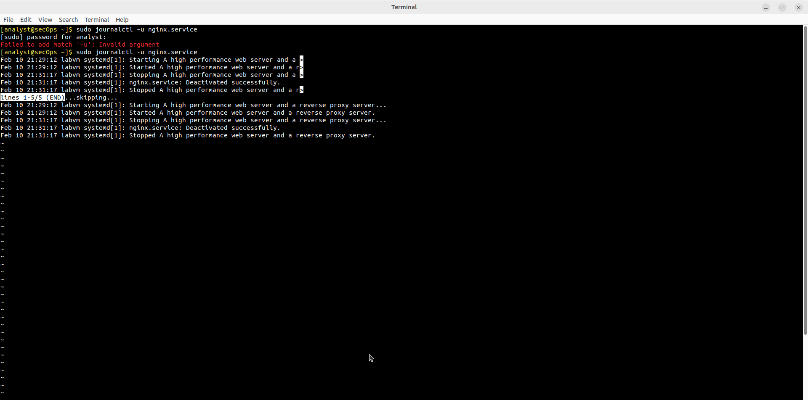

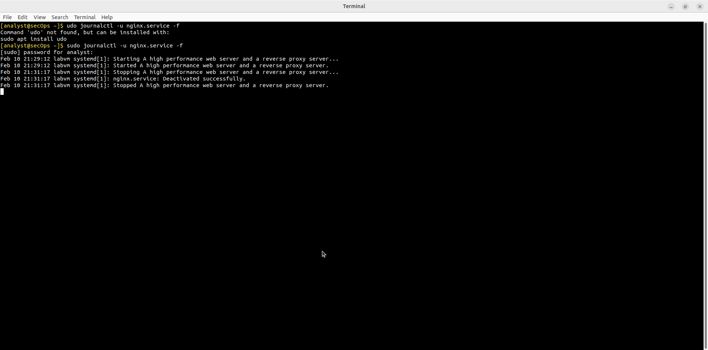

### Режим follow

```bash
sudo journalctl -f
```

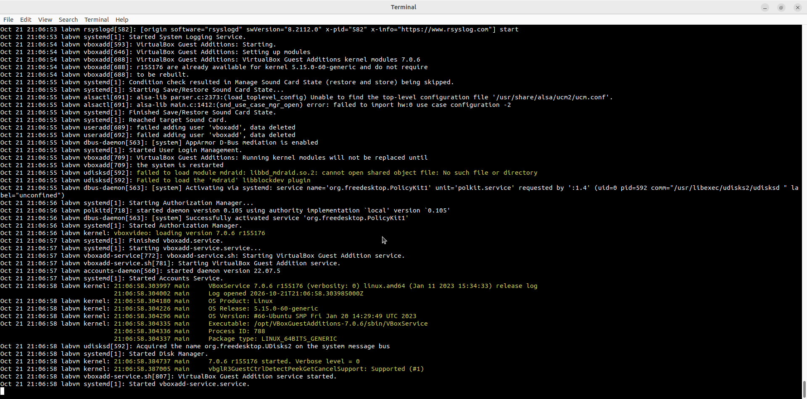

## Основные команды

| Команда                              | Назначение                          |
|--------------------------------------|-------------------------------------|
| `ls -l /var/log`                     | Список системных логов              |
| `tail -f /var/log/nginx/access.log`  | Слел-тайм просмотр access-лога     |
| `journalctl`                         | Все журналы systemd                 |
| `journalctl -b`                      | Журнал текущей загрузки             |
| `journalctl -b -2`                   | Журнал загрузки 2 назад             |
| `journalctl --list-boots`            | Список загрузок                     |
| `journalctl --since "..."`           | Фильтр по времени                   |
| `journalctl -u <service>`            | Журнал конкретного сервиса          |
| `journalctl -f`                      | Режим follow (как tail -f)          |

## Результат

- ✅ Найдены логи nginx в `/var/log/nginx`
- ✅ Просмотрены access и error логи
- ✅ Освоены фильтры `journalctl` (boot, time, unit, follow)

## Полученные навыки

В ходе лабораторной работы были отработаны:

- поиск логов сервисов
- работа с ротированными логами
- использование `journalctl` для анализа systemd-журналов
- фильтрация логов по времени и сервису

## Используемые технологии

```text
Linux
journalctl
nginx
/var/log
CyberOps Workstation
```

## Итог

Лабораторная работа закрепляет навык быстрого нахождения и анализа логов — ключевой элемент расследования инцидентов и troubleshooting.
