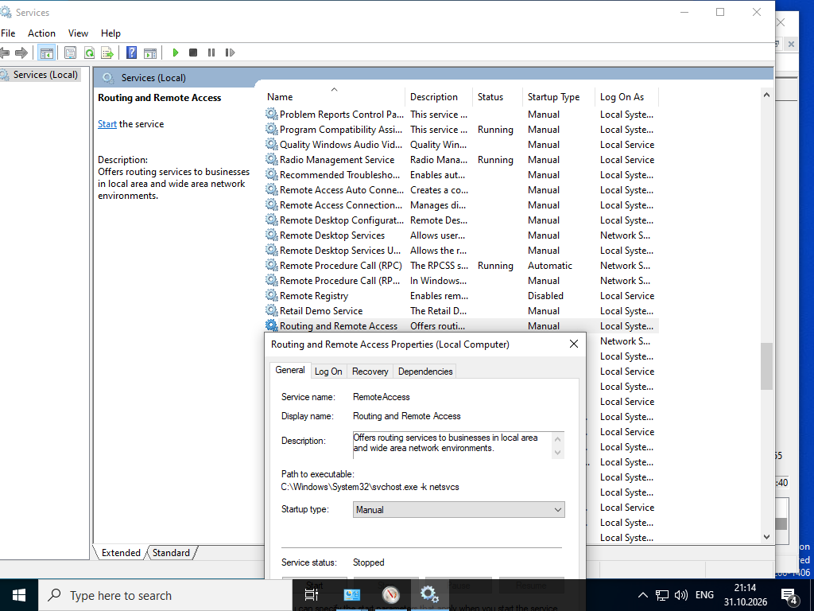
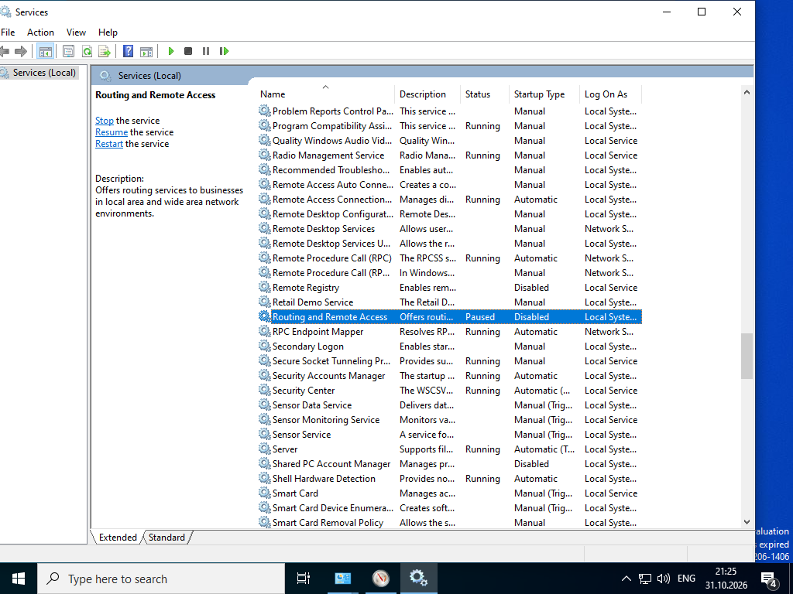
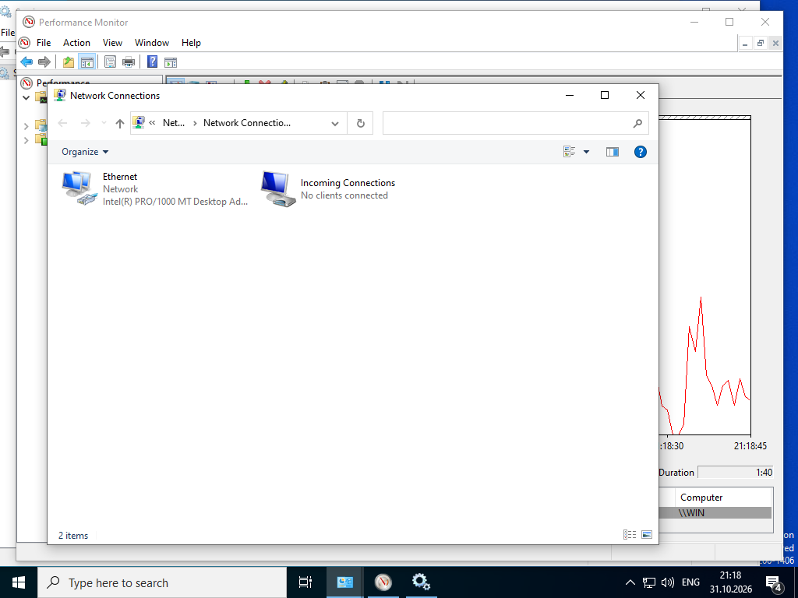
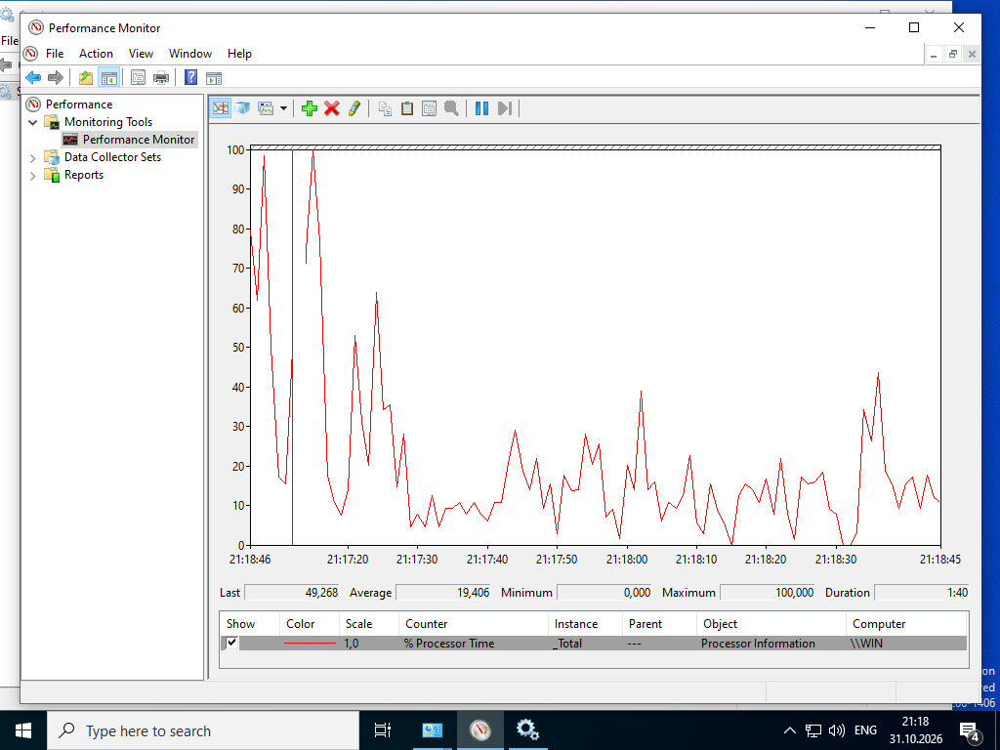
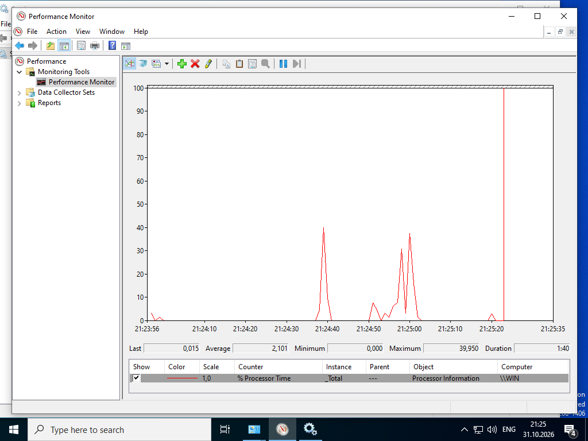
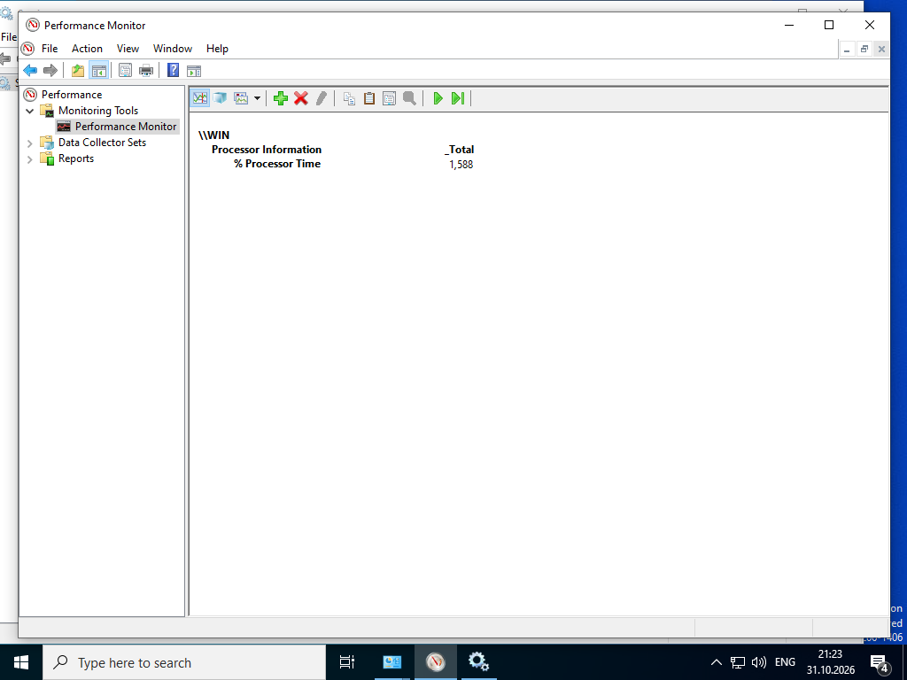
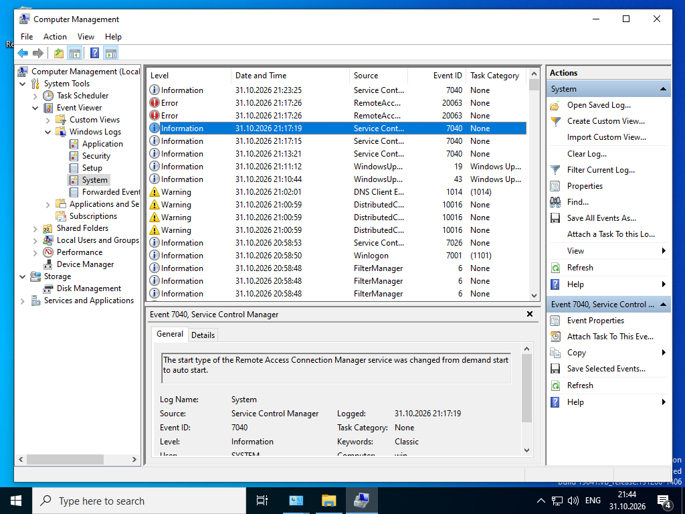
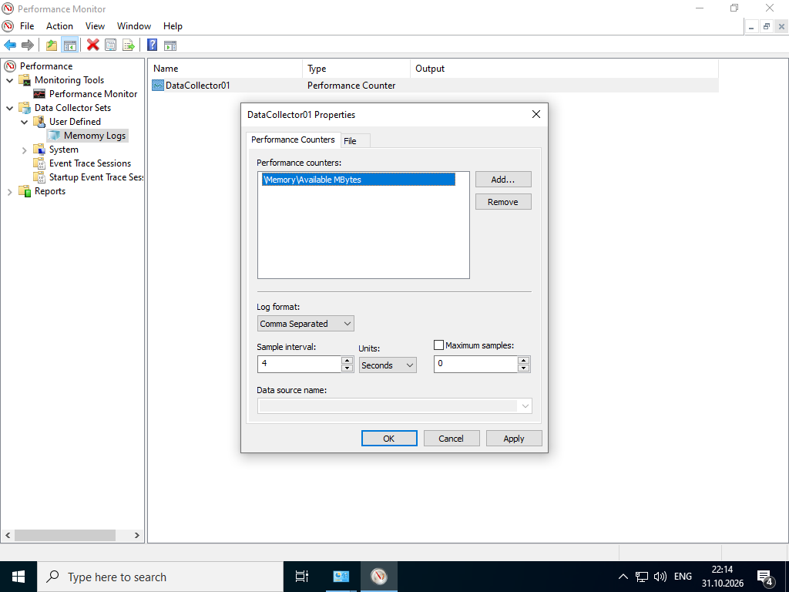
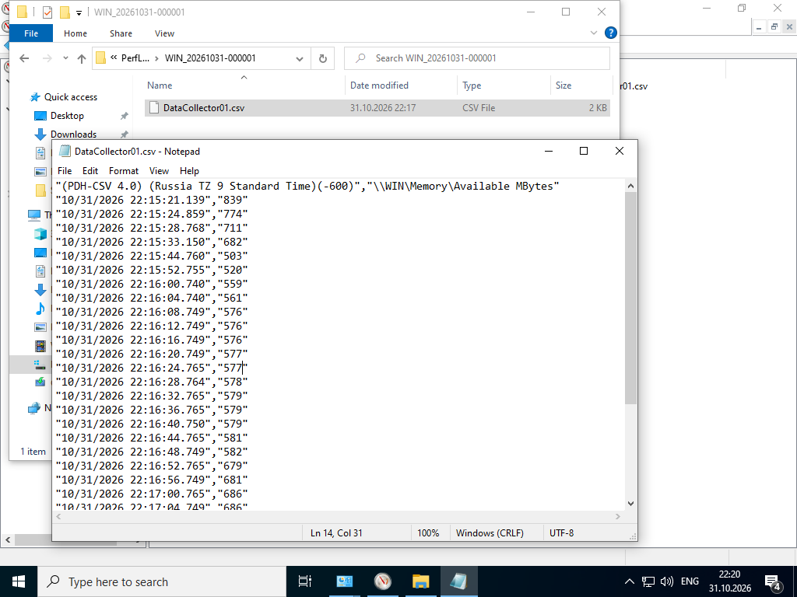

# Lab - Monitor and Manage System Resources in Windows

Лабораторная работа выполнена на **Windows VM**.

Цель работы — управлять службами Windows, мониторить производительность и анализировать события системы.

## Objectives

- Запускать и останавливать службу Routing and Remote Access
- Работать с Performance Monitor
- Анализировать события в Event Viewer
- Создавать Data Collector Set

## Part 1: Routing and Remote Access Service

### Управление службой

Через **Services**:



| Параметр     | Значение                          |
|--------------|-----------------------------------|
| Service name | RemoteAccess                      |
| Display name | Routing and Remote Access         |
| Startup type | Manual → Disabled                 |
| Path         | `C:\Windows\System32\svchost.exe -k netsvcs` |

После остановки и отключения:



- Status: **Paused / Stopped**
- Startup Type: **Disabled**

### Network Connections

При запуске службы появляется дополнительное сетевое подключение (Incoming Connections).



### Performance Monitor

График загрузки процессора при старте/остановке службы:





Режим Report:



```
% Processor Time  →  1,388
```

## Part 2: Event Viewer (System Log)

Через **Computer Management → Event Viewer → Windows Logs → System**:



События, связанные с Routing and Remote Access:

| Event ID | Level       | Описание                                      |
|----------|-------------|-----------------------------------------------|
| 7040     | Information | Startup type изменён (demand → auto / disabled)|
| 20063    | Error       | Ошибки Remote Access                          |

## Part 3: Data Collector Set

Создан пользовательский набор **Memory Logs**:



Параметры:
- Counter: `\Memory\Available MBytes`
- Sample interval: 4 seconds
- Log format: Comma Separated (CSV)

Результат сбора:



Файл сохранён в `C:\PerfLogs\...` и содержит значения доступной памяти во времени.

## Результат

- ✅ Служба Routing and Remote Access запущена, остановлена и отключена
- ✅ Проанализированы изменения в Network Connections и Performance Monitor
- ✅ Найдены события службы в System Log
- ✅ Создан и запущен Data Collector Set для мониторинга памяти

## Полученные навыки

В ходе лабораторной работы были отработаны:

- управление службами Windows (Start / Stop / Disable)
- мониторинг производительности через Performance Monitor
- анализ системных событий
- создание и использование Data Collector Sets

## Используемые технологии

```text
Windows Services
Performance Monitor
Event Viewer
Data Collector Sets
Computer Management
Endpoint Security
```

## Итог

Лабораторная работа демонстрирует ключевые инструменты администрирования Windows для мониторинга и управления системными ресурсами — важные навыки для endpoint security специалиста.
