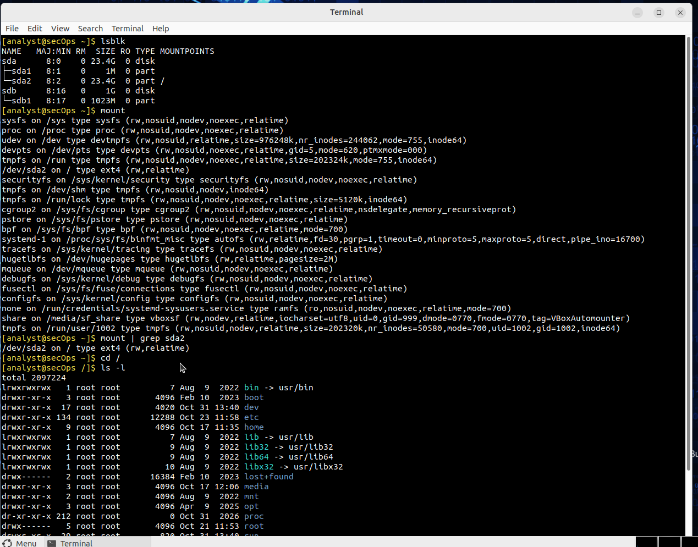
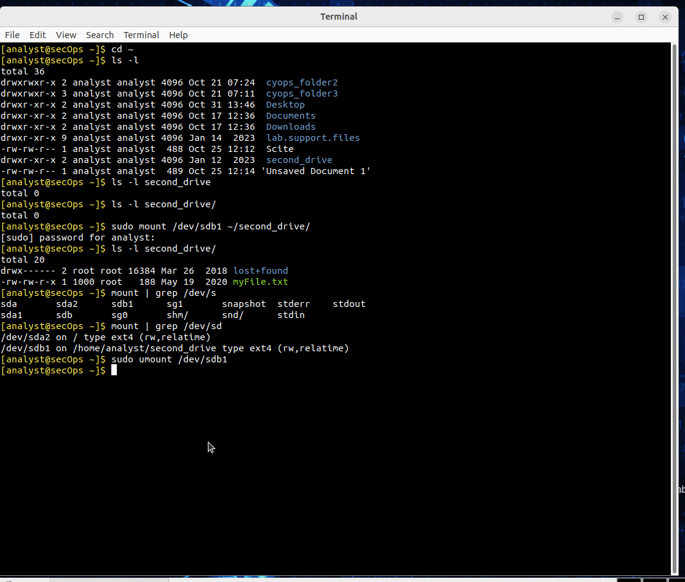
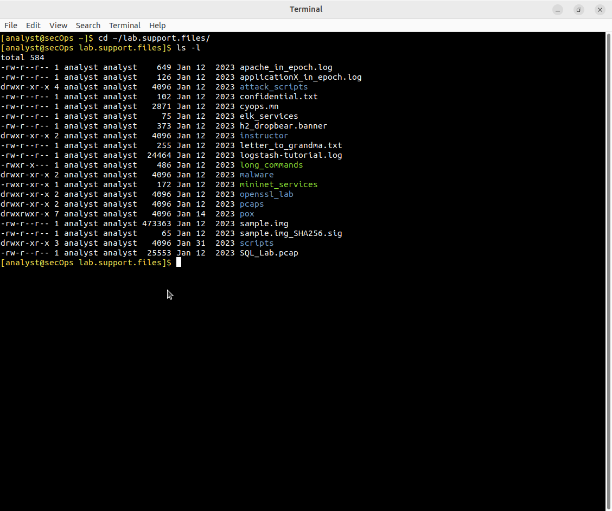
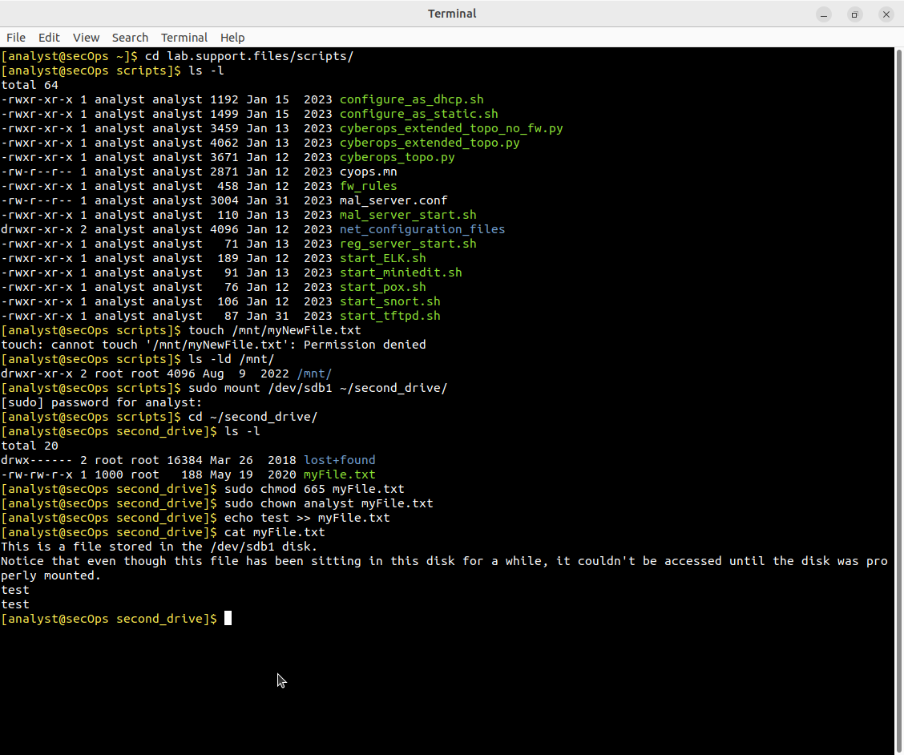
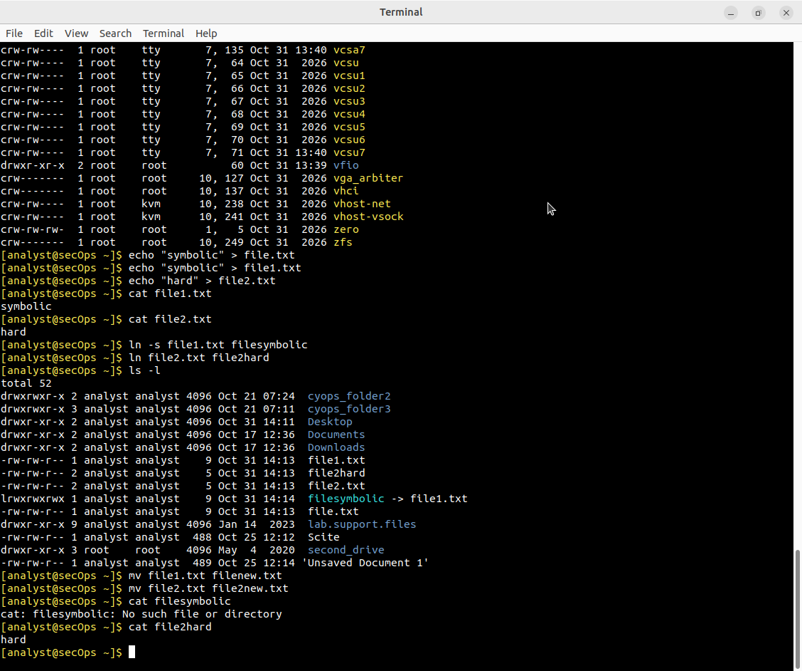

# Lab - Navigating the Linux Filesystem and Permission Settings

**Endpoint Security 8.5.4**

Лабораторная работа выполнена на **Security Workstation VM**.

Цель работы — изучить файловую систему Linux, права доступа, монтирование и ссылки.

## Objectives

- Исследовать файловые системы и точки монтирования
- Работать с правами доступа (chmod, chown)
- Создавать символические и жёсткие ссылки

## Part 1: Exploring Filesystems

### Block devices

```bash
lsblk
```

| Device | Size  | Mountpoint |
|--------|-------|------------|
| sda    | 23.4G |            |
| sda1   | 1M    |            |
| sda2   | 23.4G | /          |
| sdb    | 1G    |            |
| sdb1   | 1023M |            |



### Монтирование второго диска

```bash
sudo mount /dev/sdb1 ~/second_drive/
ls -l second_drive/
sudo umount /dev/sdb1
```



После монтирования в `second_drive` появляются файлы с диска (`myFile.txt`, `lost+found`).  
После `umount` директория снова пустая.

## Part 2: File Permissions

### Просмотр прав

```bash
ls -l lab.support.files/
ls -l lab.support.files/scripts/
```



Пример: `cyops.mn` → `-rw-r--r--` (owner: rw, group: r, others: r)

### Изменение прав и владельца

```bash
sudo mount /dev/sdb1 ~/second_drive/
cd ~/second_drive
sudo chmod 665 myFile.txt
sudo chown analyst myFile.txt
echo test >> myFile.txt
```



| Команда              | Результат                     |
|----------------------|-------------------------------|
| `chmod 665`          | `-rw-rw-r-x`                  |
| `chown analyst`      | владелец → analyst            |
| `echo test >>`       | успешная запись в файл        |

Попытка `touch /mnt/myNewFile.txt` → **Permission denied** (директория принадлежит root).

## Part 3: Symbolic and Hard Links

```bash
echo "symbolic" > file1.txt
echo "hard" > file2.txt
ln -s file1.txt filesymbolic
ln file2.txt file2hard
ls -l
```



| Тип ссылки     | Команда              | Поведение после переименования |
|----------------|----------------------|--------------------------------|
| Symbolic (l)   | `ln -s`              | Ломается                       |
| Hard           | `ln`                 | Продолжает работать            |

После `mv file1.txt file1new.txt`:
```bash
cat filesymbolic   # No such file or directory
cat file2hard      # hard  (всё ещё работает)
```

## Результат

- ✅ Исследованы block devices и точки монтирования
- ✅ Диск `/dev/sdb1` смонтирован и отмонтирован
- ✅ Изменены права и владелец файла
- ✅ Созданы и протестированы symbolic / hard links

## Полученные навыки

В ходе лабораторной работы были отработаны:

- работа с `lsblk`, `mount`, `umount`
- понимание прав доступа Linux (rwx)
- команды `chmod` и `chown`
- разница между symbolic и hard links

## Используемые технологии

```text
Linux Filesystem (ext4)
lsblk / mount / umount
chmod / chown
ln (symbolic & hard links)
Endpoint Security
```

## Итог

Лабораторная работа даёт фундаментальное понимание файловой системы Linux, прав доступа и ссылок — базовые навыки для работы в среде cybersecurity.
