# Lab - Reading Server Logs

Лабораторная работа выполнена на **CyberOps Workstation** (VirtualBox).

Цель работы — освоить инструменты для чтения и анализа логов: `cat`, `more`, `less`, `tail`, а также работу с **Syslog** и **Journalctl**.

## Objectives

- Part 1: Reading Log Files with Cat, More, Less, and Tail  
- Part 2: Log Files and Syslog  
- Part 3: Log Files and Journalctl  

## Part 1: Основные команды просмотра логов

### cat

Выводит весь файл целиком.

```bash
cat /home/analyst/lab.support.files/logstash-tutorial.log
```

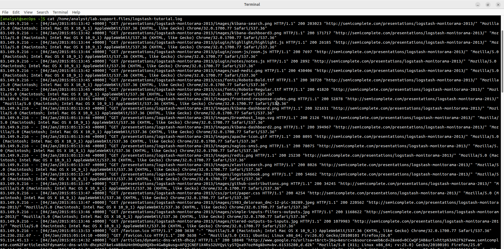

### more

Постраничный просмотр (пробел — вперёд, `b` — назад).

```bash
more /home/analyst/lab.support.files/logstash-tutorial.log
```

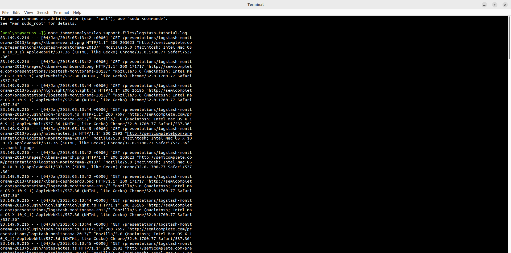

### less

Удобный просмотр с поиском (`/` — поиск, `q` — выход).

```bash
less /home/analyst/lab.support.files/logstash-tutorial.log
```

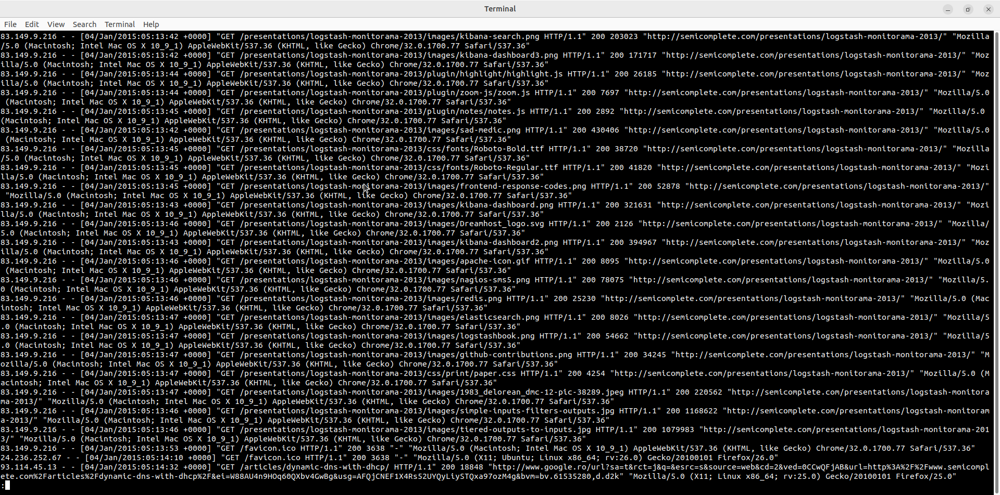

### tail

Показывает последние строки файла (по умолчанию 10).

```bash
tail /home/analyst/lab.support.files/logstash-tutorial.log
```

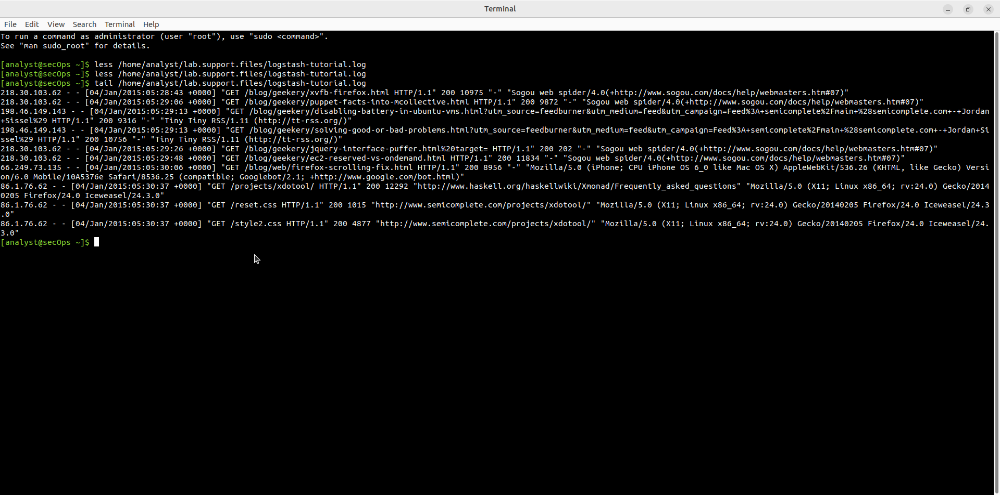

## Part 2: Syslog

Просмотр классического syslog-файла:

```bash
sudo cat /var/log/syslog.1
```

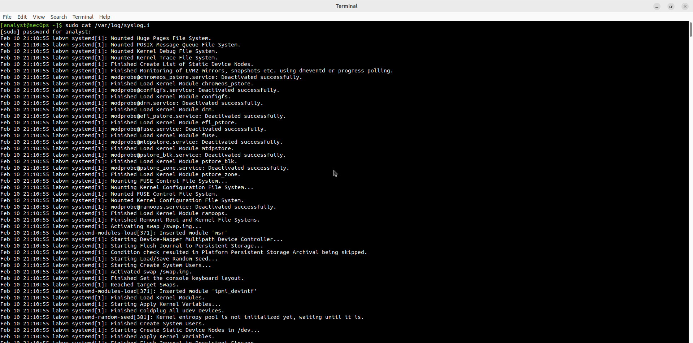

## Part 3: Journalctl

### Базовый просмотр

```bash
journalctl
```

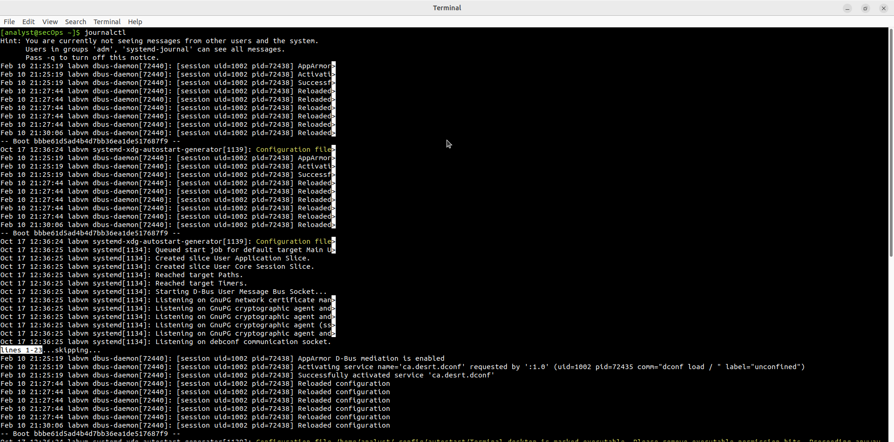

### Время в UTC

```bash
sudo journalctl --utc
```

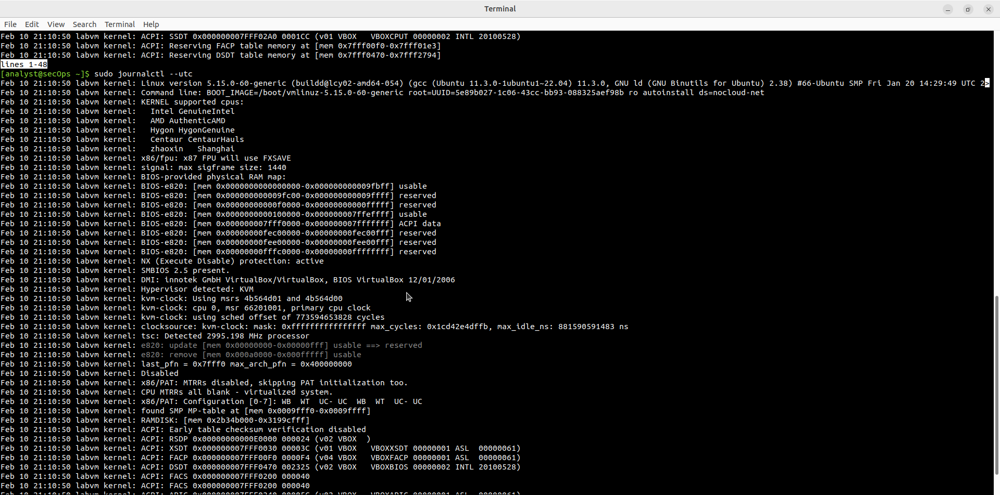

### Логи текущей загрузки

```bash
sudo journalctl -b
```

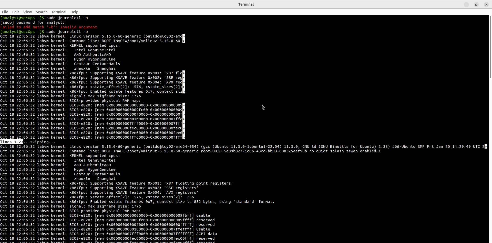

### Логи конкретного сервиса

```bash
sudo journalctl -u nginx.service --since today
```

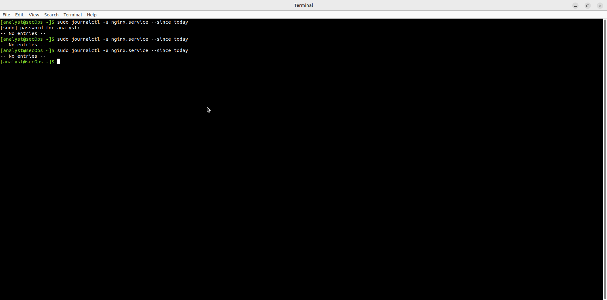

### Kernel messages

```bash
sudo journalctl -k
```

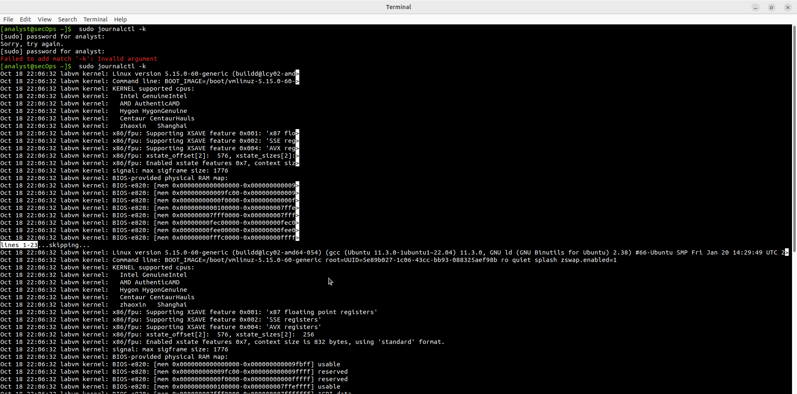

### Слежение в реальном времени

```bash
sudo journalctl -f
```

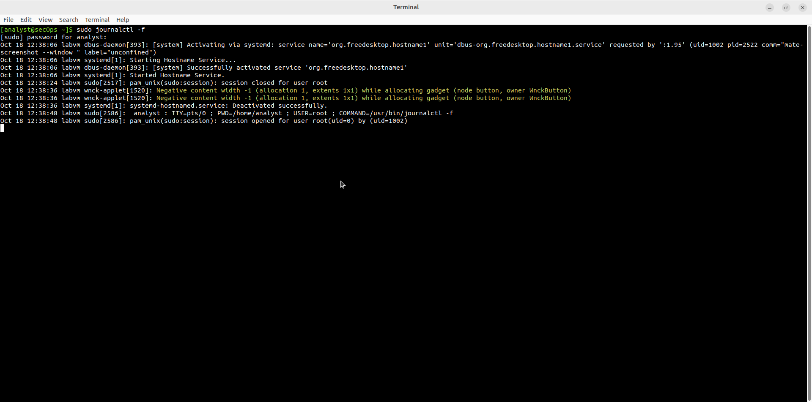

## Результат

- ✅ Освоены команды `cat`, `more`, `less`, `tail`
- ✅ Просмотрены файлы Syslog
- ✅ Использован `journalctl` с различными фильтрами
- ✅ Просмотрены kernel logs, логи сервисов и live-режим

## Полученные навыки

В ходе лабораторной работы были отработаны:

- чтение текстовых логов классическими утилитами
- работа с `/var/log/syslog`
- использование `journalctl` (фильтры по времени, сервису, kernel, follow)
- понимание разницы между Syslog и Journald

## Используемые технологии

```text
Linux
cat / more / less / tail
Syslog
journalctl
systemd
CyberOps Workstation
```

## Итог

Лабораторная работа даёт практические навыки чтения и фильтрации серверных логов — один из ключевых навыков при анализе инцидентов и troubleshooting.
