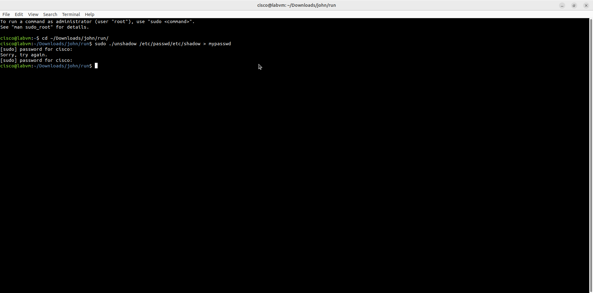
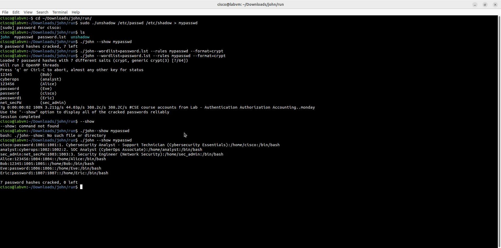
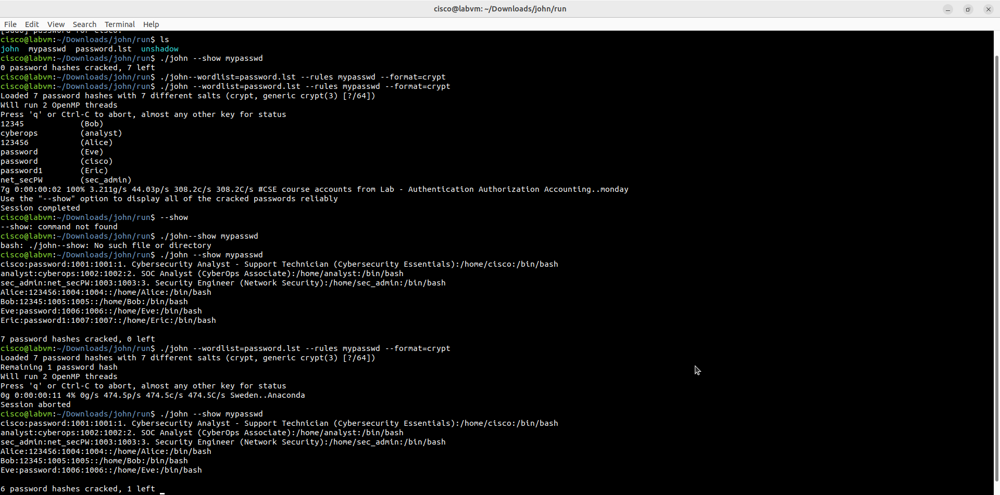

# Lab - Recover Passwords

Лабораторная работа выполнена на **CyberOps Workstation** (labvm).

Цель работы - восстановить (взломать) пароли пользователей с помощью **John the Ripper**, объединив `/etc/passwd` и `/etc/shadow` через `unshadow`.

## Objectives

- Объединить passwd и shadow с помощью `unshadow`
- Запустить John the Ripper с wordlist
- Просмотреть взломанные пароли
- Изменить пароль пользователя и повторить атаку

## Part 1: Подготовка хешей

```bash
cd ~/Downloads/john/run/
sudo ./unshadow /etc/passwd /etc/shadow > mypasswd
```



> Примечание: для выполнения `unshadow` требуются права root (sudo).

## Part 2: Запуск John the Ripper

```bash
ls
./john --wordlist=password.lst --rules mypasswd --format=crypt
```



John успешно взломал пароли:

| Пользователь | Пароль      |
|--------------|-------------|
| cisco        | password    |
| analyst      | cyberops    |
| sec_admin    | net_secPW   |
| Alice        | 123456      |
| Bob          | 12345       |
| Eve          | password    |
| Eric         | password1   |

```bash
./john --show mypasswd
```

```
7 password hashes cracked, 0 left
```

## Part 3: Смена пароля Eric и повторный crack

После успешного взлома всех паролей был изменён пароль пользователя **Eric** на более сложный, после чего:

1. Заново создан файл `mypasswd` через `unshadow`
2. Повторно запущен John the Ripper

```bash
sudo ./unshadow /etc/passwd /etc/shadow > mypasswd
./john --wordlist=password.lst --rules mypasswd --format=crypt
```

Результат:

```
Loaded 7 password hashes with 7 different salts
Remaining 1 password hash
```



```bash
./john --show mypasswd
```

```
6 password hashes cracked, 1 left
```

Пароль Eric больше не был найден в wordlist `password.lst` — демонстрация важности сложных паролей.

## Результат

- ✅ Создан файл `mypasswd` с помощью `unshadow`
- ✅ Запущен John the Ripper с wordlist `password.lst`
- ✅ Все 7 паролей успешно взломаны
- ✅ После смены пароля Eric повторный crack оставил 1 hash невзломанным

## Полученные навыки

В ходе лабораторной работы были отработаны:

- использование `unshadow` для объединения passwd + shadow
- работа с John the Ripper (wordlist + rules)
- анализ результатов password cracking
- понимание важности сложных паролей (на примере Eric)

## Используемые технологии

```text
John the Ripper
unshadow
Linux (/etc/passwd, /etc/shadow)
CyberOps Workstation
Endpoint Security
```

## Итог

Лабораторная работа демонстрирует, насколько легко слабые пароли поддаются атаке с помощью John the Ripper, и показывает, что смена пароля на более сложный делает атаку по словарю неэффективной.
