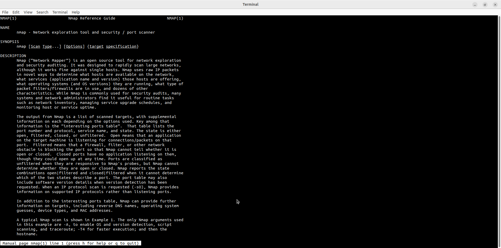
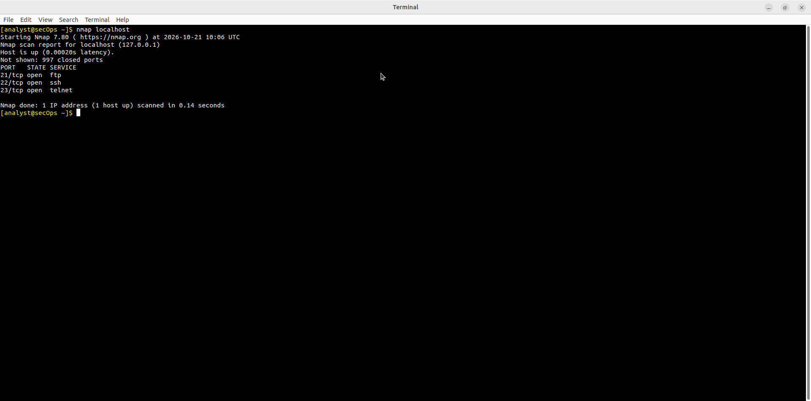
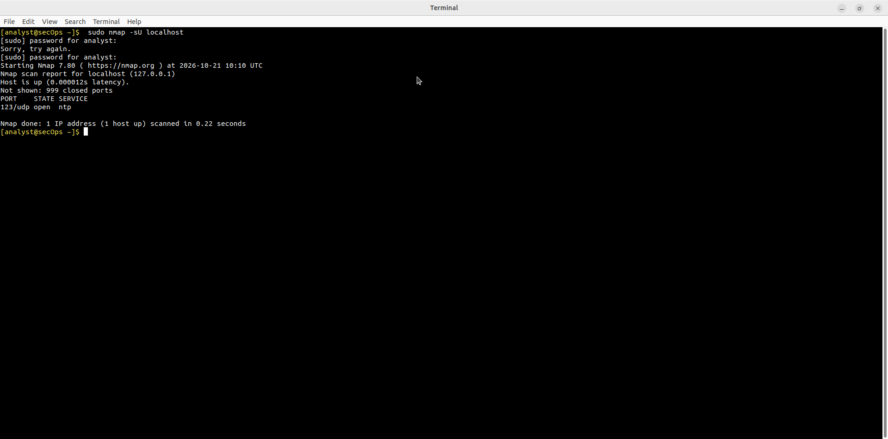
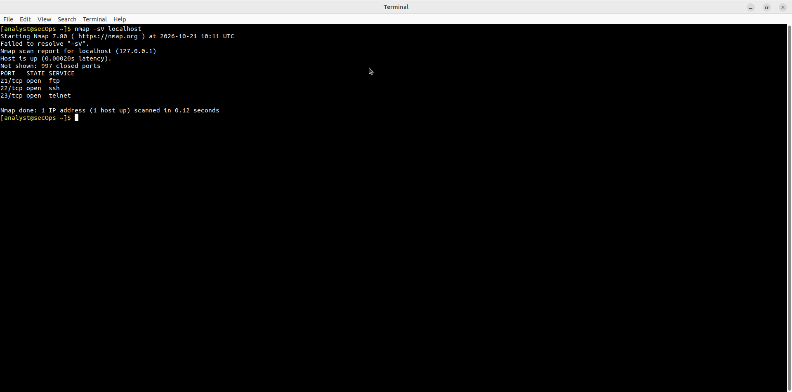
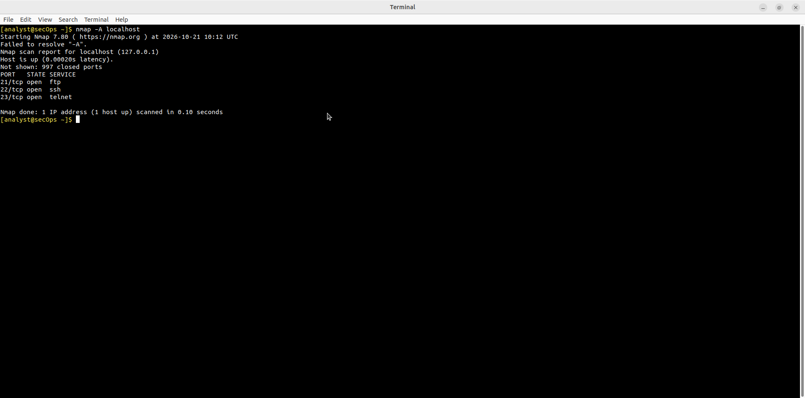

# Lab - Use a Port Scanner to Detect Open Ports

Лабораторная работа выполнена на **CyberOps Workstation**.

Цель работы — использовать **Nmap** для обнаружения открытых портов на localhost.

## Objectives

- Ознакомиться с утилитой Nmap  
- Выполнить сканирование TCP и UDP портов  
- Определить открытые службы  

## Part 1: Справка по Nmap

```bash
man nmap
```



## Part 2: Базовое сканирование

```bash
nmap localhost
```

Результат:

| PORT     | STATE | SERVICE |
|----------|-------|---------|
| 21/tcp   | open  | ftp     |
| 22/tcp   | open  | ssh     |
| 23/tcp   | open  | telnet  |



## Part 3: UDP-сканирование

```bash
sudo nmap -sU localhost
```

Результат:

| PORT     | STATE | SERVICE |
|----------|-------|---------|
| 123/udp  | open  | ntp     |



## Part 4: Определение версий служб

```bash
nmap -sV localhost
```



## Part 5: Агрессивное сканирование

```bash
nmap -A localhost
```



## Обнаруженные открытые порты

| Порт      | Протокол | Служба  | Риск |
|-----------|----------|---------|------|
| 21        | TCP      | FTP     | Высокий |
| 22        | TCP      | SSH     | Средний |
| 23        | TCP      | Telnet  | Высокий |
| 123       | UDP      | NTP     | Средний |

> **Примечание:** Порты 21 (FTP) и 23 (Telnet) считаются высокорисковыми, так как часто используются злоумышленниками для несанкционированного доступа и передачи данных в открытом виде.

## Основные команды Nmap

| Команда              | Назначение                          |
|----------------------|-------------------------------------|
| `nmap <host>`        | Базовое TCP-сканирование            |
| `nmap -sU <host>`    | UDP-сканирование                    |
| `nmap -sV <host>`    | Определение версий служб            |
| `nmap -A <host>`     | Агрессивное сканирование (OS + scripts) |
| `man nmap`           | Справка                             |

## Результат

- ✅ Выполнено TCP-сканирование localhost
- ✅ Выполнено UDP-сканирование
- ✅ Определены открытые порты: 21, 22, 23 (TCP) и 123 (UDP)
- ✅ Освоены основные флаги Nmap

## Полученные навыки

В ходе лабораторной работы были отработаны:

- использование Nmap для сканирования портов
- различие TCP и UDP сканирования
- анализ результатов сканирования
- понимание рисков открытых портов

## Используемые технологии

```text
Nmap
Linux
CyberOps Workstation
TCP / UDP
```

## Итог

Лабораторная работа знакомит с одним из ключевых инструментов сетевой разведки и аудита безопасности — **Nmap**.
