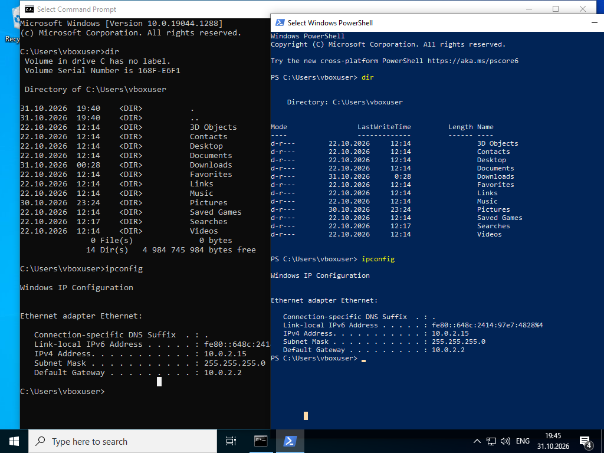
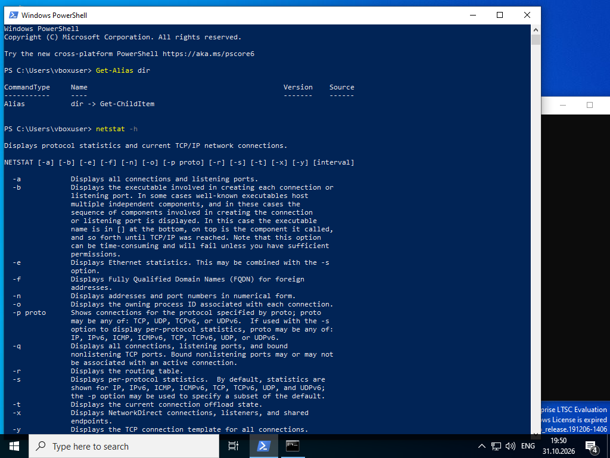
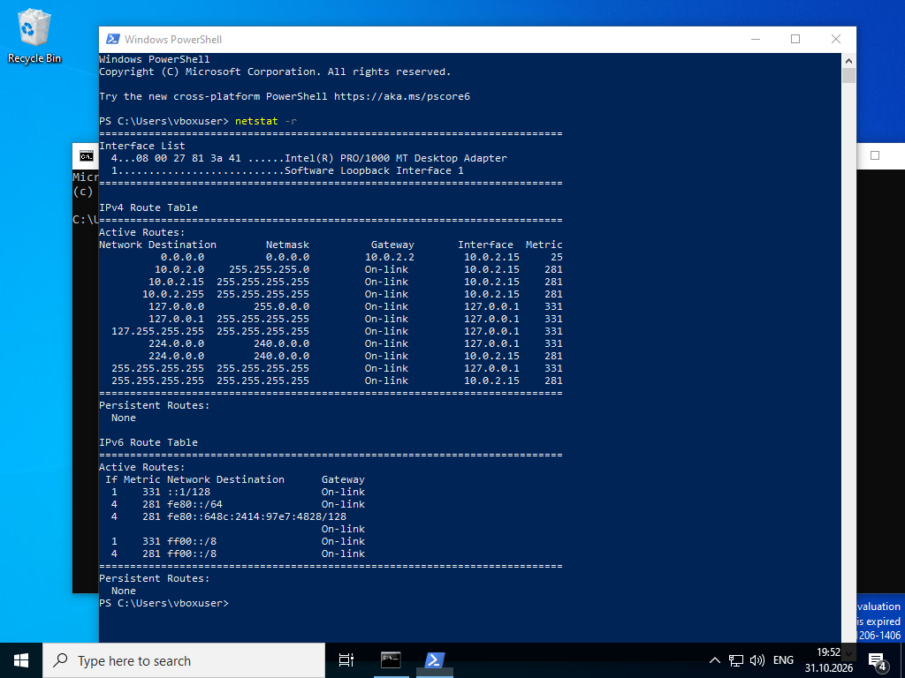
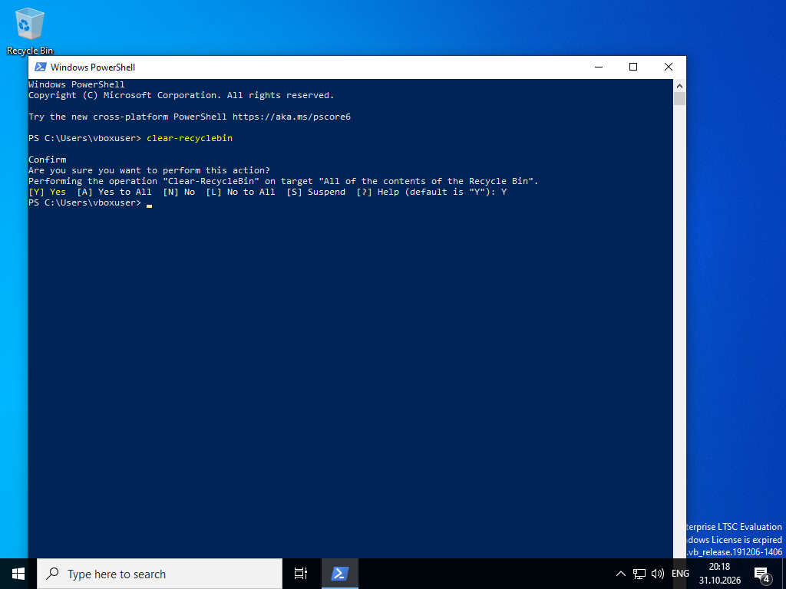

# Lab - Using Windows PowerShell

Лабораторная работа выполнена на **Windows VM**.

Цель работы — познакомиться с PowerShell: командами, cmdlets, netstat и автоматизацией задач.

## Objectives

- Сравнить Command Prompt и PowerShell
- Изучить cmdlets и алиасы
- Использовать netstat
- Очистить корзину через PowerShell

## Part 1–2: Command Prompt vs PowerShell

Одни и те же команды работают в обоих консолях:

```powershell
dir
ipconfig
```



| Команда   | CMD                          | PowerShell                     |
|-----------|------------------------------|--------------------------------|
| dir       | классический вывод           | вывод в виде объектов          |
| ipconfig  | одинаковый результат         | одинаковый результат           |

## Part 3: Explore cmdlets

```powershell
Get-Alias dir
```

Результат:

```
Alias  dir -> Get-ChildItem
```



PowerShell-команды строятся по схеме **Verb-Noun** (например, `Get-ChildItem`, `Clear-RecycleBin`).

## Part 4: netstat в PowerShell

### Справка

```powershell
netstat -h
```

### Таблица маршрутизации

```powershell
netstat -r
```



**IPv4 Gateway:** `10.0.2.2`  
**Интерфейс:** `10.0.2.15`

Основные опции netstat:

| Опция | Описание                              |
|-------|---------------------------------------|
| -a    | Все соединения и listening ports      |
| -b    | Исполняемый файл, создавший соединение|
| -n    | Адреса и порты в числовом виде        |
| -o    | PID процесса                          |
| -r    | Таблица маршрутизации                 |

## Part 5: Empty Recycle Bin

```powershell
clear-recyclebin
```



Команда запрашивает подтверждение и полностью очищает корзину.

## Результат

- ✅ Сравнены CMD и PowerShell
- ✅ Изучен алиас `dir → Get-ChildItem`
- ✅ Просмотрена таблица маршрутизации через `netstat -r`
- ✅ Корзина очищена командой `Clear-RecycleBin`

## Полученные навыки

В ходе лабораторной работы были отработаны:

- работа с PowerShell-консолью
- понимание cmdlets и алиасов
- использование netstat
- автоматизация простых задач (очистка корзины)

## Используемые технологии

```text
Windows PowerShell
Command Prompt
netstat
cmdlets
Endpoint Security
```

## Итог

Лабораторная работа показывает, что PowerShell — мощный инструмент автоматизации и администрирования Windows, необходимый специалисту по endpoint security.
