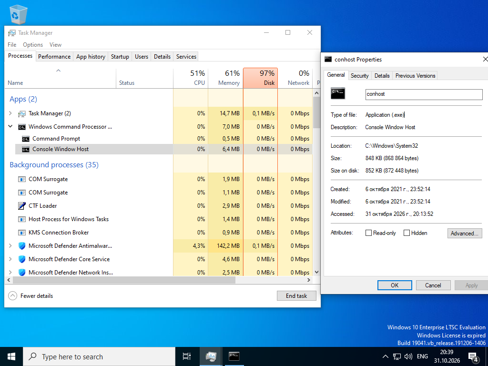
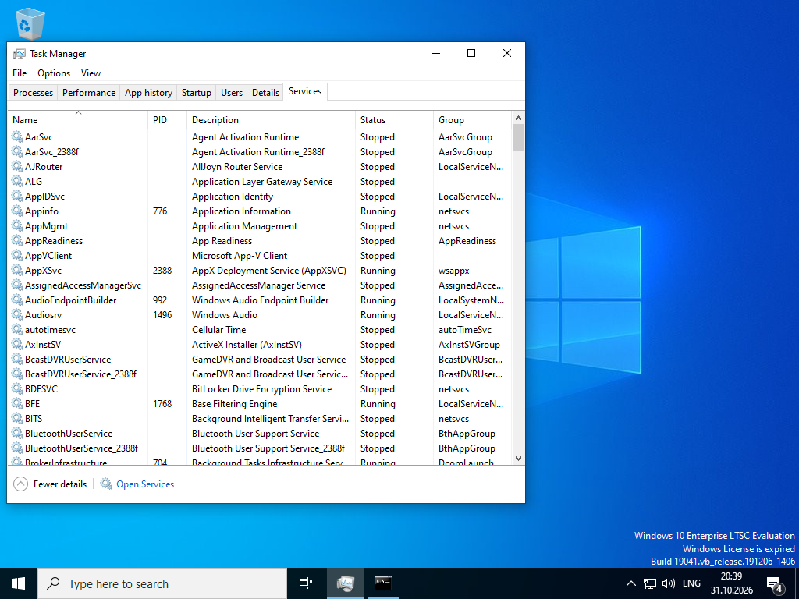
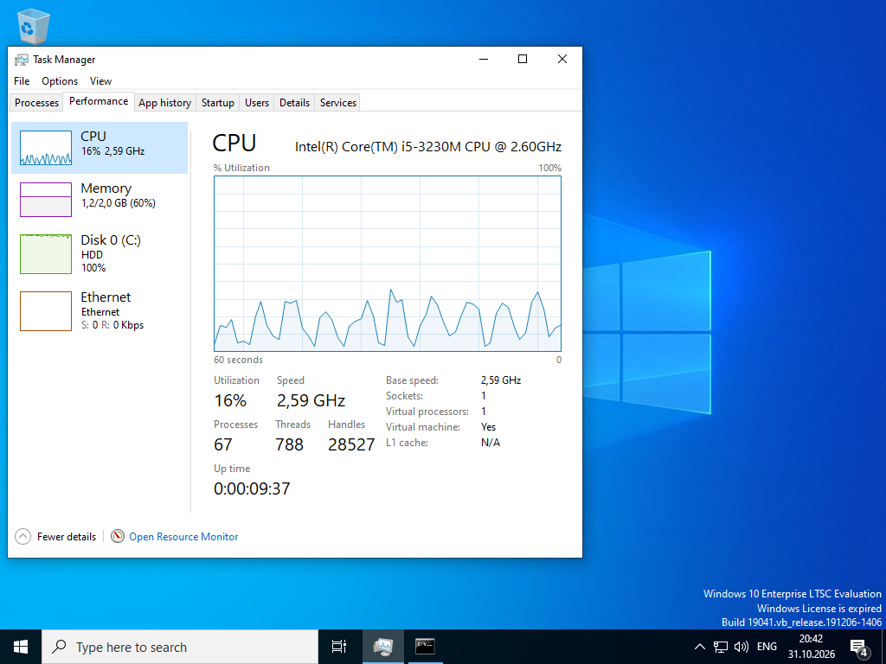

# Lab - Windows Task Manager

Лабораторная работа выполнена на **Windows VM**.

Цель работы — изучить Task Manager: процессы, службы и производительность системы.

## Objectives

- Работать с вкладкой Processes
- Изучить вкладку Services
- Анализировать вкладку Performance

## Part 1: Processes tab

Открыт **Task Manager** (More details).



### Иерархия процессов

При запуске Command Prompt появляются:

- **Windows Command Processor** (cmd.exe)
  - **Console Window Host** (conhost.exe)

Свойства `conhost.exe`:
- Location: `C:\Windows\System32`
- Type: Application (.exe)
- Description: Console Window Host

При закрытии окна Command Prompt оба процесса завершаются.

### Управление процессами

- Сортировка по столбцам (CPU, Memory, Disk)
- **End task** — завершение процесса
- Переключение Resource values (Bytes / Percents)

## Part 2: Services tab



Статусы служб:
- **Running**
- **Stopped**

Примеры:
| Service              | Status  | Group          |
|----------------------|---------|----------------|
| Appinfo              | Running | netsvcs        |
| AppXSvc              | Running | wsappx         |
| AudioEndpointBuilder | Running | LocalSystem... |
| BFE                  | Running | LocalService...|

Кнопка **Open Services** открывает полноценную оснастку Services.

## Part 3: Performance tab



### CPU

- Intel Core i5-3230M @ 2.60 GHz
- Utilization: ~16%
- Processes: 67
- Threads: 788
- Handles: 28527
- Up time: 00:00:09:37

### Другие ресурсы

| Ресурс   | Значение              |
|----------|-----------------------|
| Memory   | 1.2 / 2.0 GB (60%)    |
| Disk     | 100% (пиковая нагрузка)|
| Ethernet | 0 Kbps                |

Из Performance можно открыть **Resource Monitor**.

## Результат

- ✅ Исследована вкладка Processes и иерархия cmd/conhost
- ✅ Просмотрены службы (Running / Stopped)
- ✅ Проанализированы CPU, Memory, Disk, Network

## Полученные навыки

В ходе лабораторной работы были отработаны:

- мониторинг процессов через Task Manager
- завершение процессов (End task)
- анализ служб Windows
- оценка производительности системы

## Используемые технологии

```text
Windows Task Manager
Processes / Services / Performance
Resource Monitor
Endpoint Security
```

## Итог

Лабораторная работа даёт практический навык работы с Task Manager — основным инструментом мониторинга и управления процессами в Windows.
