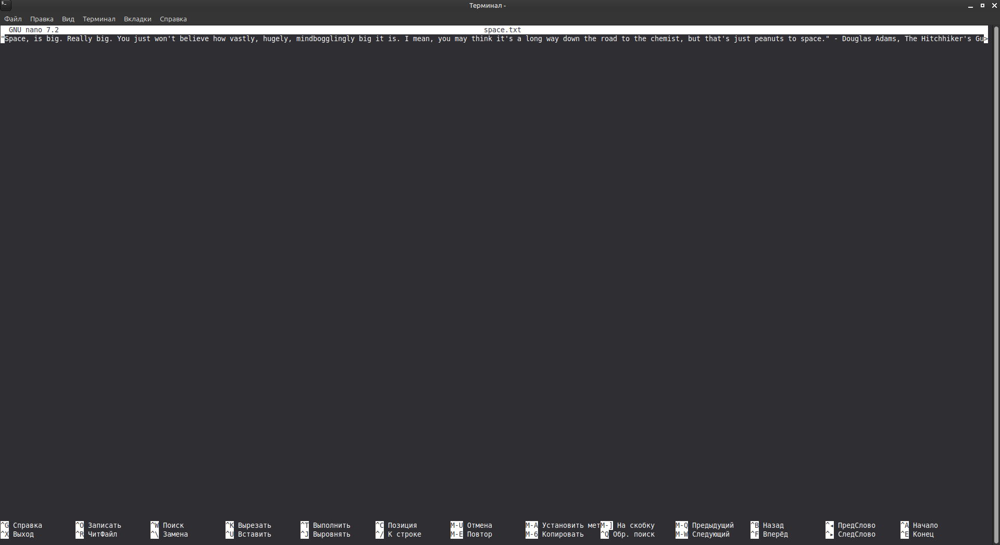
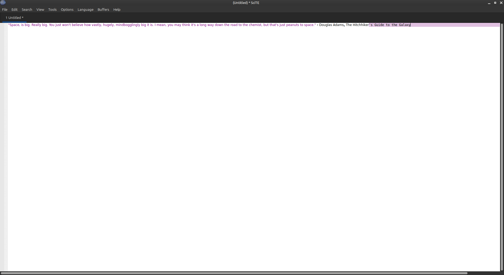
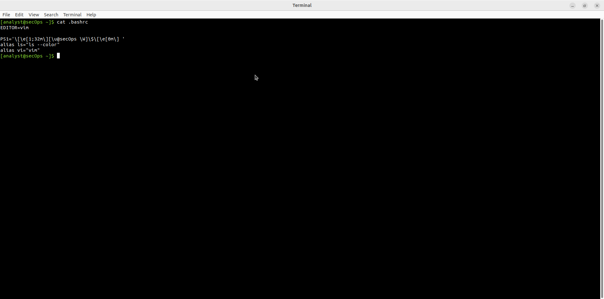
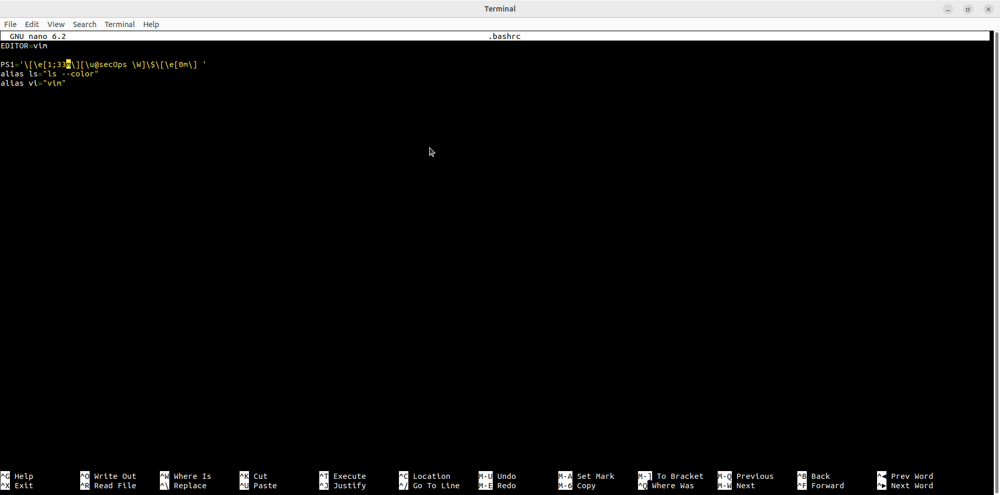
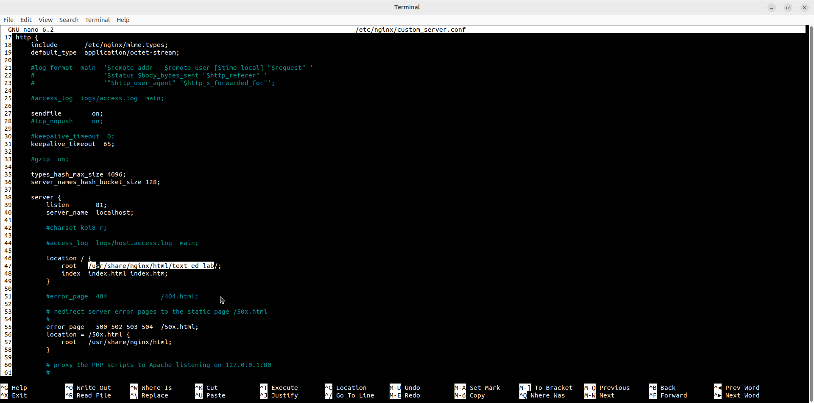
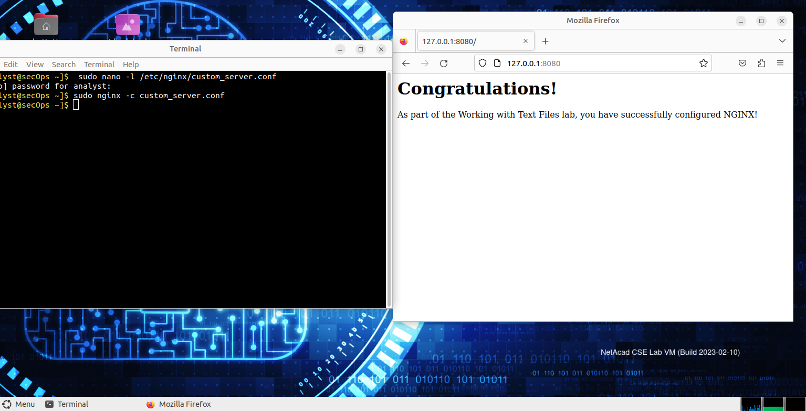
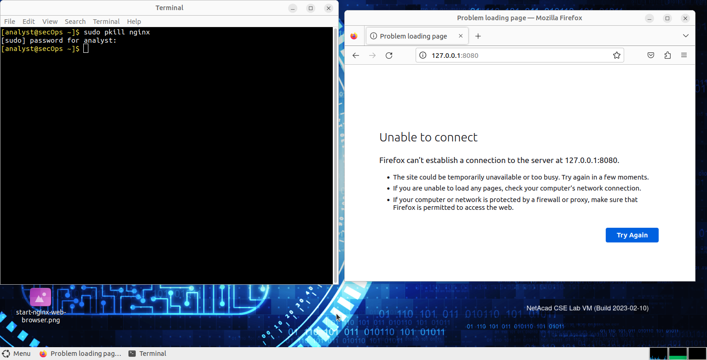

# Lab - Working with Text Files in the CLI

Лабораторная работа выполнена на **CyberOps Workstation** (NetAcad CSE Lab VM).

Цель работы — освоить работу с текстовыми файлами в командной строке: редакторы `nano` и `SciTE`, настройка `.bashrc` и конфигурация nginx.

## Objectives

- Работа с текстовыми редакторами в CLI и GUI  
- Редактирование пользовательских и системных конфигурационных файлов  
- Настройка и проверка работы nginx  

## Part 1: Текстовые редакторы

### nano

```bash
nano space.txt
```

Открыт файл с цитатой Дугласа Адамса.



### SciTE

GUI-редактор с подсветкой синтаксиса.



## Part 2: Настройка .bashrc

Просмотр и редактирование пользовательского `.bashrc`:

```bash
cat .bashrc
nano .bashrc
```

Добавлены:

```bash
EDITOR=vim
PS1='...'
alias ls="ls --color"
alias vi="vim"
```





Системный файл:

```bash
cat /etc/bash.bashrc
```


## Part 3: Конфигурация nginx

Редактирование кастомного конфига:

```bash
sudo nano -L /etc/nginx/custom_server.conf
```

Ключевые изменения:

| Параметр     | Значение                              |
|--------------|---------------------------------------|
| listen       | 81                                    |
| server_name  | localhost                             |
| root         | /usr/share/nginx/html/text_ed_lab/    |



Запуск nginx:

```bash
sudo nginx -c custom_server.conf
```

Проверка в браузере: `http://127.0.0.1:8080` → **Congratulations!**



Остановка:

```bash
sudo pkill nginx
```

После остановки браузер показывает ошибку подключения.



## Результат

- ✅ Освоены редакторы nano и SciTE
- ✅ Настроен пользовательский `.bashrc` (EDITOR, aliases, PS1)
- ✅ Изменён конфиг nginx и проверена работа веб-сервера
- ✅ Понятна важность прав доступа и перезапуска сервисов

## Полученные навыки

В ходе лабораторной работы были отработаны:

- редактирование текстовых файлов в CLI (`nano`)
- использование GUI-редактора SciTE
- настройка оболочки через `.bashrc`
- изменение конфигурации nginx
- запуск/остановка сервисов и проверка через браузер

## Используемые технологии

```text
Linux
nano
SciTE
.bashrc
nginx
CyberOps Workstation
```

## Итог

Лабораторная работа закрепляет навыки работы с текстовыми файлами и конфигурациями сервисов — базовый навык системного администратора и специалиста по кибербезопасности.
